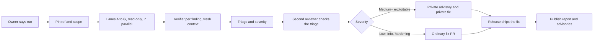

# Security and privacy audits

How Sempere audits itself, on a schedule, and publishes the result. The policy a reader needs (cadence, severity,
the CVE rule, the AI-assisted caveat) is in [`SECURITY.md`](../../SECURITY.md) "Audits"; this page is the runbook the
people (and agent sessions) running an audit follow. The lane briefs are in [`LANES.md`](LANES.md), the report
template in [`TEMPLATE.md`](TEMPLATE.md).

An audit is not a penetration test and not a certification: the reviewers are AI models reading the source, and a
clean report is evidence, not proof. Every report says which models did what.

## Checks and audits

A **check** has a yes/no answer a script can give cheaply; it runs on every PR or on a timer and fails a job. The
**audit** is what needs judgment. Checks never open PRs or issues.

| Check | Where | What it answers |
| --- | --- | --- |
| `scripts/check-security.sh` (`just security-check`) | PR gate, "Help and portability checks" | no secret-looking text outside `scripts/security-allow.txt`; no `print(`, `NSLog`, `os_log`, `Logger(` or `dump(` in `Sources/` outside `Sources/SempereCLI` and `#if DEBUG`; no PerfSink call naming a key, secret, passphrase, identity, password or title or interpolating an error's own text (`LogSafe.describe` is the way to log an error); `Package.resolved` complete; every npm package has an integrity hash; every `uses:` is a full commit SHA; every workflow declares `permissions:` |
| `scripts/test-check-security.sh` | same job | the check fails on a planted key, log call, unpinned action, lockfile entry without integrity, and passes on a clean tree |
| `.github/workflows/security-weekly.yml` | weekly, fail-only | `npm audit --omit=dev --audit-level=high` in `web/`, and the OSV database for the resolved Swift packages |
| `scripts/release-check.sh` | release | warns (never fails) when the last full audit in `SECURITY.md` is over 7 months old |

`scripts/security-allow.txt` lists the exceptions, each with a reason and the SHA-256 of the one statement or token it
covers (a failure prints it), so a new call in an allowed file needs its own entry; the check reports an entry that
matches nothing.
**Every audit reviews that list**: an entry whose reason no longer holds goes. Actions are pinned by hand: a full
audit moves each pin to the current release of its action (resolve a tag with
`gh api repos/OWNER/REPO/git/ref/tags/TAG`; for an annotated tag, read the commit it points at) and keeps the `# vX`
comment. A full audit also confirms the weekly workflow is still enabled (`gh workflow view "Security weekly"`):
GitHub disables a scheduled workflow after 60 days without repository activity.

## The run

1. **Pin.** Make the working folder `data/audits/<YYYY-MM>-<version>/` (`data/` is git-ignored; this folder is also the
   embargo store, so it holds advisory ids, not exploit text, once an advisory is filed). Record in `pin.md`: the commit
   SHA or tag, the kind (full, release, full + release), tool versions (`swift --version`, `node --version`, `jq`,
   `curl`), and the scope table. A full audit runs all seven lanes. A **release audit** runs lane G plus every lane whose
   paths changed between the last audited tag and the release candidate: take
   `git diff --name-only LAST_TAG..RC` and use the table below, so the choice is mechanical.
2. **Lanes.** One read-only agent per lane, in parallel. Each gets its brief from `LANES.md`, the paths, the spec and
   claim documents it names, the previous reports (so it checks that old findings stayed fixed) and the finding schema.
   Models: Opus for lanes A to D, the verifier and the triage reviewer; Sonnet for E to G. For the first (baseline) run,
   use Opus everywhere. Lanes write findings as JSON to `findings/<lane>.json`.
3. **Verify.** Every finding rated Low or above goes to a verifier that sees only the finding's claim, its `path:line`
   and the code, not the lane's reasoning. It reproduces the finding (a failing test or script in the run folder, never
   committed unless it becomes the regression test) or explains why the claim is false. Verdicts: confirmed, not
   reproducible, false positive, downgraded. The verifier is a different agent, and a different model where one is
   available. A finding it cannot confirm is listed in the report as "not confirmed", with the reason.
4. **Triage.** The coordinator assigns severity (`SECURITY.md` "Audits" table; one line of reasoning each) and an action,
   removes duplicates and writes the fix list. A second reviewer (Opus) checks the triage and the fix designs.
5. **Fix and ship** (below), then **publish**.

The owner's part: say "run the audit" (or a release checklist item does); create each draft advisory from the
coordinator's text (on a personal-account repository only the admin can); merge an embargoed fix at release time and
push the tag; request the CVE and publish the advisory in GitHub's UI; approve the report PR. Two questions need a
device (a locked watch's Keychain, the Face ID gate): the report lists them as "owner-verified", each as a device-check
card.

## Handling findings

- **Embargoed track:** Critical, High, and any Medium that someone other than the user or a key holder can exploit. One
  private advisory per finding or per fix. The draft advisory holds the text, the reproduction and the credits. Develop
  the fix in a local branch, not in the advisory's temporary private fork (pushing there needs the account added to the
  advisory, and Actions do not run there). The fork stays available to an outside reporter who wants to collaborate.
- **Open track:** Low, Info, hardening, document fixes, and a Medium that an outsider cannot exploit. They ride in one
  "audit fixes" PR per run with a neutral description ("tighten X"). No advisory.
- **Time limits (aims):** Critical and High fixed in the next release, within 30 days; Medium within 90. A fix that
  needs a format change goes through a `features` marker (`format.md` section 7) and the advisory says who is affected.
  A finding that cannot ship in 90 days is published as withheld: id, severity, area, advisory link, no reproduction.
- **Outside reports** found between runs follow the same track and appear in the next report's "Reports from outside
  the audit" section.

### Embargoed fixes

A public commit, branch, tag or PR title is a disclosure.

1. The fix is one commit, with its regression test, on top of `origin/main`, in a local branch that is never pushed.
   Write no changelog fragment for it before release time.
2. **A release with embargoed fixes** (the standard way, in a scheduled release): make the release commit X locally and
   never push it. X is `origin/main` plus the release changes (version, changelog), the embargoed fix commits (one per
   advisory) and, once the fixes are in, the audit report and its changelog fragment. Gate X with
   `scripts/local-ci.sh --release --no-status` (the full sweep: it posts nothing, and on a clean checkout it records X's
   tree id in `data/local-ci/release-sweep-trees`), then build from it: an App Store build of an unpushed commit needs
   `just testflight --skip-suite-check both X`, because the suite status it looks for lives on Gitea. The owner checks the
   TestFlight build and submits it with **manual release**.
3. **Freeze `main`** from that build until the release: no merges, so the merge commit's tree will equal X's tree. A
   public push, branch or PR before step 4 is a disclosure.
4. **On App Store approval** (minutes before the release): push X as the release PR's branch and squash-merge it when the
   PR gate passes (the repository is squash-merge only, so `main` gets a new commit id). Check that
   `git rev-parse X^{tree}` equals the merge commit's tree, then run `scripts/local-ci.sh --post-sweep <merge sha>`: it
   posts `local/release-sweep` for that commit only because its tree is one the sweep passed, so no second sweep is
   needed (an edited file, however small, changes the tree and it refuses). Then tag the merge commit
   (`just release-tag`), `just release-build`, `just release-publish`, Release This Version in App Store Connect,
   publish the advisories and request the CVEs, and update the formula. The window between the merge and the
   advisories is about an hour: the PR gate plus the CLI build. The release notes and `CHANGELOG.md` say who is affected
   and what to do (`SECURITY.md` "What happens next", step 4). Without the `--post-sweep` mode the fallback is
   `just ci-release` on the merge commit, which stretches the window to the sweep's length. If the release stalls
   after the merge (the CLI build fails, say), finish it before anything else.
   `release-build.sh` also refuses to build unless this checkout is clean and its build and packaging scripts equal
   `origin/main`'s, and it hands `SHA256SUMS` to the maintainer to sign (SECURITY.md "Verifying releases"; the release tag is the maintainer's too, docs/releasing.md B.1).
   **The out-of-band path** (a fix that cannot wait for a scheduled release): `scripts/release-tag.sh --embargo X.Y.Z`
   (REF defaults to `HEAD`) tags a local commit without pushing anything. It refuses a dirty tree, a commit already on
   `origin/main`, a merge, and a commit whose parent is not on `origin/main`. **Known gaps, closed the first time this
   path is needed:** `release-build.sh` cannot build a non-prerelease embargo tag, because it reads the release-sweep
   status of the tagged commit from Gitea, which an unpushed commit does not have (`--post-sweep` is for a commit the
   forge has); from 1.1.0, `release-build.sh` also refuses an `--embargo` tag, which the build account signs (the maintainer would sign the tag on the fix commit themselves, for example from a `git bundle` of it); and `release-tag.sh --push` wants the tag's commit on `origin/main` (it would need a rule for a commit off
   `main` whose parent is on `main` and for which a `main` commit has the same `git patch-id --stable`).
5. **Before any push** (including X in step 4 and the open-track PR): no exploit detail in a commit message, branch name, PR title or body, issue, changelog fragment
   or test name; the run folder is not under any synced or backed-up path that is public. **Never** run
   `git push --tags` or `--follow-tags` while an embargo tag exists: push single refs by name. `scripts/mirror-gitea.sh`
   copies GitHub's `main`, branches and tags to Gitea, so it only ever sees what has already been pushed to GitHub;
   still, check before each push. After an accidental push, delete the ref on GitHub and on Gitea too: the mirror
   never deletes.

### Publishing the report

After the last embargoed fix has shipped (an audit that finds nothing publishes at once), one PR adds
`docs/audits/YYYY-MM-<version>.md` (from `TEMPLATE.md`, the run start's month), links the advisories (published at the
same time), adds one line to the index below and one row to the `SECURITY.md` "Audits" table (`Full`, `Release` or
`Full + release`, as `release-check.sh` reads it), and a changelog fragment.

## Path to lane

| Changed path | Lane |
| --- | --- |
| `Sources/Age/`, `Sources/CZlib/`, `Sources/Sempere/Epoch*.swift`, `Sources/Sempere/JoinCodes.swift`, the rest of `Sources/Sempere/` (vault format, file framing), `Sources/SempereImport/`, `Sources/SempereImporters/`, `Sources/SempereNotability/`, `Sources/SemperePDF/`, `Tests/SempereTests/Fixtures/*vectors*`, `docs/format.md`, `docs/design/key-hierarchy.md`, `docs/post-quantum.md`, `docs/import-notability.md` | A |
| `Sources/SempereCLI/`, `Sources/SempereAppCore/DeviceKeyStore.swift`, `Sources/SempereAppCore/KeyRemoval.swift`, `Apps/Sempere/SempereApp/*KeyStore*`, `Apps/Sempere/SempereApp/DeviceWriteStores.swift`, `Apps/Sempere/SempereApp/WebDAVLocations.swift`, `Apps/Sempere/*.entitlements`, `docs/cli.md` | B |
| `Sources/SempereAppCore/QuickCapture/`, `Sources/SempereCaptureShared/`, `Sources/SempereSpeech/`, `Apps/Sempere/SempereShared/`, `Apps/Sempere/SempereWidgets/`, `Apps/Sempere/SempereStatusItem/`, any Watch target, `docs/quick-capture.md` | C |
| `Sources/SempereWebDAV/`, `Sources/SempereSync/`, `docs/io.md`, `docs/settings-sync.md` | D |
| `web/`, `docs/web-viewer.md` | E |
| `Package.swift`, `Package.resolved`, `web/package*.json`, `.github/`, `scripts/release-*.sh`, `scripts/check-security.sh`, `scripts/security-allow.txt`, `scripts/mirror-gitea.sh`, `**/PrivacyInfo.xcprivacy`, `docs/releasing.md` | F |
| every audit; also `docs/appstore/privacy-policy.md`, `docs/privacy/`, `SECURITY.md`, `docs/security.md`, anything that opens a connection or logs | G |

A path in two rows runs both lanes. A path in none (documentation, tests) runs none; lane G still runs.

## Reports

| Report | Kind | Code audited |
| --- | --- | --- |
| [2026-11-1.1](2026-11-1.1.md) | Full + release | 6a7afb0, and the delta 6a7afb0..54b9ed6 |
