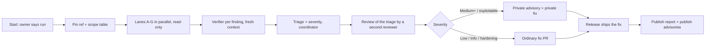

# Recurring public security and privacy audit (design)

Status: design, 2026-11-09, for Sempere 1.1. The owner's ask: a recurring audit; a SECURITY.md section on the process and its frequency; a report template,
one report per run in the repo; unfixed findings stay in private GitHub security advisories until the fix
ships; the first audit, of 1.0.

## 1. Goal and non-goals

Goal: a process that finds security and privacy problems on a schedule, fixes them without disclosing them early,
and then publishes what was checked, what was found and what was fixed. The published reports are the evidence
for the claims in `docs/security.md` and the privacy policy.

Non-goals:
- Not a third-party penetration test and not a certification. Reports say they are AI-assisted reviews (section 3.3).
- Not a bug bounty. SECURITY.md already takes outside reports; those follow the same advisory path.
- Not a new CLI feature. The `sempere` CLI is an audit target (lanes A and B), not part of the process. The automatable
  part is one shell script and CI steps (section 3.7), the way `scripts/check-portability.sh` works today.
- Not a replacement for the CI checks that already exist. The deep audit covers what scripts cannot judge.

## 2. What exists today

- **Reporting policy.** `SECURITY.md` (private vulnerability reporting at
  `github.com/anthonytw/sempere/security/advisories/new`; acknowledge within a week; fix in the advisory's
  private fork; publish with the fixed release; CVE "for a serious issue"; credit). It has a scope list and a
  severity order in prose (SECURITY.md "What happens next", step 1) but no scale, no audit section, no cadence.
- **The claims to check.** `docs/security.md` lists what the encryption protects (notes, titles, tags,
  attachments, transcripts; tagged `vault.json`; home-device-only device changes; recovery key reads but does not
  write) and what it does not (unlocked device, plaintext the app keeps, metadata the provider sees). The privacy
  policy (`docs/appstore/privacy-policy.md`) claims no data collected and WebDAV as the only connection.
  `docs/quick-capture.md` has a per-attacker table for the capture key. `docs/web-viewer.md` (around line 498)
  fixes a CSP with Trusted Types and a ban on `innerHTML` (ESLint). Each is a list of testable claims.
- **Spec to audit against.** `docs/format.md` (normative), `docs/design/key-hierarchy.md` (epochs, sealed set,
  home-only signing, takeover), `docs/post-quantum.md`.
- **Hard rules that are checks already.** Network code only in `SempereWebDAV`; no `os` logging in `Sources/`
  (`scripts/check-portability.sh`); crypto only through swift-crypto except scrypt and PBKDF2 (CLAUDE.md "Hard
  rules"); the frozen recovery script test (`EpochChainTests.testFrozenRecoveryScriptOpensEveryEpoch`); deep fuzz
  (`SEMPERE_FUZZ_LONG=1`); `scripts/release-check.sh` (no team ID, privacy manifests, entitlements, networking).
- **TLS.** Server trust is the system's unless the user pinned a certificate: `WebDAVServerTrust` is a protocol in
  `Sources/SempereWebDAV/Transport.swift:92`, applied in the session delegate (`Transport.swift:385`); the
  implementation lives in `Apps/` (it needs `SecTrust`). Linux uses libcurl's store, no pinning.
- **Keychain.** `Apps/Sempere/SempereApp/DeviceKeyStore.swift`, `DeviceWriteStores.swift`, `WebDAVLocations.swift`,
  `QuickCapture+App.swift` use `kSecAttr*`; tests in `KeychainDeviceKeyStoreTests.swift`.
- **Dependencies.** Swift: two packages, swift-crypto and swift-argument-parser, both `from:` ranges
  (`Package.swift:47-48`), so `Package.resolved` is the real pin. Web: six runtime packages at exact versions
  (`web/package.json:21-28`: noble curves/hashes/post-quantum, scure/base, age-encryption, pdfjs-dist) and a
  lockfile; CI installs "lockfile only" (`ci.yml` "Web viewer"). Actions are pinned by tag (`@v4`), not SHA.
- **CI.** `.github/workflows/ci.yml` and `pr-description.yml`; no scheduled workflow; no dependency or secret scan.
  No Dependabot (owner wants little GitHub traffic).
- **Audit history.** The October 2026 audit (#149 batch; #150 reuse, #151 inconsistency, #152 iOS 27, #153
  inefficiency, **#154 security**, #155 pre-v1 removal, #156 bugs) was an internal, pre-1.0 staged code audit. Its
  security stage was merged as ordinary PRs. It left **no report in the repo**, and its stage briefs and finding
  files were kept outside the repo and are gone. 1.0 is therefore live with no
  public security review. Lesson used below: lane briefs live in the repo so a run is reproducible.
- **Release flow.** `docs/releasing.md`: `just ci-release` sweep, `release-check`, steps marked **[you]**. It
  predates the GitHub move and "must be reworked before the next release"; the audit step slots into that rework.

## 3. The design

### 3.1 Scope: seven lanes

One lane is one reviewer with one brief. A lane reads the code, the spec and the claims for its area, and returns
findings in the schema of section 3.4. Lane briefs are committed (`docs/audits/LANES.md`) and changed by PR.

| Lane | Covers | Starts from |
| --- | --- | --- |
| A. Crypto, format and parsers | `Sources/Age`, `Sources/Sempere/Epoch*.swift`, `JoinCodes.swift`, scrypt/PBKDF2 vectors, vault tag, file framing, padding, parsers' limits on hostile input (vault files, importers: Notability, `.note`, PDF), fuzz targets, the kit's recovery script | `format.md`, `key-hierarchy.md`, `post-quantum.md`, `import-notability.md` |
| B. Keys, device and CLI | Keychain classes and access control, Secure Enclave signing keys, Face ID gate, key lifetime in memory, plaintext at rest (attachment cache, voice notes before sealing, Mac window titles), join approval words, takeover; the `sempere` CLI's files (key files 0600, temp files, stdin/stdout of secrets, `--root`, path traversal in exports and backups) | `docs/security.md` "The keys", "What the encryption does not protect", `cli.md` |
| C. Capture keys | the capture profile, inbox acceptance, transcript binding, suspension after removal, widgets, **the Apple Watch path (1.1)**: how the profile reaches the watch (the age-sealed provisioning payload), watchOS Keychain class, plaintext audio on the watch until sealed, transfer back to the phone (metadata checks, routing by vault, ledger entries under the file's epoch), what a stolen watch can do | `quick-capture.md` table, `1.1-watch.md` |
| D. Sync and WebDAV | `SempereWebDAV`, `SempereSync`, TLS trust and the pinning delegate, credentials in headers and Keychain, redirects, hostile listings and manifests, cut and replayed uploads, set-aside files | `io.md` "Sync engine and transports" |
| E. Web viewer | CSP and Trusted Types, the DOM builder (no markup), SVG allow-list, `blob:` handling, pdf.js hardening, key worker, bounded work, the hosting recommendation (headers, origins), `npm` packages | `web-viewer.md` |
| F. Supply chain and release | `Package.resolved`, `package-lock.json`, GitHub Actions pins and permissions, `release-*.sh`, signing, attestations (`gh attestation verify`), `SHA256SUMS`, Homebrew formula, the tap, entitlements, privacy manifests, the Gitea mirror (what it receives) | `releasing.md`, `SECURITY.md` "Verifying releases" |
| G. Privacy and claims ledger | everything that leaves the device (all `URLSession` sites, widgets, Watch, Spotlight, share sheets, pasteboard, crash logs), logging (`PerfSink` call sites; nothing secret), telemetry (none), metadata in vault files and file names (`format.md` §1; size classes, timestamps, device names, `vault.json`), the privacy policy and App Store labels against the code; then one pass over every sentence of `SECURITY.md`, `docs/security.md`, the privacy policy and the quick-capture and web-viewer threat tables: each claim gets a verdict (holds with test X / holds, no test / does not hold / cannot check) | `privacy-policy.md`, `docs/security.md` "What others can see", the four documents |

The claims ledger (lane G's second half) is the privacy and security equivalent of a doc review and is the cheapest
way to catch drift: the documents are public promises. Verdicts "holds, no test" become test tasks in the report.

Why seven, not nine: the CLI's files are key handling (B) and the importers are hostile-input parsers (A), and the
claims ledger and the privacy pass read the same documents against the same code. Fewer lanes means fewer
duplicate findings to triage; each brief stays a page.

Scope is per run, not fixed. A full run does all seven. A release run (3.2) does G plus the lanes whose paths
changed since the last audited tag (a path-to-lane table in `LANES.md`, so the choice is mechanical).

### 3.2 Cadence

Two kinds of run:

- **Release audit, per minor release (1.1, 1.2, ...)**: diff-scoped, from the last audited tag to the release
  candidate. It runs once the release's features are merged and before the App Store build is submitted. Patch
  releases get one only if the diff touches a lane's paths (`LANES.md` table) and security-labeled fixes.
- **Full audit, every six months** (target: April and October), whatever happened in between. It covers all seven
  lanes on `main`, plus a dependency refresh (3.7).

Why both: a release audit stops a new feature (the Watch capture path is the 1.1 case) from shipping with a hole,
and is cheap because it is a diff. It cannot find drift: a dependency that gains an advisory, a platform change,
a doc claim that stopped being true. The periodic run finds those. Six months fits the release pace (about one
minor release per 2 to 3 months, so most full audits land near a release and can be combined with it: then one
report, kind "full + release"). Monthly would be noise for a one-owner project; yearly leaves a published
dependency flaw undiscovered too long, and the automated checks (3.7) cover the gap in between.

SECURITY.md states exactly this, plus: "An audit may find nothing. That is still published."

### 3.3 Who runs it, and how

The run is orchestrated by an agent session (the coordinator) from a committed runbook (`docs/audits/README.md`).



1. **Pin.** The coordinator records the commit SHA (or tag), tool versions, and the scope table in the working
   folder `data/audits/<run>/` (git-ignored, private until publication; the run folder is also the embargo store).
2. **Lanes.** One agent per lane, read-only, run in parallel. Each gets: its brief, the paths, the spec and claim
   documents, the previous reports (so it checks that old findings stayed fixed), and the finding schema. Model:
   Opus for A, B, C and D (judgment on crypto and protocol), Sonnet for E to G (checklist-heavy). See decisions.
3. **Independent verification.** Every finding of severity Low or above goes to a verifier that sees only the
   finding's claim, its file:line and the code, **not** the lane's reasoning. It must either reproduce (a failing
   test or script, written in the run folder, never committed unless it becomes the regression test) or
   explain why the claim is false. Verdicts: confirmed, not reproducible, false positive, downgraded. The verifier
   is a different agent and, where available, a different model than the lane. A finding the verifier cannot
   confirm is listed in the report as "not confirmed" with the reason, not dropped silently.
4. **Triage.** The coordinator assigns severity (3.5) and an action per finding, deduplicates, and writes the
   fix list. A second reviewer (Opus) checks the triage and the fix designs, the same pattern as PR review.
5. **Fix and ship** (section 3.6), then **publish**.

The owner's role is minimal, and specific:
- say "run the audit" (or a release checklist item does, section 3.8);
- create each draft advisory from the coordinator's text (decision D3: on a personal-account repository only the
  owner can);
- merge any embargoed fix at release time and push the tag (already their job);
- click "request CVE"/"publish" on advisories (GitHub UI, needs their account);
- approve the report PR.

Everything else is agent work. No hardware is needed for any lane except two device-only questions in B and C
(real Keychain behavior on a locked watch; Face ID gate), which the report lists as "owner-verified" with a
device-check card in the usual format (docs/plan.md device checks, one card per check).

**Honesty about method.** The report says: reviewers are AI models working from source; they can miss things; a
clean report is evidence, not proof. It names the models and the verifier setup per lane.

### 3.4 Finding schema (shared by lanes, verifier, report)

`id` (`A-03`), `lane`, `title`, `severity`, `confidence`, `component` (path:line), `claim` (which documented
guarantee or hard rule it breaks, or "none: new risk"), `attack` (who can do what, with what access), `evidence`
(reproduction or test name), `fix` (proposal), `status` (open, fixed in PR/release, accepted risk, not
confirmed). Lanes write JSON; the coordinator writes the report table from it (decision D6).

### 3.5 Severity scale

Tied to the guarantees in `docs/security.md`, so a rating is an argument about a sentence, not a feeling. It
extends the prose order already in SECURITY.md.

| Rating | Meaning | Example |
| --- | --- | --- |
| Critical | Someone without a key reads notes or recovers a key, or plants content that passes as authentic, remotely or from storage alone | a tag check that can be skipped; a key written to the vault in clear |
| High | Same, but needs a precondition the attacker can plausibly get (a joined-then-removed device, one captured file, a hostile WebDAV host) | a removed device's late file accepted; a passphrase copy offline-guessable beyond the documented limit |
| Medium | A documented guarantee does not hold in a narrower case, or notes/metadata leak to a party the docs say cannot see them, or hostile input crashes or exhausts the app (no data exposure) | parser memory blow-up on a crafted vault; a title in a log; a filename that leaks more than `docs/security.md` says |
| Low | Defense in depth, a missing hardening step, a doc that overstates, an unlikely local-only leak | key file mode wider than 0600 on one path; a CSP directive broader than needed |
| Info | Observation, no action required, or a test gap | a claim that holds but has no test |

Each rating carries one line of reasoning in the report. Out-of-scope items (SECURITY.md: needs the unlocked
device or the identity file; metadata a provider sees by design) are listed as "Not a finding" with the reason, so
a reader sees they were considered. GitHub advisories also need a severity; GitHub's levels are Critical, High, Moderate and
Low, so the table maps one to one with Medium as Moderate, and a CVSS vector is added only when asked.

### 3.6 Handling findings

- **Embargoed (private advisory) track**: Critical, High, and any Medium that is exploitable by someone other than
  the user or a key holder. One advisory per finding or per fix (related findings can share a fix and an
  advisory). The draft advisory holds the text, the repro and the draft credits. The run folder holds only the
  advisory ID, not the details, once filed. The fix is developed in a local branch, not in the advisory's
  temporary private fork. Pushing to that fork needs the account to be added to the advisory, and GitHub Actions
  does not run there. The fork stays available for an outside reporter who wants to collaborate (SECURITY.md).
- **Open track (ordinary PR)**: Low, Info, hardening, doc fixes, and Medium that is not exploitable by an outsider.
  They ride in one "audit fixes" PR per run, with a neutral description ("tighten X"), the same bundling the owner
  wants for everything else. No advisory.
- **Coordination so a fix does not disclose early.** A public commit, branch, tag or PR title is a disclosure.
  - The embargoed fix lives only in a local, never-pushed branch, one commit on top of `origin/main`, and the
    release build (TestFlight, then App Store) is made from it.
  - **Today's scripts cannot do that:** `release-build.sh` takes a VERSION and needs its tag, and `release-tag.sh`
    refuses a tag that is not on `origin/main` (`release-tag.sh:28`, `:54`). So the process PR adds an `--embargo`
    mode to `release-tag.sh`: a local signed tag on a commit whose parent is on `origin/main`, not pushed, with its
    test.
  - The fix reaches public `main` when the fixed version is live (decision D2), as an ordinary PR that the gate
    runs on. It is merged **without squashing** (a rebase or fast-forward that keeps the tagged commit), so the
    release tag ends up on `main`, and the tag is pushed then. The public diff appears next to a release, a
    changelog entry and the advisory publication.
  - Gotchas for the runbook: the Gitea mirror (`scripts/mirror-gitea.sh`) mirrors `main` only, so check before
    each push. The fix is gated locally (`scripts/local-ci.sh`) before the release build. A regression test lands
    with the fix. The changelog fragment is written at release time, never before.
- **Time limits.** Aim: Critical and High fixed in the next release, within 30 days; Medium within 90. If a fix
  needs a format change, SECURITY.md already says fixes never silently change the format, so it goes through
  `features` markers (`format.md` §7) and the advisory says who is affected. A finding that cannot ship in 90 days is
  published as "withheld" (id, severity, affected area, advisory link, no repro) so the report is not blocked
  forever; this is the one place the report is published before every fix ships (decision D4).
- **Release notes and users.** For an embargoed fix: CHANGELOG entry and release notes say who is affected and what
  to do, per SECURITY.md step 4, written at release time, not before.
- **Publishing the report.** After the last embargoed fix has shipped: the report PR adds
  `docs/audits/YYYY-MM-<version>.md`, with advisory links (published at the same time), adds one line to the index in
  `docs/audits/README.md` and a changelog fragment. An audit that finds nothing publishes immediately.
- **CVE.** Request one (through GitHub, which is a CNA) for every published advisory of High or Critical, and for
  a Medium that breaks a stated guarantee for released versions. No CVE for Low, Info, hardening or findings
  present only in unreleased code. This is the existing SECURITY.md rule made specific: "anything that exposes
  note content or keys, or lets someone plant content that passes as authentic".
- **Outside reports** found between runs go through the same track and appear in the next report's "Reports from
  outside the audit" section.

### 3.7 Automation: what is a check and what is the audit

The split rule: a check is anything with a yes/no answer a script can give offline or cheaply, run on every PR or
on a timer. The audit is what needs judgment. Checks never open PRs or issues; they fail a job, and the owner
already gets a failure email.

New script, `scripts/check-security.sh` (also `just security-check`; portable bash, works on Linux like the other
`check-*.sh`), with a test, `scripts/test-check-security.sh`, that feeds it bad fixtures. It runs in the existing
"Help and portability checks" job (no new job, no new runner minutes worth mentioning):

1. **Secret scan.** Patterns for `AGE-SECRET-KEY-`, `-----BEGIN .*PRIVATE KEY`, `AGE-SECRET-KEY-PQ-1` and
   long hex/base64 next to words `password|token|secret`, over `git ls-files` minus the fixtures that legitimately
   hold test keys (an allow-list file `scripts/security-allow.txt`, each entry with a reason). No third-party
   scanner: a scanner action is itself supply chain.
2. **Logging lint.** Fails on `print(`, `NSLog`, `os_log`, `Logger(`, `dump(` in `Sources/` except
   `Sources/SempereCLI`, whose standard output is its interface (all 34 files with `print(` in `Sources/` are
   there today; portability already bans `os`) and on `PerfSink` call sites whose arguments mention `key`, `secret`, `passphrase`, `identity`,
   `password` or `title`, with an allow-list. The Apps side is checked for `os_log`/`Logger` calls with
   non-`privacy: .private` interpolation of those words.
3. **Pins.** `Package.resolved` is committed and matches `Package.swift` (`swift package resolve` leaves no diff
   when run offline from the cache; otherwise a text check that every dependency has an entry with a revision);
   `web/package-lock.json` has an `integrity` hash for every package; every `uses:` in `.github/workflows` and
   `.github/actions` is a full SHA (see decision D5: today they are `@v4` tags), except local `./.github/actions/…`
   paths and each workflow declares
   `permissions:`.
4. **Network surface.** The existing portability rule plus a list of all `URL(string:` literals in `Sources/` and
   `Apps/` compared with `docs/security-surfaces.txt`... (decision D7: skipped; the lane G pass does this and the
   privacy policy lists connections).
5. **Release hygiene.** `release-check.sh` already checks no team ID and entitlements; add: the privacy policy
   "Last updated" matches (exists), and the SECURITY.md audit table's last full audit is under 7 months old
   (warns, never fails) so the cadence cannot be forgotten silently.

On a timer: **one weekly workflow, `security-weekly.yml`**, no PRs, no issues, fails on a finding:
`npm audit --omit=dev --audit-level=high` in `web/`, and an OSV query for the two Swift packages' resolved versions
(`osv-scanner` is a third-party binary: use the plain OSV HTTPS API with `curl` and `jq` in the script instead).
It needs the network, which is why it is not in the PR gate. This replaces Dependabot, which would add PR traffic.
GitHub disables a public repository's scheduled workflows after 60 days with no activity; the full audit checks the
job is still enabled.
Everything else the owner asked about (a lint that logs no secrets, secret scan) is in the PR gate.

The deep audit's dependency lane additionally reads changelogs of each bumped package, checks maintainers and
provenance, and asks if each package is still needed (the six web packages and pdf.js's hardening flags are
the main surface).

### 3.8 Hooking it into releases

`docs/releasing.md` gets one checklist item (in the rework the GitHub move already requires): before submitting a
minor release, "release audit done: report published, or advisory-embargoed with the fix on the release build".
It is a **[you]** line because it is judgment about embargoes; the coordinator prepares a one-paragraph status.
It is not enforced by a script (a script cannot see private advisories).

### 3.9 The first run: audit 1.0 first, then 1.1 as a release audit

Recommendation: **a full audit of the `v1.0.0` tag now, run in parallel with 1.1 development; the 1.1 release
candidate then gets a diff-scoped release audit.**

Why 1.0 first:
- 1.0 is live and has had no published security review; any Critical or High there affects users today. Waiting
  for 1.1 delays the fix by the length of the 1.1 cycle.
- A full run needs no features to be finished, so it does not block 1.1. Embargoed fixes can ride in 1.1 or in a 1.0.1
  if severe.
- It establishes the baseline report that every later run diffs against, and it is the first test of the process.
- The 1.1 Watch capture path does not exist yet; auditing it now would audit a design. The release audit of 1.1
  covers it with real code (lane C).

Report name: `docs/audits/2026-11-1.0.md` (it stays that name even if it publishes in December; the date is the
run start). The 1.1 run is `docs/audits/2027-01-1.1.md` or whenever.

## 4. The CLI side

There is none, on purpose. The process is documentation plus one check script, and `sempere` is what lanes A, B
and D audit. Everything is still automatable without the UI: the lanes run in agent sessions, the checks are
shell, and the coordinator writes the report from the lanes' JSON. The runbook lists the commands that create the
run folder `data/audits/<run>/` (pinned SHA, tool versions, findings file); no helper script. If the owner wants an audit-in-the-CLI (e.g. `sempere verify` that
checks a vault's integrity and prints what an attacker with storage access could see), that is a feature, not
part of this process, and would be a separate decision.

## 5. Report template (`docs/audits/TEMPLATE.md`)

```markdown
# Security and privacy audit: <version> (<kind: full | release | full + release>)

| | |
| --- | --- |
| Run | <YYYY-MM> (started <date ET>, published <date ET>) |
| Code audited | <tag or SHA>, from <last audited tag> (release audits) |
| Method | AI reviewers in lanes, independent verification (see "Method"); not a third-party audit |
| Result | <N Critical, N High, N Medium, N Low, N Info>; <N fixed, N open> |
| Advisories | <GHSA links, or none> |

## Summary
Three to six sentences: what was checked, what mattered, what changed. Say plainly if nothing was found.

## Scope
The lanes run (A to G) and paths; for a release audit, the diff and the path-to-lane table result.

### Out of scope, and why
Each excluded area, with the reason (not reachable, owner device-only, third-party service, not yet built).
Also the "Not a finding" list: documented non-goals considered and left alone.

## Method
Models per lane and for verification; commit pinned; tools and versions (swift, npm, jq, curl, fuzz settings
and duration, `check-security.sh` result, `npm audit` output date, OSV query date); what was run versus read.
Limits: what an AI source review cannot show.

## Findings
| ID | Severity | Lane | Title | Component | Status | Fixed in |
| --- | --- | --- | --- | --- | --- | --- |

Then one subsection per finding: claim broken, attack, evidence, fix, who is affected (versions, platforms),
what users should do. Withheld findings show id, severity, area and advisory link only.

## Not confirmed
Candidate findings the verifier could not confirm, with the reason.

## Claims ledger
Table: claim (document and sentence) | verdict | evidence (test or file:line). Verdict "holds, no test" lists
the test added or the follow-up.

## Privacy review
What leaves the device (connections, with the policy line for each); logging; telemetry (none); metadata in
vault files and names, compared to `docs/security.md` "What others can see"; privacy manifest and App Store labels.

## Dependencies and release integrity
Swift packages and npm packages with versions; advisories found; pins; Actions; attestation check run on the
current release (`gh attestation verify` output summarized).

## Follow-ups
Tests to add, docs to change, items for the next run, measured against the previous report (each earlier finding:
still fixed? regression test present?).

## Reports from outside the audit
Advisories received since the last run and their disposition.
```

## 6. Repo files

| File | New or changed |
| --- | --- |
| `SECURITY.md` | new "Audits" section: what they cover, the two kinds and cadence, that reports are published after fixes ship, where they are, the severity scale, the CVE rule, that reviewers are AI-assisted; a small table "Audit | date | version | report"; "Supported versions" gets a line that fixes for audit findings follow the same disclosure path |
| `docs/audits/README.md` | the runbook (steps in 3.3, 3.6), index of reports, path-to-lane table |
| `docs/audits/LANES.md` | the seven lane briefs and the finding schema (3.4) |
| `docs/audits/TEMPLATE.md` | the template of section 5 |
| `docs/audits/2026-11-1.0.md` | the first report (after its fixes ship) |
| `docs/security.md` | one line linking to the reports under "The design is in" |
| `docs/releasing.md` | the checklist item (3.8) |
| `scripts/check-security.sh`, `scripts/test-check-security.sh`, `scripts/security-allow.txt` | new |
| `scripts/release-tag.sh` and its test | `--embargo` mode (3.6) |
| `.github/workflows/ci.yml` | one step in "Help and portability checks"; Actions pins to SHAs |
| `.github/workflows/security-weekly.yml` | new, weekly |
| `justfile` | `security-check` |
| `data/audits/<run>/` | git-ignored: working folder and embargo store |

## 7. Tests: what is automated, what needs the owner

Automated:
- `scripts/test-check-security.sh`: fixtures with a planted `AGE-SECRET-KEY-`, a `print(` in `Sources/`, an
  unpinned action, a lockfile entry without integrity; each must fail, the clean tree must pass (same
  pattern as `test-release-check.sh`, `test-ci-hash-guard.sh`).
- `release-tag.sh --embargo` test: a tag on a local commit whose parent is on `origin/main` passes; a commit two
  away from `origin/main` or with a dirty tree fails; nothing is pushed.
- Regression tests ship with every fix, as SECURITY.md already promises.

Needs the owner:
- Confirm private vulnerability reporting is enabled on `anthonytw/sempere` (SECURITY.md already sends reporters to
  it), and create draft advisories from the coordinator's text (D3).
- Merge an embargoed fix at release time; App Store Connect and signing for a security release.
- Request CVE and publish advisories (GitHub UI).
- Device checks flagged by lanes B and C (Keychain on a locked iPhone/Watch, Face ID gate), as cards.
- Approve the report PR.

## 8. Implementation plan

- **One PR, process and checks (~350 lines of Markdown, ~250 shell, ~30 YAML)**:
  - Docs: the SECURITY.md section, `docs/audits/{README,LANES,TEMPLATE}.md`, the security.md link and the
    releasing.md item.
  - Checks: `check-security.sh` with its tests and the allow-list, the CI step, SHA pins for Actions, the weekly
    workflow, `release-tag.sh --embargo` with its test, and the justfile line.
  - Merging it makes the process real, and the first run starts from it.
- **Per run, not a design PR**: one report PR (`docs/audits/<run>.md` + index + SECURITY.md table row + changelog
  fragment) and one "audit fixes" PR for the open track; the embargoed fixes ride the release path of 3.6.

## 9. Decisions (reviewed 2026-11-09)

- **D1. Cadence: (a), a release audit per minor release plus a full audit every six months.** The diff scope keeps
  release audits cheap, and the periodic run catches drift.
- **D2. Embargoed fix: (a), merge to `main` once the fixed release is live.** It is built from the local branch and
  tagged with `--embargo` (3.6). The merge keeps the tagged commit, so the tag lands on `main`.
- **D3. Who files advisories: (a), the owner.** On a personal-account repository, only the admin (the owner) can create
  or publish repository advisories, and the "security manager" role exists only for organizations. The
  coordinator writes the advisory text. Exploit details never go in a PR, an issue, a commit message or the
  Gitea mirror.
- **D4. Past 90 days: publish with the finding withheld** (id, severity, area, advisory link). The rest of the report
  should not wait, and a severity alone is not an exploit.
- **D5. Pin Actions by full SHA.** Local `./.github/actions` paths are exempt, and pins are updated by hand in the full
  runs. A moved tag is the classic CI supply-chain step.
- **D6. No `audit-report.py` and no `audit-new.sh`.** The coordinator writes the table from the lanes' JSON, and the
  runbook lists the setup commands. Two fewer scripts to maintain for a twice-a-year process.
- **D7. Network-surface allow-list: skip.** The portability rule and lane G cover it. Revisit only if lane G finds a
  surprise.
- **D8. Models: Opus on A to D, the verifier and the triage reviewer; Sonnet on E to G.** Use Opus everywhere for the
  1.0 baseline run. Fable is unavailable.
- **D9. First run: a full audit of `v1.0.0` now, in parallel with 1.1.** 1.0 users have had no published review. The
  1.1 release audit then covers the real Watch code in lane C.
- **D10. Keep the weekly fail-only workflow.** It makes no PRs, no issues and no traffic unless something fails. The
  web viewer parses hostile files with npm packages (pdf.js has had a script-execution advisory, CVE-2024-4367),
  so a six-month gap is too long.
- **Lanes: seven, not nine** (3.1). The CLI moves into A and B, and the privacy pass merges with the claims ledger.


**Considered and set aside (owner, 2026-11-09): a "council" of non-Anthropic models** (several labs through one
API such as OpenRouter, cross-lab verification of every finding). It would reduce single-vendor blind spots, but it
adds a harness, a paid API key and per-run cost, so it is out for now. Revisit if a run's findings look one-sided.

## 10. Risks

- **AI review is not a pentest.** The report says so; the claims ledger and the verifier reduce false assurance but
  do not remove it. A public report invites readers to treat it as certification: SECURITY.md wording must say
  "evidence, not proof".
- **Embargo leaks.** The Gitea mirror, a pushed branch, a PR title, a changelog fragment or a run folder in
  a backup can disclose early. The runbook has a pre-push checklist; the run folder is under `data/`
  (git-ignored) and holds advisory IDs, not exploit text, once filed.
- **Releasing from an unpushed branch** breaks the "build from `main`" habit (`release-tag.sh` requires
  `origin/main`). The `--embargo` mode and its test (3.6, section 7) cover it. Rare in practice: most findings will be Low or Medium and ride the open track.
- **False positives cost time.** The verifier step and "not confirmed" listing bound this; lane briefs tell lanes
  to rate by the documented guarantees, not by taste.
- **Owner time.** The design keeps them to a handful of clicks per run: one draft advisory per embargoed finding
  (pasting the coordinator's text, D3), request CVE, publish.
- **Checks rot or cry wolf.** The allow-list requires a reason per entry and the weekly job only fails on
  High or above; the audit reviews the allow-list each run.
- **Scope drift between spec and code.** The claims ledger only finds drift it can see; a claim with no test stays a claim.
  The report names those so tests accumulate over runs.
- **Stale facts in this design.** Line numbers cited (Transport.swift:92, :385; Package.swift:47-48; web/package.json:21-28)
  are from main at 0cea02d and will move; the lane briefs name files and symbols, not lines.
