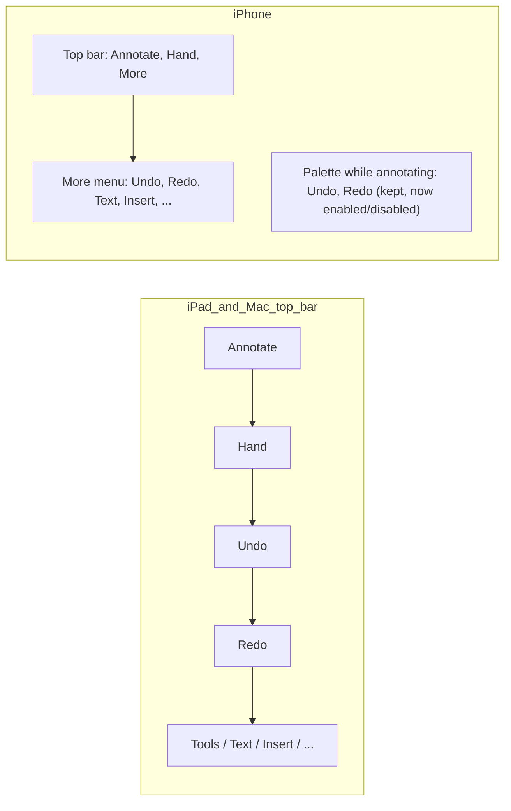

# Undo and redo controls in the note editor (issue #8)

Status: design for 1.1, 2026-11-09. Paths are relative to the repository root; line numbers are from main at 0cea02d.

## 1. Goal and non-goals

**Goal.** A visible Undo and a visible Redo button in the note editor's toolbar on iPad, iPhone and Mac. They undo
a stroke, an erase or an item edit with no gesture or shortcut. They act on the focused canvas. They are disabled
when there is nothing to undo or redo, and their tooltip or label names the step ("Undo Move").
Every system gesture and shortcut that works today keeps working.

**Non-goals.**
- A new unified undo stack replacing PencilKit's (section 3.1 explains why not).
- Undo across pages, across notes, or across a relaunch. Stacks stay per page and per session, as today.
- Making new edit types undoable (recordings, paper, page add/move). Listed in 2.3 as a gap; not in 1.1 (7.2).
- A CLI `undo` command (section 4).

## 2. What exists today

### 2.1 Where the stacks live

Undo is **per canvas, on `UndoManager`**, and the app owns it. `NoteEditor` (SempereAppCore) holds no stack.

| Piece | Code |
| --- | --- |
| A page canvas picks its manager. An embedded page (the page stack) has its own `pageUndo`; a single canvas takes the responder chain's | `Apps/Sempere/SempereApp/PageCanvasView.swift:508-511`, `:761-766` |
| Tests give a one-page canvas a manager (`testUndoManager`, DEBUG) | `PageCanvasView.swift:770-771`; `Apps/Sempere/SempereAppTests/InkInjector.swift:20-48` |
| `PageCanvasHost.undo()` / `redo()` guard on read-only and `canUndo`/`canRedo`, then call the manager | `PageCanvasView.swift:1476-1484` |
| `PageStackView` forwards to the focused slot | `Apps/Sempere/SempereApp/PageStackView.swift:712-718` |
| The menu-bar and palette reach it through `CanvasCommandTarget.undo()/redo()` and `editor.canvasTarget` | `Apps/Sempere/SempereApp/CanvasCommands.swift:57-59`; `PageStackView.swift:48` |
| A stack never crosses pages or notes: it is cleared on page load and on every drawing replace | `PageCanvasView.swift:203`, `:224`, `:261` |
| A remote merge replaces the ink and drops the steps of the pages it touched | `Sources/SempereAppCore/NoteEditor/NoteEditor+RemoteMerge.swift:50-55`, `PageCanvasView.swift:244-253` |
| Version restore reopens a fresh editor (all stacks gone) | `Sources/SempereAppCore/AppModel/AppModel+History.swift:218-236` (`reopenEditor`) |

### 2.2 Existing controls and shortcuts (to keep)

- **iPhone palette**: Undo and Redo buttons exist today, in the compact palette while annotating
  (`Apps/Sempere/SempereApp/DrawingPaletteView.swift:93-100`, `if Platform.isPhone`). They are never disabled and
  show nothing while Reading or Hand is the mode (the palette is hidden then, `docs/iphone.md:250-254`).
- **Mac**: Edit > Undo / Redo, ⌘Z and ⇧⌘Z are the system's, through the responder chain, and the menu title follows the
  manager (`Sources/SempereAppCore/MenuCommand.swift:80-91`, `:185-186`, `:411`; `docs/mac.md:103`). The commands are
  `provider == .system` and never added as items by us. `.undo/.redo` are enabled by `canEditNote` (`:355`).
- **iPad**: the system's three-finger swipe (left undo, right redo), three-finger double tap, the undo/redo shortcut
  bar and hardware ⌘Z all reach the same manager. Nothing in the app disables shake-to-undo or these gestures
  (`grep` for `ShakeToEdit` finds nothing). A Mac UI test pins ⌘Z twice after a resize (`SempereAppUITests/MacItemUITests.swift:205-211`).
- **Pages**: Delete Page has its own undo (`NoteEditor.deletedPages`, `undoDeletePage()`,
  `NoteEditor.swift:787-833`), a banner button (`NoteCanvasView.swift:175-179`), a Pages-menu entry
  (`NoteToolbar.swift:134-146`, `NoteCanvasView.swift:657`) and ⌃⌘Z (`MenuCommand.swift:174`). It is not on a manager.
- **Sidebar**: a note or notebook move registers a step on the window's manager
  (`Apps/Sempere/SempereApp/AppModel+Drags.swift:21-33`; core `restoreNotebooks`, `AppModel+Drags.swift:62-83`).
  That is the Library window's Edit > Undo, not the note editor's. Out of scope for the toolbar.

### 2.3 Edit type by edit type

| Edit | Undoable today? | How |
| --- | --- | --- |
| Pen / marker / pencil stroke (finger, Pencil) | Yes | PencilKit registers the step on the canvas's manager; one step per stroke. Ink goes `drawingDidChange` -> `NoteCanvas.update(&ledger, ...)` -> autosave |
| Pixel erase | Yes | PencilKit, same path |
| Object (stroke) erase | Yes, one step per gesture | `ObjectEraser.swift:18-21`, `:182`, `:282-294` registers a step that sets the whole drawing back |
| Lasso move / resize / recolor of ink | Yes | PencilKit |
| Mouse stroke on the Mac | Yes | `MouseInk.swift:115`, `:282-305`, `:433-443` |
| Item move, resize | Yes | `ItemActions.setFrame`, one delta + one step (`ItemActions.swift:20`; `ItemSelection.swift:847-849`, arrow keys `:1155`) |
| Rotate, crop, bring to front | Yes | `ItemActions.swift:86-110`, `:145-148` |
| Add text box, duplicate, paste, insert image/PDF item, add/delete items | Yes | `ItemActions.added`/`delete`/`restore` (`:35-59`, `:120-135`); undo of a delete restores under new ids (`NoteEditor+Items.swift:162-163`, `ItemOps.swift:145-160`) |
| Replace Image | Yes | `ItemActions.swift:62`, `:153`; core `AppModel+Insert.swift:68` |
| Text box content | Partly | While typing: UITextView's own manager. At end of edit: one "Typing" step (`ItemActions.swift:28`; `TextBoxEditor.swift:20-33`); Markdown helpers register their own (`:650-677`) |
| Equation edit, Convert to Math | Yes | `NoteEditor+Math.swift:35-74`; `NoteEditor+MathInk.swift:109-128` (`takeInk`/`putInkBack`, `keepUndo`) |
| Page delete | Yes, but separate | `undoDeletePage` (above); not on the manager |
| Page add, duplicate, move, layout switch, paper | No | one delta, no inverse registered (`NoteEditor.swift:817-830`, `:745`) |
| Recording delete / rename | No | `NoteEditor+Recordings.swift:78-110` write a delta; history can restore the blob (blobs stay until collection) |
| Note rename, tags, favorite, notebook move from the note | No (the notebook move from the sidebar: yes, Library window) | |
| Note-level restore from history | No, but it is itself a new delta and a newer version stays | `HistoryView.swift:192` |

So for the issue's three cases (stroke, erase, item edit) the machinery is **complete**; what is missing is
visibility, state and a toolbar placement.

## 3. The design

### 3.1 One unified stack, or keep the per-canvas managers?

**Recommendation: keep the per-canvas `UndoManager`s. Add controls and a small observable state. Do not build a
unified editor-level stack in 1.1.**

Why a unified stack in SempereAppCore is the wrong 1.1 bet:

1. **PencilKit owns stroke undo and the canvas drawing is the truth.** The ledger is derived from the drawing after
   the fact (`NoteCanvas.update`, `NoteCanvas.swift:44-45`; `StrokeLedger.swift:95-125`: "an undo of an erase ...
   brings back identical content"). A unified stack must either (a) wrap PencilKit's steps, which it cannot
   observe step by step, or (b) turn off PKCanvasView's own undo and replay inverse drawings itself. (b) breaks the
   system gestures and ⌘Z through the responder chain (the issue says keep them) and changes behavior for every
   stroke tool, Scribble and the pixel eraser. (a) double-registers.
2. **The size is large, the gain small.** Every item edit already has a tested inverse (`ItemActions`, 160 lines)
   and an eraser/mouse step. A new stack would re-do all of them plus stroke undo, with `NoteEditor` becoming the
   owner of ordering across pages (page-switch clears the stack today on purpose: the stack must not run on
   another page, `PageCanvasView.swift:224`).
3. **Linux testability is not lost.** The part worth testing without a simulator is the *rules*: which buttons
   exist, where, and enabled or not. That goes in core (3.3). The step execution needs PencilKit and stays an app
   test, as now.
4. **A unified model is a 1.2 conversation** if the owner wants page-add, recordings and paper undoable in the same
   stack (7.1).

### 3.2 How undo interacts with the model (nothing new is needed)

- **Append-only deltas.** Undo is a *new edit*, never a rewrite. Item steps call the editor's normal setters
  (`setFrame`, `restoreItems`, ...), each one delta with the machine's device state (`NoteEditor+Items.swift`).
  Ink undo changes `canvas.drawing`; the delegate runs `StrokeLedger.update`, which mints a *new* id with `parent`
  for content that returns after its removal was written (format.md §5.2, `StrokeLedger.swift:564-570`), or
  silently keeps the old id if the removal never reached disk. Undone work inside one autosave pause never reaches the log
  (`StrokeLedger.swift:355-368`, "net difference"). Format unchanged, so sempere/1 forward-compat is untouched.
- **Saving.** Undo marks the page dirty exactly like a stroke (`showChangedInk`, `NoteEditor+Ink.swift:96-101`
  for the editor-driven path). No compensating "undo delta" type exists or is needed.
- **Sync, an undo after a remote change.** A merge replaces the page's ink and clears that page's steps
  (`NoteEditor+RemoteMerge.swift:50-55`): an old step could put back a drawing without the other device's strokes and
  erase them. Pages the merge did not touch keep theirs. Result for the buttons: **Undo becomes disabled after a merge
  that changed the page.** That is correct and must be visible, so the glue refreshes state after a reload (3.4).
  Item undo after a remote edit of the *same* item is last-writer-wins on registers (format.md §8.2), the same as a
  new edit would be; acceptable, not changed.
  A concurrent undo and remote slice of one stroke keeps both pieces (format.md §5.2 "one device undoes an erase
  while another slices the stroke").
- **History and checkpoints.** The history view lists revisions; an undo is just later autosave revisions in the
  same session (`docs/format.md` §5.8.2 groups them). Restoring a version reopens a fresh editor (stacks empty)
  and writes one delta, so *Undo after Restore* does not exist; "undo the restore" is restoring a newer version
  (`HistoryView.swift:192`). Checkpoints are zero-op deltas and need no handling.

### 3.3 Core (Linux-testable): toolbar rules and state

In `Sources/SempereAppCore/NoteToolbar.swift`:

- Add `Item` cases **`undo, redo`**, placed in `Item`'s declaration order right after `hand`, so the bar reads
  Annotate, Hand, Undo, Redo, [Drawing Tools on Mac], Text, ... (`order = Item.allCases`, `:30`).
- `placement(of:on:)` (`:73-91`): `.bar` on iPad and Mac. iPhone: `.overflow` (see 3.5).
- `isAvailable`: `writable && s.hasPage`, in every mode. Item moves in Hand mode are undoable, so Undo must not
  hide in Reading/Hand except for read-only notes. (Reading mode of a writable note has no edits; the buttons show disabled.)
- New `NoteToolbar.isEnabled(_:in:)`: `.undo` -> `s.undo.canUndo`, `.redo` -> `s.undo.canRedo`, else true. `State` gains
  `var undo = UndoAvailability()`; its initializer gets a defaulted parameter (source-compatible).

New file `Sources/SempereAppCore/UndoAvailability.swift`:

```swift
public struct UndoAvailability: Equatable, Sendable {
    public var canUndo = false, canRedo = false
    /// The manager's action names, as the app localizes them (empty: unnamed). Display only.
    public var undoName = "", redoName = ""
}
```

It holds no wording of its own (thin-app rule: the library holds no user-facing text; names come from the manager,
already localized by `ItemActions` and friends). `NoteEditorModel` gets `public var undoAvailability = UndoAvailability()`
(observable, so SwiftUI updates the bar). The app's glue is the only writer.

Also in core: `MenuCommand` stays as is (`.undo/.redo` remain `.system`). No new menu item.

### 3.4 App glue (UIKit/SwiftUI only)

1. **Which manager.** Add to `CanvasCommandTarget` (`CanvasCommands.swift:57-59`) `var undoState: UndoAvailability { get }`.
   `PageCanvasHost` computes it from its *effective* manager: the text box's text view manager while
   `textEditor.isEditing`, else `canvas.undoManager`. `undo()`/`redo()` use the same effective manager, so the button
   and ⌘Z agree while typing (today `undo()` uses the canvas's even mid-typing; this fixes a quiet mismatch).
   `PageStackView.undoState` returns the focused slot's.
2. **When to refresh.** Observe `.NSUndoManagerDidCloseUndoGroup`, `.NSUndoManagerDidUndoChange`,
   `.NSUndoManagerDidRedoChange` on the focused manager and write `editor.undoAvailability`. `removeAllActions()`
   posts no notification, so also refresh right after the three clear sites (`PageCanvasView.swift:203`, `:224`,
   `:261`) and after the focused slot changes (`ensureFocus`, `PageStackView.swift:457`).
3. **The buttons.** In `NoteCanvasView.toolbarView` (`NoteCanvasView.swift:467-`): `case .undo:` a `Button("Undo",
   systemImage: "arrow.uturn.backward") { editor.canvasTarget?.undo() }` with `.disabled(!NoteToolbar.isEnabled(...))`,
   `.help` "Undo <name>" or "Undo the last change", `.accessibilityIdentifier("undoButton")`; `.redo` likewise
   (`arrow.uturn.forward`, "redoButton"). `.keyboardShortcut` is **not** added: ⌘Z already arrives through the
   responder chain, and a second binding would fire twice or steal ⌘Z from a text field.
4. **Focus.** A toolbar tap must not take the first responder from the canvas (it would orphan the manager's target).
   Buttons act through `editor.canvasTarget`, not the responder chain, so this is safe; a UI test pins it (section 5).

### 3.5 Placement



- **iPad, Mac:** top bar `.primaryAction`, after the mode buttons. The iPad bar has room; the Mac bar is wider still
  (`NoteToolbarUITests` and `PseudoLanguageUITests` already check truncation; they gain the two buttons).
- **iPhone:** the top bar holds only the two mode buttons and "More", and must fit the title on an iPhone SE at 375 pt
  (`NoteToolbar.swift:67-72`). Two more icons do not fit. So: **Undo and Redo go first in the More menu** (the
  `.overflow` placement, same order), and the **palette's pair stays**, which is the fast path while drawing. Result: undo is
  reachable in every mode (Hand included) without a layout change. The overflow entries show the step name.
  Alternative A (one combined undo/redo menu in the top bar) is in section 7.

### 3.6 Keep the system paths

No change to `MenuCommand`, the responder chain, `UIKeyCommand`s, the menu bar or gestures. The buttons are an extra
caller of the same manager. The Mac Edit menu keeps its own title and enabled state from the system.

## 4. The CLI side

**There is no honest CLI analog of interactive undo.** The CLI has no canvas, no gesture, no session stack: each
command is one delta (`CLI first` rule; `NoteEdit.swift`, `Items.swift`). Re-describing "undo the last stroke" as a
command would invent state the vault does not keep (the author of a revision is a device, not a session).

What the CLI *already* has, and covers the same need non-interactively: `sempere notes history ID [--sessions]`
and `sempere notes restore ID --to REVISION [--dry-run]` (`docs/cli.md:1303-1380`): restore writes **one new delta**
(strokes re-added with `parent` naming the old id, items, recordings, meta set back; a second restore is a no-op).
That is "revert to before the last edit", and the app's version restore uses the same core call
(`NoteWriter.restore`, `AppModel+History.swift:230`).

Decision (7.3): add **no** `notes undo`. What ships on the CLI side is
- a core test that the buttons' contract holds at the data level (draw, restore to previous revision, note equals
  the earlier state; `Tests/SempereTests/HistoryTests.swift` already restores) extended with an undo-of-erase case
  (a stroke retired and revived mints `parent`);
- `docs/cli.md`: one sentence under `restore` saying it is the CLI's revert, and the app's Undo is per session.

## 5. Tests

**Automated, Linux (`swift test`):**
- `Tests/SempereAppCoreTests/NoteModeTests.swift` (existing toolbar table tests): undo/redo appear on pad and mac in `.bar`, on
  phone in `.overflow`; absent when read-only or no page; present in Reading, Hand and Annotate; order after `hand`.
- `NoteToolbar.isEnabled` table: follows `undo.canUndo`/`canRedo`; everything else true.
- `UndoAvailabilityTests`: default is disabled; `NoteEditorModel.undoAvailability` is observable
  (`Tests/SempereAppCoreTests/NoteEditor/NoteEditorModelTests.swift` with `TestCanvas`).
- Data-level: erase, write, undo (ledger revive), save: strokes back with `parent`; the item-undo inverses
  (`restoreItems`, `setFrame`) round-trip (extend `ItemOpsTests`, `StrokeLedgerMergeTests`).
- `MenuCommandTests`: `.undo/.redo` stay `.system`, shortcuts unchanged (guards "keep what works").

**Automated, Mac/simulator (`scripts/app.sh test` / `test-mac`, no owner):**
- `Apps/Sempere/SempereAppTests`, with `InkInjector`: after a stroke `undoState.canUndo` is true, `undo()` removes it and
  `canRedo` flips; an erase gesture is one step; an item move/rotate/delete likewise; after a remote merge
  (`RemoteMergeTests`) `canUndo` is false on the changed page and unchanged on others; after a page switch it is
  false; while a text box is edited the state follows the text view's manager.
- `PhoneToolbarTests`: Undo/Redo are the first entries of More on a phone, disabled at first.

**Automated UI (`scripts/app.sh test-mac-ui`, `test-ui`; no owner, Mac can run them):**
- `NoteToolbarUITests`: buttons exist on Mac and iPad, disabled on open; drag a stroke or move an item, Undo enables,
  tap undoes it, Redo enables; ⌘Z and the button give the same result; the button does not steal focus (a following
  ⌘Z still works) (`MacItemUITests.swift:205` pattern).
- `PaletteButtonUITests` / `PhoneCanvasUITests`: iPhone More menu has Undo; the palette's still does.
- `PseudoLanguageUITests`: long Spanish/pseudo labels do not truncate or overflow the bar.

**Needs the owner:** only a real iPad check of the three-finger gestures and the Pencil with the new bar
(`automate-device-checks` rule: the gesture recognizers themselves cannot be driven from XCUITest). One line on
the next TestFlight checklist, no more.

## 6. Implementation plan (one PR)

**One PR (core + app), about 350 lines of Swift + 200 of tests:**
- core: `UndoAvailability`, `NoteToolbar` items/placement/availability/`isEnabled`, `NoteEditorModel.undoAvailability`,
  Linux tests (~120 lines).
- app: `CanvasCommandTarget.undoState`, `PageCanvasHost`/`PageStackView` effective manager and refresh, two toolbar
  cases, accessibility ids, app and UI tests (~230 lines), `docs/iphone.md`, `docs/mac.md`, `docs/cli.md` sentence,
  localized strings (en and es: "Undo", "Redo", "Undo %@", "Redo %@").
- The voice-note widget glyph rides in the same PR (`1.1.md`; the widget extension and `VoiceNoteStatus`, about 60 lines
  plus the symbol asset).
- The PR touches `Apps/`, so it runs `scripts/local-ci.sh` and names it under `## Tests run`.

Undo for page add/move/duplicate and recordings is not in 1.1 (7.2).

## 7. Decisions (reviewed 2026-11-09)

- **7.1 Stack: A, keep the per-canvas `UndoManager`s.** The code bears it out. Strokes and pixel erase are PencilKit's
  steps, and object erase, mouse ink and every item edit already register on the canvas's manager
  (`ObjectEraser.swift:282-294`, `MouseInk.swift:433-443`, `ItemActions.swift:136-141`). A new stack would redo all of
  that and risk the system gestures.
- **7.2 New undoable edits: A, none in 1.1.** The issue names strokes, erases and item edits. Recording delete (C)
  goes on the private TODO list, since history already restores the blob.
- **7.3 CLI: A, no new command.** Document `notes restore` as the revert. A session stack means nothing in a
  one-delta-per-command CLI.
- **7.4 iPhone: A, first in More, with the palette's pair kept.** No width risk at 375 pt, and the palette remains the
  fast path while drawing.
- **7.5 Page delete on ⌘Z: A, no.** The manager is cleared on every page switch (`PageCanvasView.swift:224`), so
  folding page delete in would make it less undoable than it is now.
- **7.6 Disabled or hidden: A, show disabled.** A stable bar, and the button is discoverable.
- **7.7 Undo across a remote merge: confirmed, keep the drop.** The remote merge clears the touched pages' steps
  on purpose (`NoteEditor+RemoteMerge.swift:50-55`, `PageCanvasView.swift:244-262`). An old step could erase the other
  device's strokes.

## 8. Risks

- **Focus theft.** If a toolbar button moves the first responder off the canvas, ⌘Z and the manager target change. Buttons call
  `canvasTarget` directly, and a UI test pins it. Mac Catalyst toolbar items are the likeliest to differ; test there first.
- **Stale enabled state.** `removeAllActions()` posts no notification; a missed refresh leaves Undo enabled with an empty
  stack (a no-op tap, because `undo()` guards `canUndo`). Mitigation: refresh at the three clear sites and on focus
  change; the guard makes a stale state harmless.
- **Text vs canvas manager.** While a text box is edited, Undo must act on the text. Covered by the effective-manager
  rule and an app test; still the subtlest case (Markdown helpers and Scribble register their own steps).
- **Bar width.** Two more items on iPad in a narrow Split View/Slide Over and on the Mac in a narrow window
  could push items into SwiftUI's own overflow. `PseudoLanguageUITests` and `NoteToolbarUITests` cover the Mac;
  iPad compact width needs a simulator run in the PR.
- **Expectation gap.** Undo does not cover page add/move or recordings (2.3). The names in the tooltip show what
  the next step is, and docs list the limit (7.2: not in 1.1).
- **Unified-stack temptation.** A reviewer may want one stack "for correctness". Section 3.1 is the answer; the risk
  of choosing it is regressing ink and the system gestures right after 1.0 shipped.
