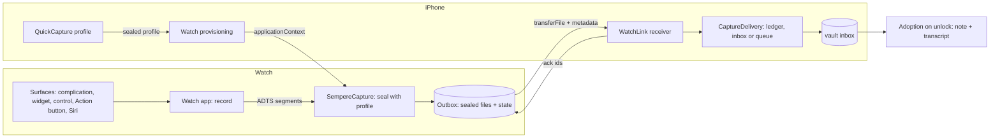

# Apple Watch voice notes (issue #14)

Status: design for 1.1, written 2026-11-09. Built in two pull requests (core and CLI; the iPhone receiver and the watch app). Where the build differs from the text below, [quick-capture.md](../quick-capture.md) "Apple Watch" is what ships: the phone's provisioning model is `WatchProvisioner` (the message codec is `WatchProvisioning`), the watch records with the OS 27 interruption messages (`interruptionNotification` is deprecated there), and a watchOS Simulator build leaves the Control out of the widget extension.

## 1. Goal and non-goals

**Goal.** Record a voice note from the wrist. The watch seals it, as soon as it stops, with a capture profile. The recording reaches the iPhone over WatchConnectivity (WC). The iPhone puts it in the vault's inbox, and the normal adoption path makes it a note. It is the iPhone's Lock Screen voice note, on the wrist.

Start surfaces: a complication, a Smart Stack widget, a Control, the Action button (Ultra), Siri.

**Non-goals.**
- No reading, browsing, searching or drawing on the watch. No vault, no vault key, no device key on the watch.
- No transcription on the watch.
- No watch app that works without an iPhone ever being set up: the profile comes from the iPhone.
- No new on-disk format. A watch capture is an ordinary `inbox/<id>.capture.age` (format.md §11).
- No per-watch revocation in 1.1 (decision D1).

## 2. What exists today

**The capture core is already key-less and Foundation-only.**
- `CaptureWriter.seal(audio:type:started:…)` seals with a `CaptureProfile` alone and returns a `SealedCapture` (name, bytes, epoch, epoch id): `Sources/Sempere/CaptureInbox.swift:467-520`. The profile holds `v_e`, the device capture key, the device id, the notebook, the epoch and the epoch id (`:107-125`).
- `CaptureKey.derive` is HKDF of `K_e` and a *listed device's* key fingerprint (`:69-100`). So a profile is always one listed device's. The reader tries the capture key of every listed device (`captureKeyRing`, `:179-190`).
- `CaptureWriter.record(_:in:)` appends to the device's write ledger before the file is placed; `store` never overwrites (`:526-548`). `Vault.captureProfile` also does `ledger.rememberKey(epoch:…)`, so catch-up can re-seal a capture of an older epoch (`:139-170`).
- The sealed file is bounded: `CaptureFile.maxBytes` = 256 MiB (`:306`).
- Adoption ids derive from the capture id, so two adopters write the same note (`CaptureAdoption.ids(for:)`, `:572-600`). A transcript is bound to the audio's hash, and the transcript's `recipient` must match the capture's (`:595-597`).

**The state machine is app-side.**
- `QuickCapture` (`Sources/SempereAppCore/QuickCapture/QuickCapture.swift`, 854 lines) does start, stop, seal, deliver, sweep. Its platform is behind protocols: `CaptureRecorder`, `CaptureRecording`, `CaptureAudio`, `CaptureAudioFiles` (`QuickCapturePlatform.swift:17-75`), plus `NoLiveActivity`, `NoBackgroundTime`.
- The logic that needs no platform is in `QuickCaptureLogic.swift`: `StoredCaptureProfile` (`:14`), `CaptureProfileStore` (`:38`), `RecordingManifest` (`:101`), `CaptureSegments` with the seal plan and leftovers (`:128`), `CaptureDelivery` (`:260`).
- Only ONE profile is stored per device: the Keychain item behind `CaptureProfileStore.load()/save()`. Quick capture targets one vault at a time.
- Audio is crash-safe ADTS segments (`CaptureSegments.segmentExtension = "aac"`) with a manifest, merged to MPEG-4 at seal (`CaptureAudioFiles.merge`). `docs/quick-capture.md` "Restarts, force quits and crashes".
- `format.md` §8.3.1 says writers write `audio/mp4`; `CaptureWriter.seal` defaults to it. So the watch must hand over MPEG-4.

**Surfaces today** (`docs/quick-capture.md` "Surfaces"): intents in `Apps/Sempere/SempereShared/` (iOS only), the widget extension `SempereWidgets`, and `Sources/SempereCaptureShared` (Foundation only, no dependencies, links into the widget) with `VoiceNoteStatus` (`:1-40`): phases `notSetUp/liveActivitiesOff/ready/recording/saving`, written to the App Group by `QuickCapture.publishStatus` (in `SempereAppCore`, which the watch does not link: on the watch, `WatchRecorder` writes it).

**Build setup.**
- `Package.swift:29`: `platforms: [.macOS(.v14), .iOS(.v17)]`. No watchOS entry. Dependencies: swift-crypto 4 and swift-argument-parser only. `Age` needs only `Crypto`. `Sempere` needs `Age`, `CZlib`, `Crypto`.
- Xcode project targets: `SempereApp`, tests, UI tests, `SempereWidgets` (app-extension), `SempereStatusItem` (`project.pbxproj:257-388`). Every config is iOS (`SUPPORTED_PLATFORMS = "iphoneos iphonesimulator"`) except the Mac status item. The deployment target is 27.0.
- This Mac has the watchOS 27.2 SDK and simulator runtime (`xcodebuild -showsdks`). Whether the CI image `xcode-27` has them is unknown (`docs/ci.md:43`); check in PR 1 (`xcodebuild -showsdks` step).
- `scripts/release-check.sh` allow-lists entitlements and checks `MARKETING_VERSION` equality across targets and a `PrivacyInfo.xcprivacy` per shipping target (`CLAUDE.md`, "App Store release").

## 3. The design

### 3.1 Picture

### 3.2 Targets and shared code

New Xcode targets (owner steps in section 9):

| Target | Kind | Bundle id |
| --- | --- | --- |
| `SempereWatch` | watchOS app (SwiftUI, standalone with `WKCompanionAppBundleIdentifier`) | `io.github.anthonytw.sempere.watchkitapp` |
| `SempereWatchWidgets` | watchOS widget extension (complication, Smart Stack, Control) | `io.github.anthonytw.sempere.watchkitapp.widgets` |
| `SempereWatchTests` | watchOS unit tests (only what Linux cannot run) | none |

The watch app is embedded in the iPhone app (`SempereApp`) so it installs from the same App Store listing.

New package target, **`SempereCapture`** (Foundation, `Sempere`, `SempereCaptureShared`; no UI, no Apple frameworks, no `os`). It is needed twice over: the watch must not link `SempereAppCore` (it pulls `SempereImport`, `SempereRender`, `SempereWebDAV`, `SempereSync`, `SempereSpeech`, and Observation; `Package.swift` `SempereAppCore` deps), and `SempereCLI` does not link `SempereAppCore` at all, so the CLI analogs of section 4 can only call watch logic that lives outside it.
- Moves from `SempereAppCore`: `CaptureSegments` (with the seal plan and `Leftover`) and `RecordingManifest`, nothing else. `StoredCaptureProfile` and the profile store stay: they hold a vault bookmark and the transcribe flag, which the watch does not have (it stores a bare `CaptureProfile` plus the vault name, 3.3). `SempereAppCore` depends on `SempereCapture` and re-exports it (`@_exported import SempereCapture`), so app code and the existing Linux tests compile unchanged.
- New: `WatchProfilePayload` (provisioning), `WatchOutbox` (the watch's queue), `WatchTransferMeta`, `WatchAck`, `ADTSToMP4` (below), `WatchRecorder` (a small start/stop/sweep state machine over the same `CaptureRecorder`/`CaptureRecording` protocols; it does not reuse `QuickCapture`, which is built around Live Activities, intents and a delivery the watch does not do; it writes `VoiceNoteStatus` for the watch widgets), and **`WatchIntake`**: the phone side's checks (3.6 steps 1, 2 and 4: metadata against the file, the received set, the ack list) over a small delivery protocol.
- The phone's `WatchReceiver` in `SempereAppCore` is `WatchIntake` plus an adapter to `CaptureDelivery`. The CLI's `inbox watch receive` is `WatchIntake` plus an adapter that records in the vault's ledger and stores with `CaptureWriter.store`. One copy of the logic, as `CLAUDE.md` "CLI first" requires. `SempereCLI` gains the `SempereCapture` dependency.

`Package.swift`: add `.watchOS(.v10)` to `platforms` (the package keeps its own low minimum and gates new APIs with `#available`, like iOS 17; `CLAUDE.md` "Gotchas"; the app targets use watchOS 27 directly). `Sempere` and `Age` must compile for watchOS:
- swift-crypto uses CryptoKit on Apple OSes. X-Wing needs the OS 26 SDK APIs; the existing `postQuantumAvailable` gate covers older OSes. The watch target is 27, so it is always true there.
- `CZlib` is a `systemLibrary` with `link "z"`; `libz` is in the watchOS SDK. PR 1 proves it by building (an unknown I could not check without Xcode project changes).
- `SempereCaptureShared` links into the watch widget, as it does into the iOS widget. It is Foundation only; `VoiceNoteStatus` and the tap log compile as they are.
- Anything that fails to build for watchOS (file locking, `flock`, `FileHandle` calls) is fixed in `Sources/`, never forked.

`scripts/check-portability.sh` stays as is. `release-check.sh` gets: the new bundle ids' version equality, a `PrivacyInfo.xcprivacy` for the watch app and its widgets, the entitlement allow-list entries, and the rule that `SempereWatch*` link no network code.

### 3.3 The watch's keys and data

- The watch holds one `CaptureProfile` (a copy of the phone's current profile) in its Keychain, `AfterFirstUnlockThisDeviceOnly`: the same item class as `KeychainCaptureProfileStore`. It holds no identity, no `K_e`, no device key.
- The watch has its own **provisioning key pair**, an `age1pq1…` `NativeIdentity` made on first launch, private half in the watch Keychain. Its use is only to carry the profile over WC (3.4).
- Plaintext audio lives only in the watch app's container, in `Application Support/SempereWatch/Capture/<id>/`, protected `completeUntilFirstUserAuthentication` (the same reasons as the phone: the recording is read back to seal while the watch is locked). It is deleted as soon as the sealed file is in the outbox (same rule as `CaptureSegments.plan`: never delete audio that was not sealed).
- The outbox is `Application Support/SempereWatch/Outbox/<id>.capture.age` plus `outbox.json`: id, size, sealed epoch, state (`sealed`, `transferring`, `acked`), attempts, dates. Only ciphertext and ids.

### 3.4 Provisioning the profile over WC

Direction: iPhone to watch. One-way trust: the phone only provisions a watch that WC says is its paired watch, and the app only provisions a key it received from that watch.

1. Settings ▸ Quick Voice Notes on the iPhone gets "Use on Apple Watch" (off by default; shown when `WCSession.isPaired` and `isWatchAppInstalled`). The model half is `WatchProvisioning` in `SempereAppCore`; the toggle and words are the app's.
2. The watch app, with no profile, sends `{provisionRequest: <its recipient>, version}` by `transferUserInfo` (queued; wakes the phone app in the background) and shows "Set up Quick Voice Notes in Sempere on your iPhone".
3. The phone, when the toggle is on and a profile exists and is not suspended, builds `WatchProfilePayload { profile, vaultName, issued, seq }`, **age-encrypts it to the watch's recipient** (`Vault.encrypt`-style, post-quantum like everything here), and sends the ciphertext with `updateApplicationContext` (latest wins, which is what a profile is).
4. The watch decrypts with its provisioning key, validates it (`CaptureWriter(profile:)` accepts it; vault id is a UUID; epoch id is 32 bytes of hex), stores it, bumps `seq`, and shows "Saving to <vault name>".

Why the extra age layer: the WC daemon persists `applicationContext` and `userInfo` outside the Keychain. The layer keeps the capture key out of that store and out of any watch backup in plaintext. Cost: about 60 lines, all in the Linux-tested core (decision D3).

**Refresh and revocation**
- The phone pushes a new payload whenever its own profile changes: it is refreshed at an unlock after an epoch change (`docs/quick-capture.md` Threat model; key-hierarchy §5.7), the notebook changes, the vault changes, or the toggle goes on.
- Toggle off, quick capture turned off, or a suspended profile (`StoredCaptureProfile.suspended`, the device was removed from the list): the phone sends `{clear: seq}` (unencrypted, carries nothing secret). The watch deletes the profile and shows "Not set up". Pending outbox files are kept and still sent (as the phone keeps its queue when suspended), and what arrives is **held** (below), not recorded. Turning the toggle off also makes the phone forget the watch's recipient (`WatchLinkState.recipient`), so nothing is ever encrypted to that watch key again until a watch sends a fresh `provisionRequest` after the toggle is turned back on. A cleared watch asks again by itself; while the toggle is off the phone ignores the request. While the toggle is on, a new epoch's profile is still pushed automatically: a legitimate watch needs it.
- **Admission.** The phone cannot tell a lost watch from a slow one cryptographically, because both hold the same key. So whether a watch file may reach a vault follows the user's trust in the link, decided once, at receipt, in `WatchIntake` (the Linux-tested core the app and the CLI share). A file gets a write-ledger entry only if it is *admitted*, which means all three hold:
  1. "Use on Apple Watch" is on (the CLI's `inbox watch receive` counts as on, because it is an explicit command);
  2. `meta.epochId` (and `epoch`) equal the epoch of the profile the phone holds for `meta.vault`: the stored profile's for the current vault, the newest epoch the write ledger remembers a key for, for another vault the store holds; for a vault the store does not hold nothing can match;
  3. the plaintext `vault.json` epoch number of that vault's folder, when it can be read, is not higher than that epoch. It is unverified, so it can only make a file held, never admitted. It closes most of the lag between another device's epoch change and this phone's next unlock.

  A file that is not admitted is **held**: kept on the phone only (`Application Support/Sempere/WatchHeld/<vault>/<id>.capture.age` with a sidecar: epoch, epoch id, received date, reason), never in a vault folder, never synced, never in the ledger. It is acknowledged, so the watch drops its copy. Held storage is capped at 200 files and 500 MB, the watch outbox's own caps; past the cap a file is refused unacknowledged and the watch keeps it. A profile or ledger that cannot be read (before the first unlock) decides nothing: the file is left unacknowledged and the watch sends it again.
  - Settings ▸ Quick Voice Notes shows "N Watch notes held" with **Add to inbox** and **Delete**; the CLI has `sempere inbox watch held list|add|delete`.
  - **Add** is the user's explicit decision. It runs the normal record-and-place path, and catch-up then re-seals the file as for any file of an earlier epoch (the old epoch's key is kept by `rememberKey`).
  - The held reason is the vault and epoch verdict first and the toggle second, and Add checks admission again with the toggle treated as on, so a note that is also of an unknown epoch or vault is never addable, whatever it was held for. While the stored profile is suspended (this device was removed), matching notes are held too.
  - For an epoch the phone never held, or a vault it does not hold, Add is not offered, only Delete. Such a file never reaches the ledger, so catch-up has nothing to retry.
  - Queue paths need no marker: only admitted files go to a queue, under their own epoch, which is correct because they were sealed before any epoch change the phone knew of. A file that lies about its epoch gains nothing: catch-up re-seals only after verifying the tag under the claimed epoch's capture key.
- A watch that was offline across an epoch change keeps sealing under the old epoch, and its notes are held until the user adds them (the phone no longer re-seals them by itself at the next unlock).
- Removing the *iPhone* from the vault ends the watch's captures too: they verify only under the phone's listed key.
- **Limit (D1):** the watch's capture key is the phone's. Losing the watch means someone can add voice notes to the inbox as the iPhone until the phone's key is replaced (a new epoch) *and* the phone stops taking the watch's files. They cannot read anything. That is the existing Lock Screen row of the threat model ("Forensic extraction after the first unlock"), on a second device. The steps for a lost watch are: (1) turn off Use on Apple Watch (the phone stops accepting and sending at once; anything that still arrives is held); (2) unpair or erase the watch (Find My); (3) replace the key (a new epoch), which retires the copied capture key against someone who also has storage access. Say that WatchConnectivity can reach the phone through Apple's cloud relay, not only over Bluetooth range, so "out of range" is no protection. The toggle and the clear revoke nothing cryptographic by themselves; the settings text says so. A real per-watch revocation needs a watch key listed in `vault.json` and a format marker: out of scope for 1.1.

**Multiple vaults.** The phone has one capture profile, so the watch has one. Quick capture's vault is already a single choice in Settings; the watch follows it. A change of vault pushes the new profile; outbox files for the old vault still go out, and each carries its vault id in `WatchTransferMeta.vault`. **`CaptureDelivery.deliver` does not route by that id today:** it places a file in the *stored profile's* vault folder and records it in that vault's ledger (`QuickCaptureLogic.swift:287-314`), so an old-vault file handed to it would land, unreadable, in the wrong vault's inbox. So the receiver routes by `meta.vault` (3.6 step 3), and only a file whose vault is the stored profile's goes through `deliver` unchanged. (If a second profile per vault is ever wanted on the phone, the watch's payload becomes a list; the wire format has a `profiles` array from day one so that is not a break. 1.1 sends exactly one.)

### 3.5 Recording on the watch

- **Start.** Every surface lands in the watch app (below). The app starts recording at launch when the launch came from a surface (`sempere-watch://record`, an intent, or Siri), not when the user opens the app from the app grid: the grid shows a big Record button. A launch that cannot record (no profile, mic denied, outbox full) shows why, never silence.
- **Surfaces.**
  - Complication and Smart Stack widget: accessory families and a rectangular Smart Stack widget in `SempereWatchWidgets`, `widgetURL` to `sempere-watch://record`. They read `VoiceNoteStatus` from the watch App Group (`notSetUp`, `ready`, `recording`): no new status type, `SempereCaptureShared` as is.
  - Control: a `ControlWidget` button that opens the app and records; it only starts (watchOS 26+ supports controls).
  - Action button: a Shortcut / app-launch target (the user picks it in Settings ▸ Action Button); the app registers an App Shortcut `Record a Sempere voice note` like the iPhone's `VoiceNoteShortcuts`, with the phrases of `docs/quick-capture.md` (English plus the Spanish catalog entries; `LocalizationCatalogTests` already checks pairs).
  - Siri: the same App Shortcut.
  - Whether a watch intent can record without opening the app (the phone's `AudioRecordingIntent` route) is NOT assumed. v1 opens the app in front. If the owner finds that too slow on the wrist, revisit after device tests.
- **Audio session.** `AVAudioSession` category `.record`, mode `.default` is enough on the watch (nothing plays), activated before the recorder starts; not mixable. If activation fails, the start fails with the system's error text kept for a diagnostics line, as `RecordingError.cannotRecord` does today.
- **Segments.** `AVAudioRecorder` writes `segment-NNN.aac` (ADTS), a manifest beside them, a segment per 5 minutes, as on the phone: a process death loses at most the last frames. The manifest records the vault and the epoch id of the profile the recording started under. A sweep at launch and at activation seals leftovers (`CaptureSegments.Leftover`, same rules) with that profile, or with the current profile only when it is of the same vault; a leftover of another vault stays, and with no profile at all (a clear, Reset) leftovers are deleted, as the phone's sweep does. The watch keeps the start-time profile for the length of a recording (in memory, plus a Keychain item keyed by the recording id, deleted after the seal), so a clear that arrives mid-recording takes effect after the seal. The phone's `QuickCapture.sweep` makes the same vault check.
- **Format.** Mono AAC-LC, 24 kHz, 32 kbps (about 240 KB per minute), set for speech. The phone uses 48 kHz / 64 kbps (`RecordingFormat.default`, `RecordingSupport.swift:61`); a watch note is smaller to move and store. Transcription on the phone does not need more. The format goes in the capture's `AudioInfo`.
- **ADTS to MPEG-4.** The phone merges segments to MPEG-4 with AVFoundation (`CaptureAudioFiles.merge`), and the format requires `audio/mp4` (`format.md` §8.3.1, "Writers write `audio/mp4`"). watchOS has no such path. In the watchOS 27.2 SDK, `AVAssetExportSession` (with every preset, `AppleM4A` and `Passthrough` included), `AVAssetWriter` and `AVAssetReader` are all marked `API_UNAVAILABLE(watchos)`. `AVMutableComposition` exists but nothing can export it, and there is no `AudioToolbox.framework`, so `AudioFile` packet copying is out too. The only system route is `AVAudioFile`, which means decoding to PCM and encoding again: a second lossy generation at 32 kbps, plus CPU and battery for every note. So: a pure-Swift `ADTSToMP4` in `SempereCapture`, about 300 lines. The same frame walk gives `CaptureSegments.Audio` (none, audio or undecodable) for the watch's seal plan, so the watch needs no AVFoundation probe. ADTS frames stand alone, so the muxer reads frame headers (profile, sample rate, channels), writes `ftyp`, `moov` (`mp4a` + `esds`, `stts`, `stsc`, `stsz`, `stco`) and `mdat`. Bounded work: it checks every header and fails with a typed error on junk. Linux-tested, fuzzed (`Tests/FuzzSupport`, as a new parser of untrusted bytes: a damaged segment is untrusted input), and checked against AVFoundation on a Mac (`#if canImport(AVFoundation)`: `AVAudioPlayer`/`AVURLAsset` reads it and the duration matches). The same code can later replace the phone's merge; not in 1.1. (D4)
- **Wrist down, interruptions.**
  - The watch app is allowed to run in the background while recording with the `audio` background mode (`UIBackgroundModes`; on watchOS `WKBackgroundModes` holds only session modes, and App Store Connect refuses `audio` there); the system shows the recording indicator. Apple documents this for watchOS audio; whether it keeps a long recording alive when the wrist is down and the screen is off needs a real watch (section 5, item W1).
  - If the session is interrupted (a call, Siri, an alarm; `AVAudioSession.interruptionNotification`), the recording pauses. On `shouldResume` it resumes into a new segment; otherwise it stops and seals what exists. Pause time is not audio, as in `RecordingTimeline`.
  - If the app is terminated while recording (memory, a reboot, the user quits it), the sweep seals the leftover at the next launch. The note then says so in the app on first open ("Interrupted voice note saved"), like the phone's banner.
  - A limit of 60 minutes per note (an hour is 14 MB at 32 kbps; below the 256 MiB file limit by a wide margin). At the limit the note stops, seals, and the screen says so; it does not start another.
- **Stop.** Stop (the Stop button in the app, Siri or a shortcut; the Control only starts a recording, it does not stop one) ends the recorder, concatenates the segments into one ADTS stream, remuxes to MPEG-4, seals with `CaptureWriter.seal(audio:type:"audio/mp4", started:, info:, title:)`, writes the sealed file to the outbox (atomic, `FileIO.writeNewFile`, `fsync`, rename), then deletes the plaintext folder. The title is `CaptureWriter.defaultTitle` with a "Watch" prefix: "Watch voice note 2026-11-09 14:32" (vault text stays English, per `CLAUDE.md` Localization). The screen says "Saved" at once, before any hand-off.
- **Haptics.** A start tick and a stop tick (`WKInterfaceDevice.play(.start/.stop)`), since the screen may be down.

### 3.6 Hand-off to the iPhone

The watch calls `WCSession.transferFile(sealedURL, metadata: WatchTransferMeta)` for each outbox file in state `sealed`, on launch, on activation, on `activationDidCompleteWith`, and when `isReachable` changes. `transferFile` queues by the system when the phone is away and survives app restarts.

`WatchTransferMeta` (all plaintext, none secret): `id` (capture UUID), `name` (`<id>.capture.age`), `size`, `sha256` of the sealed bytes, `vault` (UUID), `epoch`, `epochId`, `version`. This is what `CaptureDelivery` needs; the phone never decrypts anything.

Phone side (`WatchReceiver`, called from `session(_:didReceive:)` — the file is only valid during that callback, so the first thing it does is copy it into its own quarantine folder):
1. Check the metadata against the file: size, SHA-256, name equals `CaptureFile.name(id, .capture)`, size at most `CaptureFile.maxBytes`. A mismatch is dropped and reported (never trusted: the file crossed a daemon).
2. If `id` is in the phone's **received set** (`Application Support/Sempere/WatchReceived.json`, ids with dates, 180 days, bounded count) or already in the inbox, skip placing it but still ack. No second note can arise anyway: names are `<id>…` and `CaptureWriter.store` never overwrites, and adoption derives the same note ids.
3. Admit it or hold it (3.4 "Admission"). A file that is not admitted is held, acknowledged, and goes no further. Hashing is streamed, and a transfer is bounded at 64 MiB (a note is at most about 14 MB), so nothing near the general capture bound is read into memory.
4. An admitted file is delivered by `meta.vault`, with `epoch/epochId` from the metadata:
   - If `meta.vault` is the stored profile's vault: `CaptureDelivery.deliver(sealed, stored)`. It records in the ledger first, then writes the inbox, or the queue when the folder is unreachable.
   - Otherwise: never the current vault's inbox. When the vault store holds vault `meta.vault` by id, record the file in `ledger(meta.vault)` under its own epoch, then place it in that vault's inbox. Recording needs no profile: `CaptureWriter.record` uses the profile only as a fallback epoch, and the metadata always carries one, so a small helper appends the `LedgerEntry` directly.
   - When the store holds the vault but cannot write it now (unreachable, read-only), put the file in `queueFolder(meta.vault)` with its epoch sidecar, unrecorded. It is recorded when it is placed, as the existing queue does: a ledger entry whose file is not at its path is dropped after `ledgerIntentGrace` (one hour, `VaultCatchUp.swift`), so recording at queue time would lose the catch-up.
   - PR 2 adds a flush of `queueFolder(id)` whenever vault `id` is opened writable. It records each file under its sidecar epoch, so it needs no profile of that vault. Today `flushQueue(of:)` only flushes the stored profile's vault, and it skips files when it has no profile. Settings shows "N Watch notes waiting for another vault" while the queue holds any.
   - Delete the quarantine copy only after delivery returns.
5. Add the id to the received set. Send the ack.

**Ack and when the watch deletes its copy.** The system's `fileTransfer.didFinish` (watch side) only says the file reached the phone's WC inbox, not that it is in the vault. So the phone acks with `transferUserInfo({acked: [ids…]})` after step 3 (queued too, so it survives either side being away). The watch deletes the outbox file only on an ack, and on a re-ack of an id it no longer has does nothing. Rules:
- No ack, no delete: ever. A transfer error keeps the file; it is retried with backoff (and on every launch).
- A file is re-sent if it has had no ack for 24 hours (the system may have dropped the transfer). Duplicates are harmless by step 2.
- The phone also sends `{have: [ids…]}` at activation, so a watch that lost its ack state (reinstall, restore) can drop what the phone already holds.
- Watch storage: an outbox cap of 500 MB and 200 files. Above it a new recording is refused at start with "Open Sempere on your iPhone to send saved notes" (never delete unacked audio to make room). A watch with less than 1 GB free refuses too. A day of dictation at 32 kbps is far under the cap, so the cap is for a phone left home for months.
- Reinstalling the watch app loses the outbox (its container goes). The ack protocol cannot help that; Settings on the phone shows "Last note from Watch: <date>", and the watch shows a count of unsent notes on its home screen so the user sees it before deleting the app.

**Transcription.** The sealed audio is encrypted to `v_e`, and neither device has the key without unlocking the vault on the iPhone. So there is no way to transcribe a Watch note "on the iPhone" at receive time without sending plaintext over WC. Design: the watch note is transcribed in the existing "after adoption" path (`docs/quick-capture.md` "Transcription": the next time the vault is unlocked on a device with transcription on). That is the iPhone, normally, within seconds of the unlock that adopts it. Nothing new. Decision D2 offers the alternative (plaintext audio over WC for immediate transcription) and recommends against.

### 3.7 UI on the watch

One screen with states: `Not set up`, `Ready` (large Record), `Recording` (elapsed time, large Stop, a red dot), `Saved` (2 seconds, then back; after a recording started from a surface it stays, alone, with no Send now, until the app goes to the background: watchOS has no supported way for an app to close itself, so lowering the wrist ends it, owner build 67), `Unsent notes: N` (a line under Ready, with a "Send now" that retries), `Can't record` (reason). No lists, no settings but "Reset" (deletes the profile). The words are in the one catalog, `Sources/SempereLocalization/Resources/Localizable.xcstrings`, compiled into the watch targets' bundles as it is for the app and the widget. `InfoPlist` and `AppShortcuts` live in `Apps/Sempere/Localization/`, whose synchronized group gains the watch targets (`CLAUDE.md` Localization; `docs/localization.md`). English and Spanish.

The complication and the Smart Stack widget use the voice-note glyph of [1.1.md](1.1.md) (the owner's nib choice applies to both platforms). It is a copy of the same custom symbol in the watch widget extension's own asset catalog. The Control draws `mic.fill`, as the iPhone's: Control Center showed the nib as an empty circle (TestFlight 1.1.0 (67)). The corner complication shows the icon alone, scaled to fit its slot (no curved label).

## 4. The CLI side

The watch itself is UI and platform glue, but every piece of its logic is core, so there is a CLI analog that exercises the real code:

- `sempere inbox watch provision --to <recipient> [--out FILE]` (needs the key once, like `inbox enable`): builds the `WatchProfilePayload` for the vault's capture profile and age-encrypts it to a watch's provisioning recipient. `sempere inbox watch keygen` makes a throwaway watch provisioning identity for testing.
- `sempere inbox watch seal <audio> --payload FILE --identity FILE --outbox DIR`: acts as the watch. Decrypts the payload with the identity, remuxes ADTS to MPEG-4 when given `.aac`, seals as the watch would, writes `<id>.capture.age` and a `WatchTransferMeta` JSON into the outbox directory.
- `sempere inbox watch receive <outbox DIR>`: acts as the phone's `WatchReceiver`: validates, dedupes against a received-set file, delivers into the inbox (ledger-first), and writes the ack file. Run it twice: the second run places nothing.
- The existing `sempere inbox import` then adopts it, and `sempere inbox list` shows it. `sempere inbox capture --type audio/mp4` stays as is.
- All with `--json`. `docs/cli.md` gets a "Watch" section. `CLITests` run provision, seal, receive twice, import, and check one note with one recording.

Why not a plain `inbox capture` call: it does not use the payload, the outbox, the metadata checks or the received set, which is where the watch's risk is.

## 5. Tests

**Automated, Linux (`swift test`, no Apple frameworks):**
- `WatchProfilePayload`: round trip; wrong recipient cannot open it; tampered ciphertext fails typed; a `clear` message; `seq` ordering (an older payload is ignored); a profile that does not validate is refused.
- `ADTSToMP4`: golden bytes for a synthetic ADTS stream; frame count and duration agree; junk, truncated header, changing sample rate, a frame length over the input all fail typed; fuzz target.
- `WatchOutbox`: states and persistence across a restart; no delete without an ack; backoff and the 24 h re-send; cap and free-space refusal; an ack for an unknown id is a no-op; a corrupt `outbox.json` keeps the files.
- `WatchIntake` (and `WatchReceiver` over `CaptureDelivery` with `MemoryCaptureProfileStore` and a temp inbox): a metadata/size/hash mismatch is dropped; a file whose `meta.vault` is not the stored profile's never reaches the current vault's inbox (it goes to its own vault's inbox or queue, ledger-recorded in that vault) and is flushed when that vault opens; duplicate transfer places nothing; an id already adopted and removed from the inbox produces the same note on a second adoption (ids derive from the capture id); a file of an older epoch is ledger-recorded under its own epoch and re-sealed by `catchUp`; unreachable inbox goes to the queue; a suspended profile still delivers a pending file.
- `WatchRecorder` over fake `CaptureRecorder`/`CaptureRecording` (the existing `CaptureTestKit.swift` fakes): start, stop, seal; an interruption pauses and resumes into a new segment; a crash leftover is sealed by the sweep; a seal failure keeps the folder; the 60 minute limit; outbox full refuses the start.
- End to end in `CLITests`: provision, seal as the watch, receive twice, import, one note.
- Existing `QuickCapture*Tests` must still pass after the move into `SempereCapture` (the proof the move changes nothing).

**Automated, Mac (PR gate):** `Mac package tests` build `SempereCapture` for macOS; a `#if canImport(AVFoundation)` test plays an `ADTSToMP4` file with `AVURLAsset`.

**CI build for watchOS.** `scripts/app.sh build-watch`: `xcodebuild build-for-testing` of `SempereWatch` and `SempereWatchWidgets` for a watchOS simulator (`-sdk watchsimulator`), added to the `iOS build` job so it adds no runner. It needs the watchOS SDK on the `xcode-27` image; the SDK ships with Xcode, but the simulator runtime may be a separate download (`xcodebuild -downloadPlatform watchOS`; docs/CLAUDE.md say the same of iOS). PR 1 starts with a one-line CI probe (`xcodebuild -showsdks`). If the image lacks it: the build runs in `scripts/local-ci.sh` only (step `watch`, named under `## Tests run`), exactly as the Mac Catalyst tests do today. A compile-only check would run with `-sdk watchos` (device SDK, `CODE_SIGNING_ALLOWED=NO`) which needs no runtime. I recommend that: it needs the SDK only.

**Automated, simulator (local, not the gate):** the watch app launched on a watchOS simulator with `SIMCTL_CHILD_` debug env vars (as `DebugLaunch.swift` does for the iPad): a debug build seeds a profile payload and a fake audio source, `SempereWatchUITests` checks the states (Not set up, Ready, Recording, Saved, Unsent count, Can't record). The simulator has no microphone to speak of: the recorder is the fake; this tests the UI and the outbox, not audio.

**Needs a real watch (owner):**
- W1. A 5 and a 30 minute recording with the wrist down and the screen off: is the audio complete, does the recording indicator stay, does the app survive.
- W2. A complication, Smart Stack widget, Control, Action button and Siri each start recording, from the watch face, while locked and unlocked; time from tap to first audio.
- W3. `AVAudioRecorder` writing ADTS for a `.aac` URL on watchOS (the same unverified item the phone has in `docs/quick-capture.md` "Not verified yet").
- W4. Interruptions: a call, Siri, an alarm, headphones connected, Bluetooth route changes.
- W5. WC: a note recorded with the iPhone off or away reaches the vault after it returns; airplane mode on the watch; ack lost; app killed mid-transfer.
- W6. `transferFile` and `updateApplicationContext` on the real transport; the phone app launched in the background by `transferUserInfo`.
- W7. Battery cost of a 30 minute recording.
- W8. The `audio` background mode is accepted by App Store review for this use.

## 6. Implementation plan (2 PRs)

1. **Core and CLI (about 1900 lines, all Linux-tested).**
   - Create `SempereCapture` and move `CaptureSegments` and `RecordingManifest` out of `SempereAppCore` (re-exported).
   - Add `WatchProfilePayload`, `WatchTransferMeta`, `WatchAck`, `WatchOutbox`, `WatchIntake`, `ADTSToMP4` and its fuzz target, and `WatchRecorder`.
   - Add `.watchOS(.v10)` to `Package.swift`, and `SempereCapture` to `SempereCLI`'s dependencies.
   - Add `sempere inbox watch keygen|provision|seal|receive`, `docs/cli.md`, and a "Watch" section in `docs/quick-capture.md`. `format.md` stays untouched.
   - A CI probe for the watchOS SDK, and a `-sdk watchos` compile of `Sempere`/`Age`/`SempereCapture`, so a watchOS build failure in `Sources/` surfaces here, not in PR 2. Changelog fragment.
2. **iPhone receiver and watch app (about 2000 lines, mostly SwiftUI and glue).**
   - Phone: `WatchReceiver` (the `CaptureDelivery` adapter, with routing by vault, 3.6) and `WatchProvisioning` in `SempereAppCore` (Linux tests); the per-vault queue flush on open; the app's `WCSession` delegate; the "Use on Apple Watch" setting and its words; the received-set store.
   - Watch: new targets in `project.pbxproj` (hand edited, `plutil -lint`, unique ids), `SempereWatch` and `SempereWatchWidgets`, entitlements, `PrivacyInfo.xcprivacy`, the glyph asset.
   - Checks and tests: the `release-check.sh` tables and their tests, `scripts/app.sh build-watch` (and a `local-ci.sh` step), `SempereWatchTests` and simulator UI tests.
   - Localization: the catalog and localization-group membership, Spanish strings.

The phone half and the watch half ship together because neither does anything without the other. A "Use on Apple Watch" toggle with no watch app to provision is dead UI, and the WC path can only be tested end to end. PR 1 is mergeable alone and changes nothing a user sees. PR 2 is the owner's first TestFlight watch build.

## 7. Decisions (reviewed 2026-11-09)

- **D1. Whose capture key: (a), the phone's profile verbatim.** No format change, and the exposure is the existing Lock Screen row of the threat model on a second device. Per-watch revocation (c) goes to the post-v1 ideas list.
- **D2. Transcription: (a), after adoption.** Plaintext over WC would break "sealed on the watch as soon as it stops", and the existing path transcribes on the next unlock anyway.
- **D3. Provisioning payload: (a), age-encrypted to the watch's key.** The capture key is a Keychain `ThisDeviceOnly` secret today, and WC's persisted context is outside the Keychain with undocumented backup behavior. The cost is small, because the watch links `Age` to seal anyway.
- **D4. MPEG-4: (a), the pure-Swift muxer, confirmed necessary.** The watchOS 27.2 SDK marks `AVAssetExportSession`, `AVAssetWriter` and `AVAssetReader` unavailable and has no AudioToolbox (3.5). The merge-based fallback is dropped, and `AVAudioFile` transcoding is rejected for its quality and battery cost.
- **D5. Extract `SempereCapture`: (a), but narrower.** Move only `CaptureSegments` and `RecordingManifest`, and add `WatchIntake`. The CLI cannot link `SempereAppCore`, so the target is required for "CLI first" as well as for the watch.
- **D6. Start from a surface: open and record at once.** That is the issue's ask. The start haptic and the 60-minute cap bound a pocket press.
- **D7. Title: "Watch voice note <date>".** The source is useful in the note list, and the text stays English like all vault text.

## 8. Risks

- **watchOS cannot record in the background the way I assume** (W1/W8). Mitigation: segments plus the sweep lose little; fallback is "keep the screen on" via an extended runtime or an in-app "keep awake" for the recording, with the cost named to the owner after device tests.
- **`Sempere` or `Age` does not build for watchOS** (`CZlib`, file APIs, CryptoKit availability). PR 1 finds out with a `watchos` SDK build; the fix is in `Sources/`.
- **No watchOS SDK or runtime on the `xcode-27` image.** Fallback is the local gate; the check is named in the PR.
- **WC is not reliable timing-wise.** The design never depends on timing: the file waits in the outbox until acked; the phone dedupes.
- **A lost watch** can add notes as the iPhone until the user turns the toggle off, unpairs or erases the watch and replaces the key (D1, 3.4). Stated in the settings text and `docs/security.md`. Anything it sends after the toggle is off, or under an older epoch, is held for the user to add or delete.
- **Hand-written `project.pbxproj`** gets three more targets; ids are unique and `plutil -lint` / `release-check.sh` catch collisions.
- **Reinstalling the watch app loses unsent notes.** The unsent count and the phone's last-received date mitigate; nothing more can be done without iCloud for the watch, which is out of scope.
- **The `audio` background mode needs an explanation in review notes** (voice notes while the wrist is down).

## 9. Owner steps

1. Apple Developer: register the App IDs `io.github.anthonytw.sempere.watchkitapp` and `io.github.anthonytw.sempere.watchkitapp.widgets`, with the App Group `group.io.github.anthonytw.sempere` on both (the group id is shared with the iOS targets; the containers are separate). Automatic signing may create them, as it did for the iOS widgets (`docs/quick-capture.md`, "Not verified yet"); if not, this is a step.
2. App Store Connect: no new app record (the watch app ships inside the iPhone app). Add watch screenshots (one size, the largest Ultra) and update the privacy answers (microphone on the watch, no new data collection) and the privacy policy's two copies, same date (`CLAUDE.md`).
3. Review notes for the `audio` background mode and the microphone usage string.
4. Install on a real watch and run W1 to W8 from TestFlight (watch apps install from the phone's TestFlight build).
5. Approve the two PRs; PR 2 is merged only after a green `local-ci.sh`.
