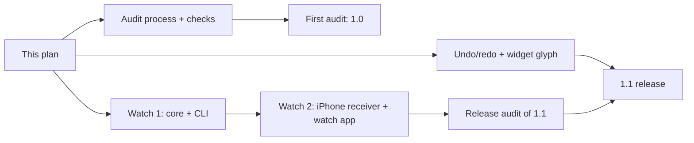

# Sempere 1.1 plan

Status: plan, 2026-11-09. The owner set the scope; the three designs below give the detail. Open questions in each
design were decided in its "Decisions (reviewed 2026-11-09)" section by the reviewer of the PR that adds this plan.
The owner chose the widget glyph, below.

## Scope

| Item | Design | Implementation |
| --- | --- | --- |
| Apple Watch app for quick voice notes (issue #14) | [1.1-watch.md](1.1-watch.md) | 2 PRs: core and CLI; then the iPhone receiver and settings together with the watch app and widget targets |
| Undo and redo controls in the note editor (issue #8) | [1.1-undo-redo.md](1.1-undo-redo.md) | 1 PR |
| Recurring public security and privacy audit | [1.1-security-audit.md](1.1-security-audit.md) | 1 PR: process docs and checks. Then one report PR and one fixes PR per audit run |
| Voice-note widget glyph | this page, below | Rides with the undo/redo PR |

Not in 1.1: faster joining (#9), Finder drag (#10), custom saved tools (#11), Make a Copy (#12) and smoothing without
the flash (#13).

## Order

Undo/redo, the audit PR and the first watch PR are independent and run in parallel. The two watch PRs are a chain.
Four implementation PRs in all, plus the 1.0 audit's report and fixes PRs.
The 1.1 release candidate gets a release audit, which covers the real watch code.

## Voice-note widget glyph

The Lock Screen widget and the Control Center control show a microphone today. On the Lock Screen and in the
control it is `VoiceNoteStatus.symbol`'s ready case, `mic.fill` (`Sources/SempereCaptureShared/VoiceNoteStatus.swift:88-96`).
Only the Home Screen widget shows `mic.circle.fill` (`SempereWidgets.swift:135`). Inside the app a microphone is
clear; on the Lock Screen it does not say Sempere. The ready state's glyph becomes the app icon's keyhole nib in
every family and in the control. It is drawn as a one-color custom symbol (from
`Apps/Sempere/IconSources/keyhole-nib.svg`) with weights, so it renders in the Lock Screen's monochrome and tinted
modes. Recording, stopping and failure keep their state symbols. The watch complication uses the same glyph.

Two constraints for the implementation:
- `symbol` is an SF Symbol name used with `Image(systemName:)`. Its comment says "system symbols only: no asset
  catalog to read, which a Lock Screen widget may not be able to before the first unlock". The custom symbol
  therefore goes in the widget extension's own bundle asset catalog (bundle files are readable before the first
  unlock; the App Group container is not), never in the App Group, and the ready case gets an image choice
  instead of a system name.
- A device check is needed: reboot, then before the first unlock the Lock Screen widget shows the nib. It is one
  card on the TestFlight checklist, beside the undo check. If the nib does not render there, the fallback is
  `mic.fill` for the ready state on the Lock Screen only.

Decided by the owner (2026-11-09): **the nib alone**, everywhere. Five candidates were compared at real sizes (the nib,
the nib with a mic badge, a mic inside the nib, a mic with a keyhole capsule, and today's `mic.fill`). A mic only read
well at 30 pt and up, and the owner preferred the brand mark; the icon can change if a non-voice widget ever appears.
The glyph is drawn larger than today: about 60% of the circle's diameter in the circular Lock Screen widget (today
`.title2`, about 22 pt) and about 70 pt in the Home Screen widget. Control Center sizes control glyphs itself.

## What needs the owner

- Watch: the watch App IDs and App Group, App Store Connect (watch screenshots, privacy answers, review notes for the
  background audio mode), and the real-watch checks W1 to W8 in [1.1-watch.md](1.1-watch.md).
- Undo/redo: one real-iPad check of the three-finger gestures and the Pencil with the new toolbar, on the TestFlight
  checklist. Glyph: the before-first-unlock check above.
- Audits: GitHub advisory actions (create the draft from the coordinator's text, request CVEs, publish), merging an
  embargoed fix at release time, and approving each report PR. SECURITY.md already sends reporters to private
  vulnerability reporting; the owner confirms it is on. `anthonytw/sempere` is a personal-account repository, so
  only its admin, the owner, can create or publish advisories. The "security manager" role exists only in
  organizations.
