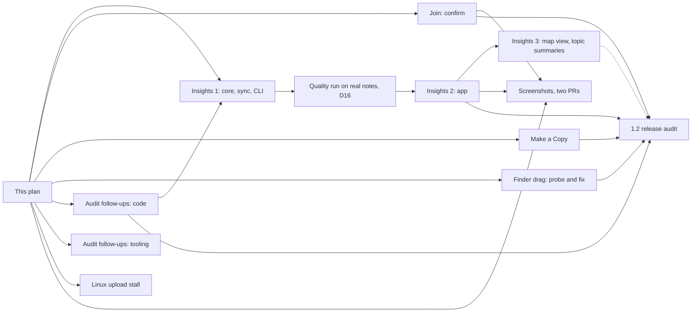

# Sempere 1.2 plan

Status: plan, 2026-11-13. The owner marked the scope below. Each design gives the current code (checked at `main`
when this page was written), the change, the tests and the open questions, each with a recommended answer for the
reviewer of the PR that adds this plan. Where the reviewer decides differently, the design's "Decisions" section
records it, as the 1.1 plan did.

## Scope

| Item | Design | Implementation |
| --- | --- | --- |
| Note Insights: summaries, keywords, related notes and a map, including transcripts and voice-note titles (D13 to D19) | [1.2-note-insights.md](1.2-note-insights.md) (its section 11 wins over earlier sections) | 3 PRs, as that design's section 10; the map view and topic summaries are behind the cut line |
| Confirm instead of typing to join | [1.2-join-confirm.md](1.2-join-confirm.md) | 1 PR |
| Drag a note to the Finder on the Mac (issue #10) | [1.2-finder-drag.md](1.2-finder-drag.md) | 1 PR: the automated probe, plus the fix if a rung passes (otherwise the findings only) |
| Make a Copy… of a read-only vault (issue #12) | [1.2-make-a-copy.md](1.2-make-a-copy.md) | 1 PR (package, CLI, app) |
| 1.1 audit follow-ups: C-10, D-07, F-13, F-14, F-16, and the two review follow-ups of the 1.1 delta | [1.2-audit-followups.md](1.2-audit-followups.md) | 2 PRs: code (C-10, D-07, nearby, Watch) and tooling (F-13, F-14, F-16) |
| New App Store screenshots with Undo/Redo; website screenshots for the Watch page and the nearby join request; dark-mode twins on the website | [1.2-screenshots.md](1.2-screenshots.md) | 1 PR here (script and demo hooks), 1 PR in the website repo |
| Linux CLI: a cut WebDAV upload stalls until the 60 s idle timeout | [1.2-linux-upload-stall.md](1.2-linux-upload-stall.md) | 1 PR: the diagnostic table is run locally first and its results go in the PR description; the test and the fix land together |

Later (not in 1.2):

- Custom saved tools (issue #11). It leads 1.3.
- Thinner pens and nibs.
- Smoothing without the flash (issue #13).
- Vault folders look like files in iCloud Drive.

Dropped:

- Pressure control.
- Joining over Bluetooth. The nearby link (1.1) and the confirm step below replace the idea of a faster join.

## Order

The audit code PR lands before Insights 1 (both edit `SyncEngine`; otherwise Insights 1 rebases on it). Everything else except the Insights chain is independent, so those PRs run in parallel. The
screenshots come last because they show Undo/Redo, the nearby join request and (for the dark twins) the final
screens; the nearby request screen changes with the join PR (it gains the six words and "They match").

PRs are few and each is bundled: the plan asks for 11 PRs besides this one (Insights 3, join 1, Finder 1, copy 1, audit 2,
stall 1, screenshots 1 here and 1 in the website repository). Pushes are batched, per the project's rule of keeping
GitHub activity low.

## Cut lines

- Insights: the map view (D9) and topic summaries (D8, D19) are built last and move to 1.3 without touching the
  rest. The cut is decided when Insights 2 merges, not earlier.
- Finder drag: if the probe's experiments all fail, the setting stays hidden, the issue stays open with the findings
  recorded in `docs/mac.md`, and the PR that would have fixed it is dropped. 1.2 ships without it.
- Audit follow-ups: C-10 and D-07 are the code changes and ship in 1.2. F-13, F-14 and F-16 are tooling and may ship
  in a release-neutral PR at any time. F-13 is a gate change: the owner merges that PR and enables code-owner review.
- Screenshots: the dark twins are website only and can follow the release.

## Rules for every PR in this plan

- No device steps: every check an agent can run is run, and nothing waits for the owner to hold a device
  (the Insights design's D15 is the same rule). Where a design below needs a real Finder or a real Watch, it says how
  an agent drives it, or says that the item is dropped if it cannot be driven.
- CLI first: anything that reads or changes vault data ships its `sempere` command in the same PR (Make a Copy has
  `sempere store copy`; the others change no vault data).
- A changelog fragment in `changelog.d/` for each user-visible change. Format changes, if any, go into
  `docs/format.md` first. No design here changes what an existing `sempere/1` field, op or file means. Insights extends
  the format compatibly (a new root folder, format §16 and settings keys; no `features` entry, because unknown files are
  ignored and never deleted, format §1, and settings carry their own versions, §7.5).

## Open questions, with recommended answers

The details are in each design. The reviewer decides these (the owner is asked only if a recommendation is rejected). Decisions of the 2026-11-13 review are recorded in each design.

| Design | Question | Recommendation |
| --- | --- | --- |
| Join | Show six words or a shorter code? | Six words. A short code is grindable during a session (see the threat model) |
| Join | Does confirming replace typing everywhere? | No. Typing and the QR code stay as the fallback, and typing stays the only way for a join with no screen to compare |
| Join | Does the reply side also become a tap? | Yes, with the words shown on the new device next to home's, and the same fallback |
| Finder | Which experiment ships first? | E1 (record the control runs), then E2 (a ready file URL, prefetched on selection only). E3 is not in 1.2 |
| Finder | Is the setting shown again? | Only after the automated drop test passes under `XC_KIND=mac xc-lock`, with no new permission; otherwise the item stays at the cut line |
| Copy | Keep history or copy the current state? | The current state, one checkpoint per note |
| Copy | Copy deleted notes? | No by default; `--include-deleted` and a toggle in the sheet |
| Copy | Keep note ids? | Yes |
| Audit | Cap for Watch notes of an unknown vault | 20 files and 50 MB, inside the 200 files and 500 MB cap |
| Audit | Handshake eviction rule | One handshake in progress per remote address; the oldest of that address goes first. The address-rotation limit is recorded in nearby-join.md |
| Screenshots | Dark twins: note pages dark or light paper in dark chrome? | Light paper in dark chrome (the default a user sees), plus one extra dark-pages shot for the website |
| Linux stall | Where does the 60 s come from, and what is the fix? | Not yet located (no Linux run was possible while writing this). Run the diagnostic table locally first (harness candidate first). Body phase stalled: a progress watchdog, flat 15 s, Linux only. Post-body phase stalled: also a first-response-byte timeout of 15 s for bodies of 1 MiB or less |

## Not verified when this plan was written

Everything was read from the code and the docs; no test, simulator or Linux run was possible in the session that
wrote it. The designs mark each claim that rests on a run that was not made.
