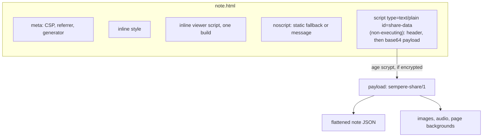
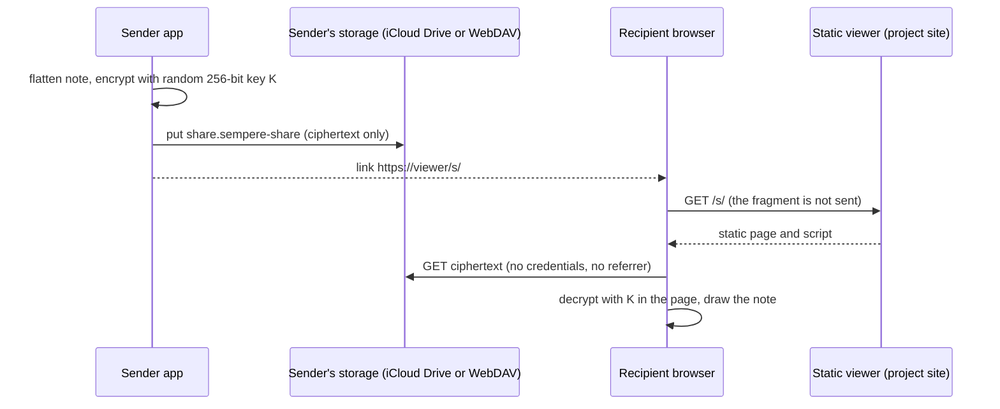

# Design: Share a note read-only, without a server of ours (Sempere 1.3)

Status: design, 2026-11-18. Paths are relative to the repository root. Phase 1 is to be built; phase 2 is design only, behind a spike (§8). No code changed.

## 1. Goal and non-goals

**Goal.** Send one note to someone who has no vault, no key and no app, so they read it in a browser, and nobody runs a service for it.

- **Phase 1:** a single self-contained `.html` file: the existing web viewer's code, the note and its attachments inside, optionally encrypted with a passphrase.
  The user sends the file (Mail, Messages, AirDrop, a drive link).
- **Phase 2 (design only):** a link. The ciphertext lives where the user already has storage (an iCloud Drive shared file or a WebDAV share), the viewer is a static page on the project's
  site, and the key is in the URL `#fragment`, which a browser never sends to any server.

**Non-goals.**
- Editing, commenting, live updates or syncing the shared copy. A share is a snapshot.
- Revocation, expiry enforcement or knowing who opened it (impossible for a file already sent; phase 2 can be deleted at its location).
- Sharing a vault, a notebook (1.3 is one note; a notebook is later) or history.
- Any Sempere-hosted storage, relay, account or analytics.
- Any change to the vault format or the stock-`age` recovery path: a share never contains vault keys, revisions or `vault.json`.

## 2. What exists today

- The web viewer (`web/`, `docs/web-viewer.md`): a TypeScript port of the reader and `SempereRender`, `age-encryption` 0.3.1 and `@noble/*` for crypto, scrypt in a key worker
  (`web/src/ui/keyunwrap.ts`, `keyworker.ts`) for passphrase-wrapped keys, pdf.js in a worker (`web/src/ui/pdf.ts`). Its CSP forbids inline script and style and any network but its own
  origin plus configured vault origins (`web/vite.config.ts`, `contentSecurityPolicy`), with Trusted Types.
- `sempere export --format html` (`docs/cli.md` "--format html"): one self-contained static page of inline SVG per note, no scripts needed, a text layer and collapsed recognized-text blocks.
- Renderers that make the same pixels in Swift and TypeScript, kept equal by `web/scripts/golden.sh` and the `web-golden` job; `RenderOutputVersion.current`.
- Attachments: image, PDF page, audio, video items and their limits (`docs/attachments.md`, format.md §8.4); photo metadata stripping (`PhotoPrivacy`, `photos.removeMetadata`).
- age with scrypt in Swift (`Sources/Age`, used by the passphrase copy, format.md §3.2, §15.11) and in the viewer.
- Untrusted-input rules for the viewer and for readers (format.md §9; web-viewer.md "Threat model").

## 3. Phase 1: a self-contained HTML file

### 3.1 Shape of the file



The CSP is a `<meta>` with `default-src 'none'; script-src 'sha256-<viewer script>'; style-src 'sha256-<style>'; img-src data: blob:; media-src blob:; connect-src 'none';
worker-src blob:; base-uri 'none'; form-action 'none'; object-src 'none'; frame-src 'none'; require-trusted-types-for 'script'; trusted-types sempere-share-worker`
and `<meta name="referrer" content="no-referrer">`. The note data sits in a non-executing `<script type="text/plain">`, so the script hash stays the same for every share of one release: a recipient
or a security-minded sender can compare it with the release's published hash (`sempere share --verify FILE`). `connect-src 'none'`: the page cannot send anything anywhere, even if its code were changed
(a file whose CSP an attacker edited is another matter: §3.9).

### 3.2 What is in the payload: a flattened snapshot, never revisions (D2)

`sempere-share/1`: the note's **current state** as the viewer's reduced model (`web/src/format/model.ts`) serialized as JSON, plus attachment blobs in a length-prefixed container:

```
payload = "SHRE" ‖ 0x01 ‖ u32 jsonLength ‖ gzip(JSON) ‖ { u32 nameLength ‖ name ‖ u64 length ‖ bytes } *
```

- Built by `NoteShare` (`Sources/Sempere/NoteShare.swift`, Linux-tested) from the note's reduced state, the same reducer the app and CLI use. No revision files, no `seq`, no device ids, no
  history, no erased strokes, no deleted items, no other notes, no `vault.json`, no note id (a fresh random `shareId` is made, used only to bind encryption, §3.5).
- Included: title, pages (paper, ink, text boxes, images, math renders, PDF page backgrounds as images), tags only if `--tags`, notebook only if `--notebook-path`, recognized text
  (for the text layer and "copy text", off with `--no-text`), recordings only with `--audio`.
- Rendering uses the viewer's renderer in the page, so a page equals `sempere export --format svg` (golden tests, §7).
- Attachments are re-encoded for the share: images downscaled to at most 2048 px on the long side as JPEG (quality 0.82; PNG kept when it has transparency and is small), metadata always removed
  (location, camera, orientation baked in); audio as stored (AAC); video never included (a poster image with a "video not included" mark).
- **PDF backgrounds are rasterized** to images at the page's displayed size at 150 dpi (the exporter's path: `sempere export --format png`'s renderer, `PopplerRasterizer` on Linux, PDFKit in the app),
  only for pages the note shows. The recipient gets pictures, not a PDF: no pdf.js, no PDF parser in the shared page, and the viewer template is smaller (D4). Selectable PDF text is lost, accepted.

### 3.3 The viewer template

`web/` gets a build target `npm run build:share` (Vite library mode plus a small post-step) producing `share-viewer.html` with the viewer's JS and CSS inlined, a placeholder for the data, no vault opening,
no file picker, no WebDAV, no cache (IndexedDB is never touched), no passkeys, no pdf.js. The scrypt worker and nothing else is started from a `blob:` URL under the one Trusted Types policy
`sempere-share-worker`. Share mode reuses `web/src/format/*` and `web/src/render/*` unchanged. Recipient UI: the note with the viewer's pan, zoom, search in the note's text,
print, dark/light, English or Spanish by browser language; at the top "Shared from Sempere, read-only. This file does not change the original."
Template size target: under 700 KB gzip-free (inferred, to measure; the pdf.js worker is the main weight the share build drops).

Where the template lives for the Swift side: the CLI and the app need it without Node. **Decision D5:** the built template is committed at `Sources/Sempere/Resources/share-viewer.html` (generated by `scripts/build-share-template.sh`,
reviewed like a lockfile) and a CI check (`web` job) rebuilds it and fails on a difference, as the golden check does. Its SHA-256 and the script hash are in `docs/web-viewer.md` per release.

### 3.4 Encryption (D1, D3): age with a scrypt passphrase

Optional but the default. When on, the payload is an **age file with one scrypt recipient** (the passphrase), not a format of our own:

- KDF: scrypt, `N = 2^18, r = 8, p = 1` (256 MiB of memory; age's default work factor). Cipher: age's ChaCha20-Poly1305 STREAM in 64 KiB chunks (authenticated, so a wrong passphrase or a flipped bit fails
  cleanly, and the file never needs to fit one AEAD message).
- The file stores the age binary, base64 in the data element with the header line `sempere-share/1; enc=age-scrypt`. Stock `age -d` opens it
  (`base64 -d | age -d`), so a recipient who distrusts the page, or in twenty years, can recover the note with a stock tool and the payload format above.
- Sender side: Swift's `Age` module (the passphrase-copy code, format.md §15.11) with its RFC test vectors. Recipient side: `age-encryption` in the browser, scrypt in the worker (WebCrypto has no scrypt; `@noble/hashes`
  scrypt is what the viewer already uses). ChaCha20-Poly1305 and the stream come from the library, not hand-rolled.
- Why not WebCrypto PBKDF2 + AES-GCM: PBKDF2 is not memory-hard (a passphrase is attackable on GPUs cheaply), and a bespoke container would be a new design to audit. Phase 2 uses WebCrypto AES-GCM because its key
  is random, not a passphrase (§4.3).
- Passphrase: generated by default, six words (`GeneratedPassphrase`'s word source, the vault recovery passphrase generator in `Sources/Sempere`, which currently offers seven words; the share uses the same list, six words is about 77 bits),
  shown once with a Copy button; the user may type their own (a warning under 12 characters or four words; none refused). Never stored in the vault, the app's defaults, logs or the CLI's history; the app does not
  remember which notes were shared.
- **Memory on the recipient's device:** 256 MiB for scrypt is fine on desktops and recent phones, but an old phone's browser may kill the tab. Open question 1: measure on iPhone Safari and drop to `N = 2^17` if needed. The work factor
  is in the age header, so the viewer follows whatever the file says, bounded at `2^22` (as the vault viewer bounds it).
- The viewer's "Decrypting…" state shows progress; wrong passphrase: "That passphrase did not open this note" with no oracle beyond that.
- **Unencrypted share:** allowed only after an explicit confirmation ("Anyone who gets this file can read the note"), `enc=none`; the payload is then in the file in the clear (gzip, base64). The unencrypted file additionally
  carries the static inline-SVG pages (the `--format html` writer's output) in the `<noscript>` area, so it also reads in contexts that block scripts (§3.8).

### 3.5 Binding and integrity

The age file's own MAC authenticates the payload under the passphrase; `shareId` and the app's `generator` string are inside the ciphertext so a swapped header cannot lie about them. The inline script is
integrity-pinned only by the CSP hash in the same file, so a recipient who gets a **modified file** gets modified code (§3.9).

### 3.6 Size and limits (D6)

| Limit | Default | Notes |
| --- | --- | --- |
| Whole file | 20 MiB (most mail services take 20-25 MB); `--max-size MB` up to 200 | the sheet shows the size breakdown before Create: ink and text, images, audio, template |
| Images | 2048 px long side, JPEG 0.82; shrink further (1600, then 1280 px) only to fit the budget | `--image-quality low|normal|high` |
| Audio | off by default; `--audio` includes recordings and their transcripts, AAC as stored | a recording over the budget is skipped with a notice, never recoded lossily without saying |
| Pages | at most 200 pages; pageless notes up to the renderer's extent limit (200,000 pt) | |
| PDF backgrounds | rasterized, 150 dpi, only the pages the note shows | |
| Video | never | a placeholder |
| Template | about 0.7 MB | the floor of every share |

Base64 costs 33%: the budget is on the file, not the payload, and the planner counts it. A note that cannot fit fails with the breakdown and what to turn off, never a truncated file.

### 3.7 What leaks (D7)

| Visible to anyone holding the file (even encrypted) | Hidden when encrypted | Never present |
| --- | --- | --- |
| That it is a Sempere share, the template version and hash, `enc=age-scrypt`, the work factor, approximate size, file modification time and the file name | title, text, ink, attachments, tags, dates, recordings | device names or ids, vault id, note id, other notes, notebook (unless `--notebook-path`), history, author name, location or camera metadata, the sender's app version |

- The **file name** is the user's to choose; the default is `Shared note.html`, never the title (a title in the name would leak what encryption hides). `<title>` inside the file is "Shared note" until decrypted.
- An unencrypted share shows everything the note shows, including recognized text, with the dates the sender allowed (modified date included only with `--dates`).
- Size reveals the note's rough magnitude, as any encrypted file does. Padding to buckets (1, 2, 5, 10, 20 MiB) is cheap, but the 33% inflation already blurs it; not done in 1.3.

### 3.8 Opening it: what recipients need

The recipient opens the file **in a browser** (Safari, Chrome, Firefox, Edge; desktop or phone). Mail's inline preview, iOS Quick Look and most chat apps' previews do not run scripts, so the encrypted file
shows only its `<noscript>` text, "Open this file in a web browser to read the note." Unencrypted shares have the static fallback. The sheet tells the sender this in one line and offers a
Send-Instructions text ("open the attachment in your browser; the passphrase will come separately").

### 3.9 Threat model

- **Honest recipient, hostile network or mailbox reader:** the encrypted file is age-protected; the passphrase travels another way. Fine.
- **Active attacker who can modify the file in transit or at rest** (a hostile mail server, a file host): can replace the page's code with code that captures the passphrase when typed. This is the
  weakness of any self-contained page and is stated in the sheet's help and in security.md; the mitigations are separate channels, the published hash and `--verify`, and the stock-`age` path.
  An unencrypted share offers nothing against modification.
- **Recipient's device:** after decryption the note is in memory of that browser tab; "Save" is not offered, but the browser's own save or print is the recipient's right.
- **Hostile sender:** the shared file is the sender's code and data. Opening it from a stranger is like opening any web page: the viewer's CSP (`connect-src 'none'`, no form, no frame, no navigation), no markup from data
  (the viewer builds DOM nodes, allow-listed SVG), bounded work (format.md §9 limits; images checked before decoding, 100 MP), and the one blob worker. A page the viewer cannot parse shows a typed error.
  A hostile file, by editing the CSP, can phone home as any web page can; a recipient opening files from unknown senders is outside the design's protection.
- **The sender's own device:** the file and, briefly, its plaintext payload are in the app's temporary folder; written under `tmp/SempereShares`, 0600, removed when the share sheet closes and at launch
  (as `NotePDFExport` does for drag, `AppModelCore.exportFolder`).
- **Passphrase guessing:** scrypt at `2^18` makes each guess cost about 0.3 s of one core and 256 MiB; a generated six-word passphrase is not guessable, a user-chosen short one is. The sheet says so.

### 3.10 CLI first

```
sempere share NOTE --out FILE.html [--passphrase-file F | --passphrase-env VAR | --generate-passphrase | --no-encrypt --yes]
               [--audio] [--no-text] [--tags] [--notebook-path] [--dates] [--max-size MB]
               [--image-quality low|normal|high] [--vault V] [--json]
sempere share --verify FILE.html [--json]   hash of the script and style, template version, enc and work factor; never decrypts
```

- A passphrase is never an argument (it would show in `ps`): file, environment variable, standard input (`--passphrase-file -`) or generated. `--generate-passphrase` prints it once, on stdout in the JSON (`passphrase`) or as a line
  on stderr in text mode.
- `--json`: `{ "file", "bytes", "encrypted", "sections": {ink, images, audio, template}, "scryptLog2N": 18, "scriptSha256", "skipped": [...] }`.
- Works on Linux (the pure builder; the rasterizer there is Poppler as for export). Read-only vaults work (nothing is written to the vault). `docs/cli.md` is updated in the same PR.

### 3.11 App UI

Note menu (iPad, iPhone, Mac: `MenuCommand.shareAsWebPage` in the File menu, where its shortcut is checked by `MenuCommandTests`) ▸ **Share as Web Page…** opens a sheet:

1. "Protect with a passphrase" (on), the generated passphrase with Copy and a "Use my own" field. Turning it off asks for the confirmation text.
2. "Include recordings" (off, shown when the note has some), "Include recognized text" (on).
3. The size line ("4.2 MB: ink 0.9, images 2.6, template 0.7") and warnings (over the limit, video not included).
4. Create → the system share sheet (iPhone, iPad; `UIActivityViewController` through the existing `ExportHandOff`) or the Mac's save panel / share picker. The passphrase screen stays until Done, with "Send the passphrase in a different way than the file".

No history of shares, no "shared" badge on the note (there is nothing the app could keep true about it).

## 4. Phase 2 (design only): a link whose ciphertext is on the user's own storage

### 4.1 Shape



### 4.2 The link

`https://<viewer host>/s/#v=1&u=<base64url of the ciphertext URL>&k=<base64url 32 bytes>`. Both values are in the fragment, so neither the viewer's host nor the storage host sees `k`
and the viewer's host does not see where the ciphertext is. The page sets `Referrer-Policy: no-referrer` and fetches with `credentials: "omit"`, `referrerPolicy: "no-referrer"`.
The link is a capability: whoever has it reads the note; it ends up in browser history and in whatever app the sender pastes it into (a chat app stores it), and the storage object can be
deleted to end access.

### 4.3 Crypto

Random 256-bit `K` per share; file `"SMPS" ‖ 0x01 ‖ nonce(12) ‖ AES-256-GCM(ciphertext ‖ tag)`, associated data `"SMPS" ‖ 0x01 ‖ shareId`; plaintext the same `sempere-share/1` payload.
WebCrypto does the decryption in the page (`crypto.subtle.decrypt`), no KDF is needed (the key is random), single-shot up to 64 MiB. Random 96-bit nonces, one write per share. Same format family as
format.md §12.1 (AES-GCM because browsers provide it).

### 4.4 Where the ciphertext can live: the feasibility risk

The viewer must `fetch` the file cross-origin, which needs `Access-Control-Allow-Origin` on the response and a public, unauthenticated, direct download URL.

- **WebDAV (the user's own):** workable when the share is public and the server sends CORS headers (Caddy, nginx, Nextcloud public shares). The user configures a public URL template per WebDAV
  target (`SempereWebDAV` already does `PUT`).
- **iCloud Drive "Share Link":** the public `icloud.com` link is an HTML page, not a direct file URL, and does not look CORS-enabled [unverified]. Likely **not usable** without a hosted proxy, which we will not run. A spike must
  test it before the design promises it (open question 4).
- **Other static hosts (S3-compatible, GitHub Pages of the user, a NAS behind Caddy)** work the same as WebDAV when CORS is open.

If iCloud fails the spike, phase 2 is "a link to a file on a static HTTPS location you control", with iCloud users staying on phase 1.

### 4.5 The viewer origin and its CSP

A viewer that fetches a URL from its fragment cannot keep `connect-src 'self'`: it needs `connect-src https:` (and for development `http://localhost`). That is a weaker CSP than the vault viewer's
(web-viewer.md "Threat model") and so is its **own build and its own origin**: `docs/web-viewer.md`'s "One origin" rule says anything else on the viewer's origin can read what the viewer reads. The project's Pages site
shares an origin with other pages of its account, so the link viewer should have a dedicated host name (open question 3). Its remaining protections: no script from data, `credentials: omit`, size cap 64 MiB checked on `Content-Length`
and while streaming, a 30 s timeout, a banner naming the host the file came from ("Loaded from example.com"), and the viewer shows nothing before decryption succeeds. A crafted link can only make the recipient's browser
fetch one URL without credentials and show attacker-chosen content (content spoofing, the same as any link) because it must also supply the key.

### 4.6 Metadata

The storage host sees the ciphertext's size and the IP and time of each fetch; the viewer's host sees page loads (IP, time, user agent) but not `u`, not `k`, not the note. Neither sees the note. The sender's storage listing
shows the file name (default `<random 16 hex>.sempere-share`, never the title).

### 4.7 Sender UI and CLI (sketch)

`Share ▸ Create Link…`: choose where (a WebDAV target with a public URL, or a folder the user picked in Files), the app writes the file and shows the link; for a provider that cannot give a direct URL
the sheet says so. `sempere share NOTE --link --to webdav://TARGET --public-url URL [--json]` prints the link. Updating a share rewrites the same object with a new key and new link
(old links stop working: the key changes), which makes "revoke" a delete plus a new link.

## 5. Privacy and security (both phases)

- No server of ours, no analytics, no account. Phase 1 is a file; phase 2's viewer is static hosting and logs are the host's.
- A share is plaintext outside the vault to everyone with the passphrase or link. The sheet says so; `docs/security.md` "What the encryption does not protect" gets a bullet; the privacy policy
  (both copies, same date) gets "Share as Web Page" under "On-device features": creating the file is done on the device; nothing is uploaded by Sempere.
- Never in a share: vault keys, key hierarchy material, device identities, the recovery kit, other notes.
- No new `features` marker, no vault format change, no sync change. The payload format is documented in a new `docs/format.md` §17 (informative: not part of the vault format) or in `docs/web-viewer.md` "Share files" (decision at implementation).
- The Swift builder runs on the same untrusted-input rules as exporters (bounded reads, no trap); the viewer's share path is fuzzed (container parser) like the other parsers.

## 6. Localization

Sheet strings in `Localizable.xcstrings` with Spanish; the page's recipient strings in `web/src/i18n/catalog.ts` (English, Spanish complete; `i18n.test.ts` enforces it).

## 7. Tests

**Linux (`SempereTests`):** `NoteShare` flatten (no history, erased strokes absent, deleted items absent, no ids), container round trip and fuzz, size planner and the breakdown, image recode bounds and metadata stripped,
PDF rasterization budget, age scrypt round trip and **stock `age -d` opens the file** (the interop test, skipped without age), RFC scrypt vectors already present, passphrase never in argv (CLI), `--verify`, golden:
the share viewer's render of a fixture equals `sempere export --format svg`.
**Web (`vitest`, Playwright smoke):** container parse and fuzz, wrong passphrase, flipped bit, truncated file, oversize work factor refused, no network request when opened from `file://` (the smoke test blocks all requests and
fails on any), CSP meta equals the expected policy and the script hash matches, no `innerHTML` (lint), Trusted Types worker, large-note scroll memory (existing release smoke).
**CLI (`CLITests`):** `share` with each passphrase input, unencrypted needs `--yes`, size failure, read-only vault, `--json`.
**App:** sheet defaults (encrypted on), unencrypted confirmation, size warnings, temp folder removed after the sheet, no share record kept.
Phase 2 (later): AES-GCM vector, fragment parsing, CORS failure messages, size cap while streaming.

## 8. Implementation plan

Phase 1, 3 PRs: (1) core and CLI: `NoteShare`, container, encryption, size planner, `sempere share`, docs; (2) web: share build target, template, CSP, i18n, smoke and golden tests, committed template and its CI check;
(3) app sheet, menu command, privacy policy, security.md. Phase 2 starts with a one-day **spike**: can a browser fetch a file from an iCloud Drive link and from a typical WebDAV share (CORS, direct URL)? Its result decides the design.

## Decisions

- **D1 Encrypt by default; unencrypted needs an explicit confirmation.** The sender's default must protect them.
- **D2 The payload is a flattened snapshot, never revisions.** No history, no ids, no other notes; the same reducer and renderer give the same pixels.
- **D3 Encryption is age with a scrypt recipient (`2^18`).** Memory-hard, stock-`age` recoverable, no new cipher; WebCrypto has no scrypt, so the viewer's existing JS scrypt in a worker.
- **D4 PDF backgrounds are rasterized; video is excluded; audio is opt-in.** Smaller viewer, no PDF parser in the shared page, predictable size.
- **D5 The built template is committed and CI-checked.** Swift needs it without Node.
- **D6 20 MiB default file budget with a visible breakdown.** Mail-sized by default; larger by choice.
- **D7 The file name and `<title>` never carry the note's title.** Encryption must hide it.
- **D8 CSP `connect-src 'none'` and a script hash in the file;** a published hash and `--verify` let sender and recipient check.
- **D9 Phase 2: random 256-bit AES-GCM key and the ciphertext URL both in the fragment,** on a dedicated viewer origin, behind a CORS/iCloud spike.

## Open questions (recommendation first)

1. **scrypt `2^18` on phones?** Start at `2^18`; measure on the oldest supported iPhone's Safari and Chrome, fall back to `2^17` (the header carries it). Do not go below `2^17`.
2. **Allow unencrypted shares at all?** Yes, behind the confirmation; they work in previews and for public notes. Remove if the owner prefers one safe path.
3. **Dedicated origin for the phase 2 viewer?** Yes (for example a custom host name on the project site); otherwise sibling pages on the same origin could read what the viewer reads. Needs the owner's domain decision.
4. **Does an iCloud Drive link work as a ciphertext source?** Assume no until the spike shows CORS and a direct URL; if no, phase 2 ships for WebDAV and static hosts only.
5. **Include recognized text by default?** Yes (copy and search in the shared page); it is already what the page shows as ink, but recognition errors are visible. `--no-text` and a toggle exist.
6. **Share a whole notebook or several notes?** Not in 1.3: one note, one file. A notebook share would be a multi-note payload (`sempere-share/1` already allows a list) and a table of contents; later.
7. **Padding to size buckets?** No in 1.3 (base64 already blurs size); revisit if a threat appears.
8. **Where is the payload format documented?** As an informative `docs/format.md` §17 so the stock-`age` recovery of a share is written down once; confirm with the owner that format.md may carry a non-vault format.
