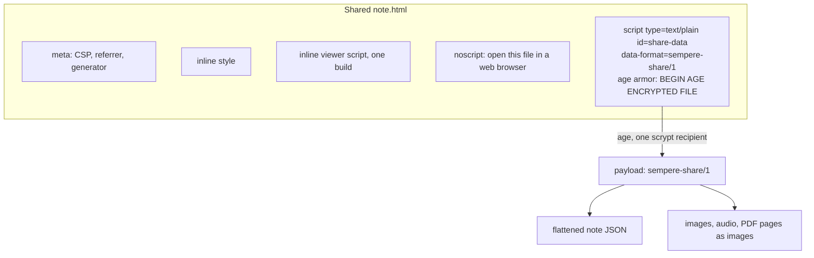
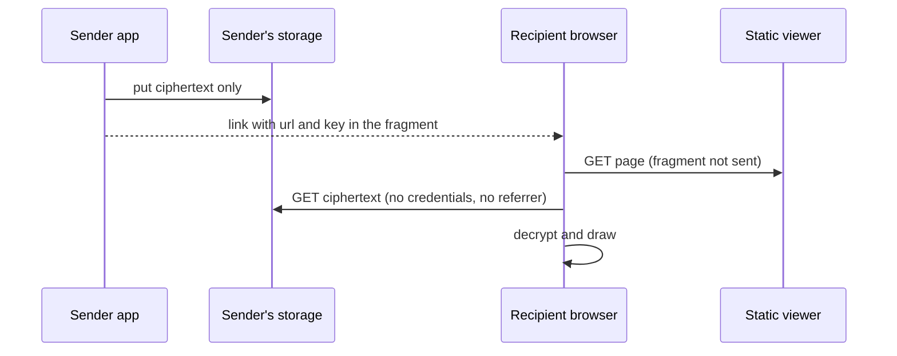

# Design: Share a note read-only, without a server of ours (Sempere 1.3)

Status: design, 2026-11-18; reviewed 2026-11-18 (decisions at the end). Paths are relative to the repository root. 1.3 builds the
encrypted single-file share (§3). Link sharing is not in 1.3 (§4 keeps its sketch and the spike that gates it). No code changed.

## 1. Goal and non-goals

**Goal.** Send one note to someone who has no vault, no key and no app, so they read it in a browser, and nobody runs a service for it:
a single self-contained `.html` file holding the existing web viewer's code and the note with its attachments, encrypted with a passphrase.
The user sends the file (Mail, Messages, AirDrop, a drive link) and the passphrase another way.

**Non-goals.**
- Editing, commenting, live updates or syncing the shared copy. A share is a snapshot.
- Revocation, expiry enforcement or knowing who opened it (impossible for a file already sent).
- Sharing a vault, a notebook or several notes, or history (one note, one file).
- Any Sempere-hosted storage, relay, account or analytics.
- Any change to the vault format or the stock-`age` recovery path: a share never contains vault keys, revisions or `vault.json`.
- An unencrypted web-page share (D1). A plaintext, script-free copy already exists: `sempere export --format html` and the export sheet's HTML format.
- Links to a copy on the user's storage (§4: later).

## 2. What exists today

- The web viewer (`web/`, `docs/web-viewer.md`): a TypeScript port of the reader and `SempereRender`, `age-encryption` 0.3.1 (typage) with `@noble/hashes`
  for scrypt, a key worker (`web/src/ui/keyunwrap.ts`, `keyworker.ts`) for passphrase-wrapped keys, age armor reading (`web/src/vault/keyfile.ts`),
  pdf.js in a worker (`web/src/ui/pdf.ts`). Its CSP (`web/vite.config.ts`, `contentSecurityPolicy`) forbids inline script and style and any network
  but its own origin plus configured vault origins, with Trusted Types (`sempere-pdf-worker`, `sempere-key-worker`). It accepts scrypt work
  factors up to 20 (`keyfile.ts`).
- The app's export (`ShareFormat` and `ShareExport` in `Sources/SempereRender/ShareExport.swift`; the app's `ExportCommand`, `ExportSheet`,
  `ExportHandOff`) and `sempere export --format html` (`docs/cli.md`): a static page of inline SVG per note.
- Renderers that make the same pixels in Swift and TypeScript, kept equal by `web/scripts/golden.sh` and the `web-golden` job; `RenderOutputVersion.current`.
- PDF page rasterizing behind `PDFPageRasterizer` (`Sources/SempereRender/Items.swift`): `PopplerRasterizer` in the CLI, PDFKit in the app.
- Attachments and their limits (`docs/attachments.md`, format.md §8.4); photo metadata stripping (`PhotoPrivacy`, `photos.removeMetadata`).
- age in Swift (`Sources/Age`: `ScryptRecipient`, `Streaming`, `Armor.encode`/`decode`) with RFC scrypt vectors; `GeneratedPassphrase`
  (`Sources/Sempere/GeneratedPassphrase.swift`: seven distinct BIP-39 English words, 11 bits each, 77 bits).
- Untrusted-input rules for the viewer and for readers (format.md §9; web-viewer.md "Threat model").
- A resource-only package target precedent: `SempereFonts` (`Package.swift`).

## 3. The share file

### 3.1 Shape of the file



The CSP is a `<meta>` with `default-src 'none'; script-src 'sha256-<viewer script>'; style-src 'sha256-<style>'; img-src data: blob:; media-src blob:; connect-src 'none';
worker-src blob:; base-uri 'none'; form-action 'none'; object-src 'none'; frame-src 'none'; manifest-src 'none'; require-trusted-types-for 'script';
trusted-types sempere-share-worker`, plus `<meta name="referrer" content="no-referrer">`. The note data sits in a non-executing `<script type="text/plain">`
as an **age armored file** (PEM base64, 64-column lines, which never contain `<`), so the script hash is the same for every share of one release. `connect-src 'none'`:
the page cannot send anything anywhere, even with a bug in its code (a file whose CSP an attacker edited is another matter: §3.9).

**Stock-tool recovery** (frozen once shipped, written in `docs/web-viewer.md` "Share files" with a test that runs it):
`sed -n '/-----BEGIN AGE ENCRYPTED FILE-----/,/-----END AGE ENCRYPTED FILE-----/p' "Shared note.html" | age -d > payload.bin` (age 1.1+ reads armor and
asks for the passphrase), then the container of §3.2. A recipient who distrusts the page, or opens it in twenty years, needs only `age`.

### 3.2 What is in the payload: a flattened snapshot, never revisions (D2)

`sempere-share/1`: the note's **current state** as the viewer's reduced model (`web/src/format/model.ts`) serialized as JSON, plus attachment blobs in a length-prefixed container:

```
payload = "SHRE" ‖ 0x01 ‖ u32 jsonLength ‖ gzip(JSON) ‖ { u32 nameLength ‖ name ‖ u64 length ‖ bytes } *
```

- Built by `WebPageShare` (`Sources/SempereRender/WebPageShare.swift`, Linux-tested; in SempereRender because it rasterizes PDF pages and re-encodes images,
  with the platform's `PDFPageRasterizer` passed in) from the note's reduced state, the same reducer the app and CLI use. No revision files, no `seq`, no device ids, no
  history, no erased strokes, no deleted items, no other notes, no `vault.json`, no note id (a fresh random `shareId` is made and kept inside the ciphertext only).
- The JSON is a contract between Swift (writer) and TypeScript (reader): its shape is pinned by a fixture (`Fixtures/share/`) both sides test, and a change
  to the viewer's model that changes it bumps the payload version.
- Included: title, pages (paper, ink, text boxes, images, math renders, PDF page backgrounds as images), tags only if `--tags`, notebook only if `--notebook-path`,
  modified date only if `--dates`, recognized text (for the text layer and "copy text"; off with `--no-text`), recordings and their transcripts only with `--audio`.
- Rendering uses the viewer's renderer in the page, so a page equals `sempere export --format svg` (golden tests, §7).
- Attachments are re-encoded for the share: images downscaled to at most 2048 px on the long side as JPEG (quality 0.82; PNG kept when it has transparency and is small),
  metadata always removed (location, camera; orientation baked in); audio as stored (AAC); video never included (its poster with a "video not included" mark).
- **PDF backgrounds are rasterized** at the page's displayed size at 150 dpi, only for pages the note shows. The recipient gets pictures, not a PDF: no pdf.js and no
  PDF parser in the shared page (D4). Selectable PDF text is lost; the recognized-text layer carries the page text instead.

### 3.3 The viewer template

`web/` gets a build target `npm run build:share` (Vite library mode plus a small post-step) producing `share-viewer.html` with the viewer's JS and CSS inlined, a placeholder for the data,
no vault opening, no file picker, no WebDAV, no cache (IndexedDB is never touched), no passkeys, no pdf.js. Share mode reuses `web/src/format/*` and `web/src/render/*` unchanged.
The scrypt worker is started from a `blob:` URL under the one Trusted Types policy `sempere-share-worker`; where a browser refuses a worker for a `file:` page, scrypt runs on the
page's thread behind a "Decrypting…" screen (the page has nothing else to do meanwhile). Recipient UI: the note with the viewer's pan, zoom, search in the note's text, print,
dark/light, English or Spanish by browser language; at the top "Shared from Sempere, read-only. This file does not change the original." Template size target: under 700 KB
(inferred, to measure; pdf.js is the main weight the share build drops).

**Where the template lives for Swift (D5):** the built file is committed in a resource-only target `SempereShareViewer` (`Sources/SempereShareViewer/Resources/share-viewer.html`,
like `SempereFonts`, so the core `Sempere` target does not carry it and the CLI's release packaging treats it as it does the fonts), generated by
`scripts/build-share-template.sh` and reviewed like a lockfile. A CI check (`web` job) rebuilds it and fails on a difference, as the golden check does. Its SHA-256 and the
script and style hashes are listed per release in `docs/web-viewer.md` "Share files".

### 3.4 Encryption (D3): age with a scrypt passphrase

Every share is an **age file with one scrypt recipient**, not a format of our own:

- KDF: scrypt `N = 2^18, r = 8, p = 1` (256 MiB; age's default). Cipher: age's ChaCha20-Poly1305 STREAM in 64 KiB chunks (authenticated: a wrong passphrase or a flipped bit fails cleanly).
- Sender: Swift's `Age` module (`ScryptRecipient`, `Armor.encode`). Recipient: typage in the browser, the same library and scrypt the viewer already uses; nothing hand-rolled.
- Why not WebCrypto PBKDF2 + AES-GCM: PBKDF2 is not memory-hard, and a bespoke container would be a new design to audit.
- **Passphrase:** generated by default with `GeneratedPassphrase.make()` (seven words, 77 bits: not guessable at any work factor), shown once with Copy; the user may type their own
  (a warning under 12 characters or four words; none refused, as for the vault's passphrase copy). Never stored in the vault, the app's defaults, logs or the CLI's history; the app does
  not remember which notes were shared. The app's Copy puts it on the pasteboard **local only, expiring after two minutes** (no Universal Clipboard).
- **Work factor on phones:** 256 MiB in a JS worker is the risk on older phones. The viewer follows the factor in the age header and accepts at most 20, as for vault keys (`keyfile.ts`).
  The implementation PR measures 2^18 in Safari on the oldest iPhone iOS 27 supports; if the tab is killed, writers use 2^17 (never lower). A generated passphrase makes the factor
  matter only for user-chosen ones.
- The viewer's "Decrypting…" state shows progress; a wrong passphrase gives "That passphrase did not open this note" and nothing more.
- **Passphrase entry in the recipient's page:** an `<input type="password" autocomplete="off">` outside any `<form>` (the CSP forbids form actions anyway), never read from or written
  to the URL, cleared from the field and dropped from memory once the key is derived.

### 3.5 Binding and integrity

The age MAC authenticates the payload under the passphrase; `shareId` and the `generator` string are inside the ciphertext, so the visible `data-format` attribute cannot lie about them.
The inline script is pinned only by the CSP hash in the same file, so a recipient who gets a **modified file** gets modified code (§3.9). `sempere share --verify FILE` checks that the
script, the style **and the CSP meta itself** equal a release's published values (a file with an edited CSP and the original script would otherwise pass).

### 3.6 Size and limits (D6)

| Limit | Default | Notes |
| --- | --- | --- |
| Whole file | 20 MiB (most mail services take 20-25 MB); `--max-size MB` up to 200 | the sheet shows the size breakdown before Create: ink and text, images, audio, template |
| Images | 2048 px long side, JPEG 0.82; shrink further (1600, then 1280 px) only to fit the budget | `--image-quality low|normal|high` |
| Audio | off by default; `--audio` includes recordings and their transcripts, AAC as stored | a recording over the budget is skipped with a notice, never recoded lossily without saying |
| Pages | at most 200 pages; pageless notes up to the renderer's extent limit (200,000 pt) | |
| PDF backgrounds | rasterized, 150 dpi, only the pages the note shows | |
| Video | never | the poster and a placeholder |
| Template | about 0.7 MB | the floor of every share |

Armor costs 35% (base64 plus line breaks): the budget is on the file, not the payload, and the planner counts it. A note that cannot fit fails with the breakdown and what to turn off,
never a truncated file.

### 3.7 What leaks (D7)

| Visible to anyone holding the file | Hidden | Never present |
| --- | --- | --- |
| That it is a Sempere share, the template version and hash, the scrypt work factor, approximate size, file modification time and the file name | title, text, ink, attachments, tags, dates, recordings | device names or ids, vault id, note id, other notes, notebook (unless `--notebook-path`), history, author name, location or camera metadata, the sender's app version |

- The **file name** is the user's to choose; the default is `Shared note.html`, never the title. `<title>` is "Shared note" until decrypted.
- Size reveals the note's rough magnitude, as any encrypted file does; no padding in 1.3.

### 3.8 Opening it: what recipients need

The recipient opens the file **in a browser** (Safari, Chrome, Firefox, Edge; desktop or phone). Mail's inline preview, iOS Quick Look and most chat apps' previews do not run
scripts, so they show only the `<noscript>` text, "Open this file in a web browser to read the note." The sheet tells the sender this in one line and offers a Send-Instructions text
("open the attachment in your browser; the passphrase will come separately").

### 3.9 Threat model

- **Honest recipient, hostile network or mailbox reader:** the file is age-protected; the passphrase travels another way. Fine.
- **Active attacker who can modify the file in transit or at rest** (a hostile mail server, a file host): can replace the page's code with code that captures the passphrase when typed
  (and then has the note). This is the weakness of any self-contained page and is stated in the sheet's help and in security.md; the mitigations are separate channels for file and
  passphrase, the published hashes and `--verify`, and the stock-`age` path of §3.1.
- **Recipient's device:** after decryption the note is in that tab's memory; "Save" is not offered, but the browser's own save or print is the recipient's right.
- **Hostile sender:** the file is the sender's code and data. Opening it from a stranger is like opening any web page: the viewer's CSP (`connect-src 'none'`, no form, no frame),
  no markup from data (the viewer builds DOM nodes, allow-listed SVG), bounded work (format.md §9 limits; images checked before decoding, 100 MP; work factor at most 20), and the
  one blob worker. A file whose CSP was edited can phone home as any web page can; a recipient opening files from unknown senders is outside the design's protection.
- **The sender's own device:** the file and, briefly, its plaintext payload are in the app's temporary folder, under `tmp/SempereShares`, 0600, removed when the share sheet
  closes and at launch (as `NotePDFExport` does for drag, `AppModelCore.exportFolder`).
- **Passphrase guessing:** at `2^18` each guess costs about 0.3 s of one core and 256 MiB; a generated passphrase is out of reach, a short user-chosen one is not. The sheet says so.

### 3.10 CLI first

```
sempere share NOTE --out FILE.html (--passphrase-file F | --passphrase-env VAR | --generate-passphrase)
               [--audio] [--no-text] [--tags] [--notebook-path] [--dates] [--max-size MB]
               [--image-quality low|normal|high] [--vault V] [--json]
sempere share --verify FILE.html [--json]   script, style and CSP against the published hashes, template version, work factor; never decrypts
```

- A passphrase is never an argument (it would show in `ps`): file, environment variable, standard input (`--passphrase-file -`) or generated. `--generate-passphrase`
  prints it once: in the JSON (`passphrase`) or as a line on stderr in text mode.
- `--json`: `{ "file", "bytes", "sections": {ink, images, audio, template}, "scryptLog2N": 18, "scriptSha256", "skipped": [...] }`.
- Works on Linux (`PopplerRasterizer` for PDF pages, as for export). Read-only vaults work (nothing is written to the vault). `docs/cli.md` is updated in the same PR.

### 3.11 App UI

A new export format, not a new menu: `ShareFormat.webPage` and `ExportCommand.webPage` (**File ▸ Export ▸ Web Page (Encrypted)…** on the Mac, the same entry in the note's
share/export menu on iPad and iPhone), one note at a time (disabled for a multi-note selection). Its options in the export sheet:

1. The generated passphrase with Copy and "Use my own".
2. "Include recordings" (off, shown when the note has some), "Include recognized text" (on).
3. The size line ("4.2 MB: ink 0.9, images 2.6, template 0.7") and warnings (over the limit, video not included).
4. Create → the system share sheet or save panel through the existing `ExportHandOff`. The passphrase screen stays until Done, with "Send the passphrase in a different way than the file".

No history of shares, no "shared" badge on the note (there is nothing the app could keep true about it).

## 4. Later: a link to a copy on the user's own storage (not in 1.3)

The sketch to start from, if a spike shows it can work: the same `sempere-share/1` payload encrypted with a random 256-bit key (AES-256-GCM via WebCrypto, no KDF), the ciphertext
put on storage the user controls (a public WebDAV share, an S3-compatible bucket, a NAS behind Caddy), and a link
`https://<viewer host>/s/#v=1&u=<base64url ciphertext URL>&k=<base64url key>`: the fragment never reaches a server, the page fetches with `credentials: "omit"` and no referrer.



Why it waits: (a) it needs CORS and a direct public URL; iCloud Drive's share links are HTML pages and very likely unusable without a proxy we will not run, so it would serve only
self-hosters; (b) a viewer that fetches arbitrary URLs needs `connect-src https:` and so its **own origin**, separate from the vault viewer and the project's Pages site
(web-viewer.md "One origin"), which means a domain decision by the owner; (c) the key in a link lands in browser history (and history sync) and in every chat app it is pasted into.
Start with a one-day spike (iCloud link and a typical WebDAV share: CORS, direct URL) before any design work.

## 5. Privacy and security

- No server of ours, no analytics, no account. A share is a file the user sends.
- A share is plaintext outside the vault to everyone with the file and the passphrase. The sheet says so; `docs/security.md` "What the encryption does not protect" gets a bullet;
  the privacy policy (both copies, same date) gets "Share as Web Page" under "On-device features": the file is made on the device; nothing is uploaded by Sempere.
- Never in a share: vault keys, key hierarchy material, device identities, the recovery kit, other notes, note or vault ids.
- No new `features` marker, no vault format change, no sync change. The payload format and the recovery recipe go in `docs/web-viewer.md` "Share files" (not `docs/format.md`,
  which stays the vault's format).
- The Swift builder follows the exporters' untrusted-input rules (bounded reads, no trap); the viewer's container parser is fuzzed like the other parsers.

## 6. Localization

Sheet strings in `Localizable.xcstrings` with Spanish; the recipient page's strings in `web/src/i18n/catalog.ts` (English, Spanish complete; `i18n.test.ts` enforces it).

## 7. Tests

**Linux (`SempereRenderTests`):** `WebPageShare` flatten (no history, erased strokes and deleted items absent, no ids), container round trip and fuzz, the JSON fixture shared with
the web tests, size planner and breakdown, image recode bounds and metadata stripped, PDF rasterization budget (a fake `PDFPageRasterizer`), age scrypt round trip and **the §3.1
recipe with stock `age -d` opens the file** (skipped without age; CI sets `SEMPERE_REQUIRE_AGE_PQ`, so it runs there), `--verify` passes the template and fails an edited CSP;
golden: the share viewer's render of a fixture equals `sempere export --format svg`.
**Web (`vitest`, Playwright smoke):** container parse and fuzz, wrong passphrase, flipped bit, truncated file, work factor 21 refused, no network request when opened from `file://`
(the smoke test blocks all requests and fails on any), the main-thread fallback when `Worker` throws, CSP meta equals the expected policy and the hashes match, no `innerHTML` (lint),
the passphrase field never in `location`, large-note scroll memory (existing release smoke).
**CLI (`CLITests`):** `share` with each passphrase input, passphrase not accepted as an argument, size failure, read-only vault, `--json`, `--verify`.
**App:** export sheet defaults, size warnings, multi-note selection disables it, the pasteboard copy is local and expiring, temp folder removed after the sheet, no share record kept.

## 8. Implementation plan (3 PRs)

(1) core and CLI: `WebPageShare`, container, encryption, size planner, `sempere share`, docs (cli, web-viewer "Share files"); (2) web: share build target, template, CSP, worker fallback,
i18n, smoke and golden tests, the committed template in `SempereShareViewer` and its CI check; (3) app: the export format and sheet options, privacy policy (both copies), security.md.

## Decisions

- **D1 Always encrypted; no unencrypted web-page share.** One safe path; the plaintext need is already met by the HTML export, which needs no script.
- **D2 The payload is a flattened snapshot, never revisions.** No history, no ids, no other notes; the same reducer and renderer give the same pixels.
- **D3 age with one scrypt recipient (`2^18`), armored.** Memory-hard, recoverable with stock `age` and `sed`, no new cipher.
- **D4 PDF backgrounds are rasterized; video is excluded; audio is opt-in.** Smaller viewer, no PDF parser in the shared page, predictable size.
- **D5 The built template is committed in its own resource target and CI-checked.** Swift needs it without Node; the core target stays small.
- **D6 20 MiB default file budget with a visible breakdown.** Mail-sized by default; larger by choice.
- **D7 The file name and `<title>` never carry the note's title.** Encryption must hide it.
- **D8 CSP `connect-src 'none'` and hashes in the file;** a published list and `--verify` (script, style and CSP) let sender and recipient check.
- **D9 Link sharing is not in 1.3** (§4).
- **D10 An export format, not a new command.** `ShareFormat.webPage` reuses the export sheet and `ExportHandOff`.

## Decisions (reviewer, 2026-11-18)

1. **scrypt on phones:** `2^18`; the implementation PR measures the oldest iOS 27 iPhone's Safari and drops writers to `2^17` only if the tab dies; never below. Reason: age's default, and the
   generated passphrase carries the security anyway.
2. **Unencrypted shares:** not offered (D1). Reason: one safe path; the existing HTML export already serves public notes and script-free previews.
3. **Dedicated origin for a link viewer:** moot for 1.3 (link sharing is Later, D9); it is the owner's domain decision if link sharing is ever scheduled.
4. **iCloud Drive link as a ciphertext source:** assumed no; it is the first thing the Later spike tests. Reason: share links are HTML pages, not CORS-enabled files.
5. **Recognized text by default:** yes, with a toggle and `--no-text`. Reason: search and copy in the shared page; it is what the ink already shows.
6. **A notebook or several notes:** not in 1.3. Reason: one note, one file keeps the sheet, size budget and tests simple.
7. **Size padding:** no. Reason: the encrypted size already reveals only magnitude, and no threat needs it.
8. **Where the payload format is documented:** `docs/web-viewer.md` "Share files". Reason: format.md is the vault's format; the share is the viewer's.
9. **Passphrase length:** seven words (`GeneratedPassphrase.make()`). Reason: the list is BIP-39's 2048 words (11 bits each), so six words would be 66 bits, not 77.

## Later

Link sharing (§4, behind its spike and an owner domain decision); notebook and multi-note shares; size padding; selectable PDF text in shares.
