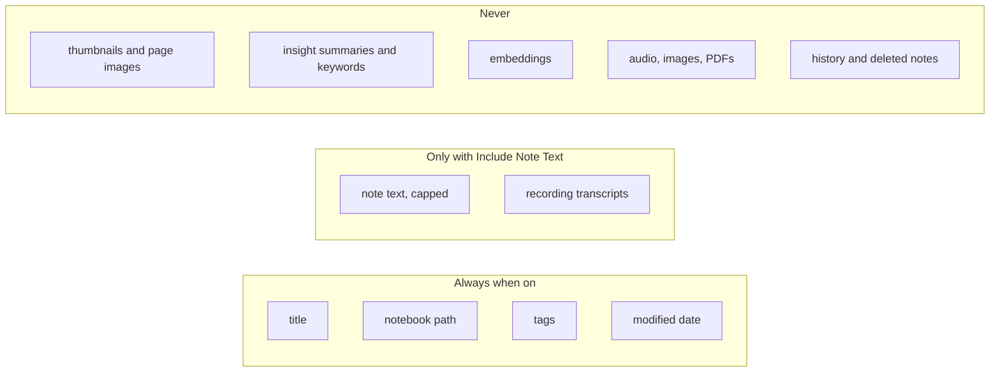

# Design: Spotlight indexing (Sempere 1.3)

Status: design, 2026-11-18; reviewed 2026-11-18 (decisions at the end). Paths are relative to the repository root. No code changed.

## 1. Goal and non-goals

**Goal.** An opt-in switch that adds the user's notes to Core Spotlight on iPhone, iPad and Mac, so Spotlight, Siri
suggestions and the Mac's search find a note by title (and, if chosen, by its text) and open it in Sempere.

**The cost, stated first.** Spotlight's index is the operating system's, not Sempere's. Whatever is donated sits
**outside the vault's encryption**: readable by the OS, by system search UI, and on a Mac by anyone who can read the
user's account files. That contradicts what Sempere otherwise promises (`docs/security.md`), so the
feature is off by default, per device and per vault, and its opt-in says so in plain words (§3.6).

**Non-goals.**
- Indexing by default, or by a global setting that follows the vault to other devices (D1).
- Thumbnails, handwriting images, summaries, embeddings or other derived data (D4).
- Indexing from the CLI or a Linux machine (D9).
- `NSUserActivity` donations for Handoff or Siri prediction of note opens (D5).
- Searching *inside* Sempere through Spotlight (Sempere has its own search: `NoteSearch`).

## 2. What exists today

- Note text for search: `PageText.texts(of:)` (recognized handwriting, text boxes, PDF text, LaTeX, transcripts since 1.2),
  titles, tags, notebooks and dates in `NoteSummary` (`Sources/Sempere/NoteSearch.swift`).
- 1.2 explicitly kept Spotlight out and enforces it: `NoCloudTests` fails on `CoreSpotlight`, `CSSearchableIndex` or
  `AppIntents` in `SempereInsights` and `SempereInsightsApple` (1.2 §8). That stays; Spotlight code lives in the app target only.
- `sempere:` links: today only `sempere://quick-voice/...` (`Apps/Sempere/SempereInfo.plist`, `RootView.swift:128`, `VoiceNoteLink`).
- Device-only state (not synced) is listed in `docs/settings-sync.md` §5.3; `UserDefaults` per vault id is where the sync switch lives.
- Vault lifecycle in the app: `AppModelCore` lock, close, `keyEpoch` bump on key changes, device removal notices
  (`Sources/SempereAppCore/AppModel/`), note deletion as a restorable `deleteNote` flag (format.md §5.2).

## 3. Design

### 3.1 The switch (D1, D2)

Settings ▸ **Spotlight** (per vault, shown for the open vault):

| Control | Default | Stored | Meaning |
| --- | --- | --- | --- |
| Show This Vault's Notes in Spotlight | off | this device, `UserDefaults` key per vault id: `spotlight.<vaultId>` | titles, notebooks, tags and dates are donated |
| Include Note Text | off, shown only when the switch is on | same record | recognized handwriting, typed text, PDF text and transcripts are donated too |

There is no "remove when the vault locks" control (D2, revised in review). The app has no auto-lock: a vault is `locked` (`AppModelCore.phase`)
only between opening and unlocking, and with this device's keys it unlocks by itself as it opens. On iPhone and iPad the system ends a suspended
app without running any code, so a removal "at lock" or "at quit" could not be kept and would be a promise the app breaks. The honest rule is
simpler: while the switch is on, the items are in Spotlight; every removal in §3.4 is driven by an event the app does see, and the 30-day expiry
is the backstop.

It is **not** a shared setting. `settings.age` syncs by design to every device that follows it (settings-sync.md §1); an OS index
is per device, and syncing the switch would put plaintext into Spotlight on a device the user never chose. So it joins §5.3's
device-state table ("Spotlight indexing: this device's OS index") and has no row in the key tables, no schema change, no `$meta`.

Eligible vaults: a vault this device holds device keys for, with a list that checks (`listStatus` trusted), not opened with the recovery key,
and not the demo vault. A read-only vault (newer format, removed device) is eligible while it unlocks with this device's keys, because
indexing only reads (D8); the other read-only causes (recovery key, untrusted list) are not.

### 3.2 What is donated (D4)



| Attribute (`CSSearchableItemAttributeSet`) | Source | When |
| --- | --- | --- |
| `title` | the note title (a blank title shows "Untitled note") | always |
| `contentDescription` | `<notebook path> · <modified date>`; with text: the first 140 characters of text instead of the date | always |
| `keywords` | the note's tags | always |
| `contentModificationDate` | modified | always |
| `textContent` | `PageText.texts(of:)` joined, first 20,000 characters (not shown by Spotlight, only matched) | Include Note Text |
| `thumbnailData` | none | never |

- **Transcripts** are inside `PageText.texts` only if the user's `search.transcripts` allows them in search; we follow the same flag so a transcript is
  indexed only when it is searchable in the app too.
- **Summaries and keywords from Insights** are derived by a model and may be wrong; they would also make an insights-only fact (the model's reading)
  visible to the OS. Not indexed. Revisit with a decision from the owner, not by default.
- **Thumbnails** would show handwriting in the Spotlight result list, which is the most revealing and least controllable way to leak a note. No.
- Deleted notes (flag set) are not indexed; restoring one indexes it again. Notes of a partial copy that are not downloaded yet (`pendingNoteIDs`)
  are not indexed until they are.
- Identity: `uniqueIdentifier = <vaultId>/<noteId>` (lowercase), `domainIdentifier = io.github.anthonytw.sempere.<vaultId>`; the domain
  makes "remove everything of this vault" one call. The vault id is not secret (it is in `vault.json`).
- Flags: `isEligibleForHandoff`, `isEligibleForPublicIndexing` and `isEligibleForPrediction` are false;
  `expirationDate` is 30 days ahead and renewed at every unlock, so anything that escapes cleanup (a crash, a force quit, a vault deleted from
  Files) disappears by itself.
- The index is a named one, `CSSearchableIndex(name: "sempere", protectionClass: .complete)` on iPhone and iPad: the index files are unreadable
  while the device is locked. **A Mac has no data protection classes** (CLAUDE.md, the `BlobCache` note), so on a Mac (Catalyst) the index is
  readable whenever the user's account is; the sheet and `docs/security.md` say so instead of claiming the iOS behavior. With `.complete`, index
  writes fail while the device is locked, so the indexer runs only while the app is active; background sync's arrivals are indexed at the next
  foreground pass.

### 3.3 Keeping it right (`SpotlightIndexer`)

Pure planning in the package, platform calls in the app:

- `Sources/Sempere/SpotlightPlan.swift` (Foundation only, Linux-tested): `SpotlightItem` (the record above, no CoreSpotlight type),
  `SpotlightPlanner.items(for notes: [NoteSummary], options:)`, `SpotlightPlanner.diff(old:new:)` for incremental updates (a changed title, tag,
  notebook or text hash; removed or deleted notes), `SpotlightPlan.caps` (20,000 characters, 140-character description, 50,000 notes).
- `Apps/Sempere/SempereApp/Spotlight/SpotlightIndexer.swift`: the only file that imports `CoreSpotlight`, behind a `SpotlightIndexing` protocol
  (`index([SpotlightItem])`, `delete(ids:)`, `deleteDomain(vault:)`, `deleteAll()`), faked in tests.
- Incremental: the model's summary updates (`queueListUpdate`, `merge`) feed `diff`; batches of at most 200 items, debounced 2 s, on a utility task.
  First indexing is a background pass of the unlocked vault, about 1000 notes per few seconds.
- Reindex everything at unlock and at launch when the setting is on (upsert by `uniqueIdentifier` replaces), which also renews `expirationDate`.

### 3.4 Removal (D6): every path that must delete

| Event | Action |
| --- | --- |
| Switch turned off | `deleteDomain(vault)`; if no vault has it on, `deleteAll()` for the named index |
| Include Note Text turned off | reindex the vault without text (upsert replaces attributes) |
| Note deleted (flag), or purged | `delete(ids:)` for that note; restore re-donates |
| Note's title, notebook, tags, text change | upsert |
| Vault closed, app quit or ended | nothing: items stay while the switch is on (§3.1); they expire 30 days after the last unlock that renewed them |
| Key change: new epoch, re-encryption finished, any device removed, handoff, takeover, kit replaced | `deleteDomain(vault)`, then reindex only if this device is still listed, unlocked and the setting is on. A removal or re-encryption is the user saying "I no longer trust old copies"; the OS index is one more old copy |
| This device removed from the vault, or the list stops checking | `deleteDomain(vault)`, setting forced off with a notice |
| Vault removed from the app (Remove from This Device) | `deleteDomain(vault)` and the `UserDefaults` record |
| Switching which vault is open | nothing for the other vaults beyond their own rules above |
| App deleted | the OS drops the index; the 30-day expiry is the backstop for anything it keeps |

Everything runs through `SpotlightIndexing.deleteDomain`, awaited before the key change or removal completes where the platform allows (a failed delete
is retried at next launch from a small "pending deletions" list of vault ids in `UserDefaults`, which holds no note data).

### 3.5 Opening a note from a result

The system hands the app an `NSUserActivity` of type `CSSearchableItemActionType` with `CSSearchableItemActivityIdentifier = <vaultId>/<noteId>`
(`.onContinueUserActivity(CSSearchableItemActionType)` on the library and note windows, next to `.onOpenURL`). It becomes a `NoteLink`
(`{vaultId, noteId, page?}`, shared with [1.3-ask.md](1.3-ask.md) §3.7) in the model's `pendingNoteLink`:

- vault open and unlocked: open the note (a window on the Mac if the user's pattern is windows; the current window on iPad and iPhone);
- vault known but closed or locked: open the vault (the normal unlock with Face ID or passphrase), then the note; cancelling leaves the app on the library;
- vault unknown on this device, or the note gone: say "That note is not on this device any more", delete the stale item, open the library;
- a text hit carries no page (Spotlight gives no match location): the note opens where it starts.

### 3.6 Opt-in text and privacy

The switch's confirmation sheet (shown each time it is turned on, with Cancel as the default button):

> **Show notes in Spotlight?**
> Spotlight is part of iOS and macOS, not part of Sempere. If you turn this on, your note titles, notebook names and tags are copied into Spotlight's
> index on this device, **where they are not protected by your vault's encryption**. Anyone who can use this device while it is unlocked [on a
> Mac: anyone or any app that can read your account's files], and system features such as Siri and Apple Intelligence, can read them. They stay
> there while this is on, even when Sempere is closed. Sempere removes them when you turn this off, delete the note, change your vault's keys or
> remove this device. Nothing is sent to us or anyone else.
> [Turn On] [Cancel]

`Include Note Text` has its own, stronger sheet (it is the part that makes whole notes plaintext outside the vault). Privacy policy
(`docs/appstore/privacy-policy.md` and `docs/privacy/index.html`, same date), under "On-device features": a Spotlight paragraph saying it is optional,
off by default, per device, that what it copies lives in Apple's index and not in the vault, and how to remove it. `docs/security.md` "What the encryption
does not protect": a new bullet with the same facts, naming Spotlight. 1.2's claim "no Spotlight donation" (1.2 §8) is amended to "none unless the user opts in
per vault (1.3)". Backups: neither the sheet nor the policy makes any claim about whether the OS backs the index up; they say "on this device" only
(decision 5). `docs/mac.md`: on a Mac the index is not protected by data protection, and Spotlight can surface items in system search UI.

## 4. Multiple vaults, read-only vaults

- Each vault has its own switch and domain. Results show the vault name in `contentDescription` only when the device has more than one vault
  with the switch on (the name is itself disclosure, so single-vault users do not get it).
- A vault with the switch on stays in Spotlight whether it is open or not; only the open, unlocked vault is updated (and renewed).
- Read-only: see §3.1; indexing never writes to the vault, only to the OS index, and does not need `requireWritable`.

## 5. CLI first, with its exception

The CLI cannot donate to Spotlight in a way that opens the app: items belong to the process's bundle identifier, and a command-line binary has none
that the system can launch. This is the one place the "CLI first" rule is met differently:

```
sempere spotlight plan [--vault V] [--text] [--json]    what would be donated: one record per note (id, title, description, keywords, text length)
                                                        and the caps; never writes anywhere
```

It runs the same `SpotlightPlanner` the app does, so an owner can audit exactly what turning the switch on exposes before enabling it (and a test pins
it). Linux works. `docs/cli.md` documents it together with the statement that indexing itself is app-only.

## 6. Limits

50,000 notes per vault (beyond: the oldest by modified date are left out, with a notice); 20,000 text characters and 140-character descriptions per item; batches of 200;
`expirationDate` 30 days, renewed at each unlock; one reindex pass at a time per vault.

## 7. Tests

**Linux (`SempereTests`):** `SpotlightPlanner` (title only, with text, caps, deleted notes excluded, transcripts follow `search.transcripts`, blank title,
no thumbnails ever), `diff` (title, tag, notebook, text change; delete; restore), vault id in identifiers, `plan` CLI output; the scan test still
bans `CoreSpotlight` in the Insights targets and is extended to allow it only under `Apps/Sempere/SempereApp/Spotlight/`.
**App (`SempereAppTests`, `FakeSpotlightIndex`):** off by default; turn on indexes after the sheet, cancel indexes nothing; turn off deletes the domain; delete note
deletes it; closing the vault deletes nothing; each key-change event deletes then reindexes only if listed; device removed forces off; two vaults stay in
separate domains and turning one off leaves the other; read-only vault with device keys indexes, recovery-key vault does not; the pending-deletions list retries
after a failed delete; `NSUserActivity` routes: open vault, locked vault unlocks first, unknown vault clears the stale item; privacy sheets are shown.
**Mac (agent-run):** one smoke test (Catalyst; check whether `init(name:protectionClass:)` is available there and fall back to `init(name:)` if not) with the real `CSSearchableIndex` in the test host, donate one fixture note, query it with `CSSearchQuery`, delete the domain, query again for zero.

## 8. Implementation plan (1 PR, about 1100 lines + tests)

`SpotlightPlan`, `sempere spotlight plan`, docs (cli, security, privacy policy both copies, mac, settings-sync §5.3 row), then the app part: the indexer, the settings
rows and sheets (localized with Spanish values, `scripts/l10n.py merge`), the lifecycle hooks, the activity route, and the `NoCloudTests` scan update.
`PrivacyInfo.xcprivacy` and the entitlements need no change (CoreSpotlight needs none); `scripts/release-check.sh` is checked for an allow-list that names it.

## Decisions

- **D1 Off by default, per vault, per device, not synced.** The index is plaintext outside the vault; a synced switch would silently extend that to other devices.
- **D2 Two controls:** the switch (metadata only) and Include Note Text (its own warning). (Review removed "Remove When Locks": the app has no auto-lock and
  cannot run code when iOS ends it, §3.1.)
- **D3 Opt-in text names the consequence in plain words,** each time the switch is turned on.
- **D4 Metadata by default; text and transcripts only on the second switch; never thumbnails, summaries, keywords from Insights or embeddings.** Least that is useful.
- **D5 Identity is `<vaultId>/<noteId>`; opening uses `CSSearchableItemActionType` and the shared `NoteLink`.** No Handoff, no prediction.
- **D6 Delete on every trust change** (opt-out, key change, device removal, vault removal), with a 30-day expiry as the backstop and a retry list for failed deletes.
- **D7 Protection class `.complete` on a named index (iPhone, iPad).** The index is unreadable while the device is locked; a Mac has no such protection and the text says so.
- **D8 Read-only vaults can be indexed when this device holds its keys.** Indexing writes nothing to the vault.
- **D9 The CLI plans, the app donates.** The OS call needs the app's bundle identity.

## Decisions (reviewer, 2026-11-18)

1. **Remove at lock by default?** No such control (D2 revised). Reason: the app has no auto-lock and iOS ends suspended apps without notice, so the promise could not be kept.
2. **Include Note Text in 1.3?** Yes, behind its own off-by-default switch and sheet. Reason: titles alone find few handwritten notes; the second switch keeps the default surface minimal.
3. **Vault name in results?** Only when two or more vaults on the device have the switch on. Reason: a vault name is itself disclosure, and with one vault it adds nothing.
4. **Per-notebook exclusion?** Not in 1.3. Reason: a per-device list is one more thing to explain; Include Note Text off covers a private notebook's content.
5. **Backed up or synced by iOS/macOS?** Make no claim: the sheet, policy and security.md say "on this device" only. Reason: unverified; the implementation PR may check on a
   device and add a claim only with that evidence.
6. **Apple Intelligence reading indexed items?** Assume yes: the sheet names "Siri and Apple Intelligence". Reason: we cannot bound what system features read, so say the worst case.
7. **Index while the app is not running?** No: only while the app is active and the vault unlocked; Spotlight may lag. Reason: `.complete` forbids writes while locked, and a
   background task would need the vault key in the background.

## Later

Per-notebook exclusion; thumbnails (never without a design of their own); `NSUserActivity` prediction and Handoff; App Intents / indexed entities; background indexing.
