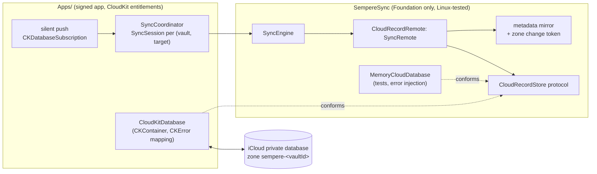
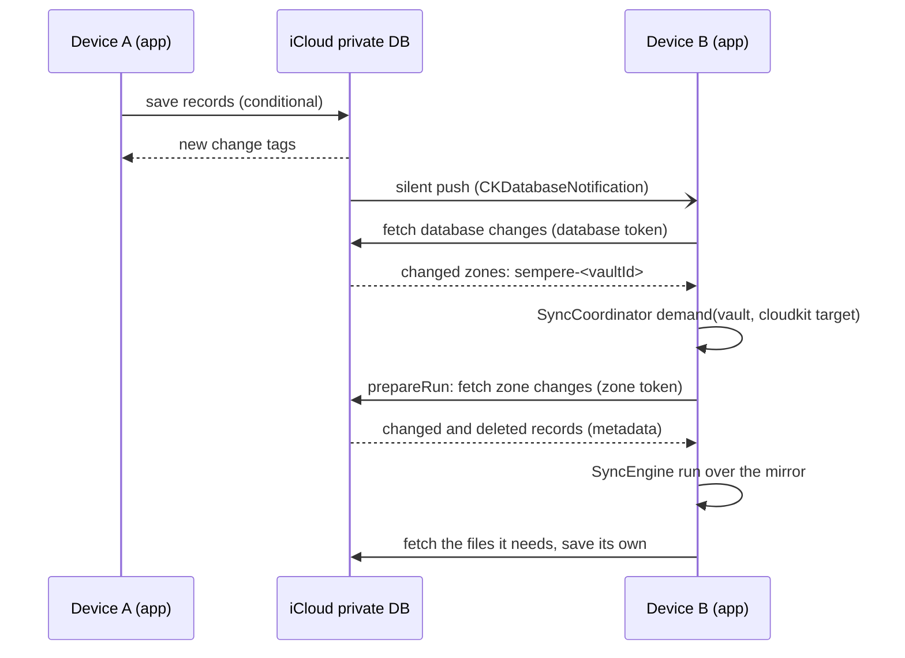

# CloudKit sync target (1.4 design)

Status: design, 2026-11-20; phase C0 (the spike) done 2026-11-24, findings in §13 and folded in below where they
change a number or an assumption (marked *C0*). Target release **1.4**, headline feature. Code starts after TestFlight build 113.

Owner decisions (2026-11-20): CloudKit is a first-class sync **target** for Apple devices, next to folder and
WebDAV targets, not a replacement for them. Apple-only is fine: the Linux CLI keeps WebDAV (and folders) for
backup and sync, and there is no Android. 1.4 ships it as a headline feature.

Reading: `docs/io.md` "Sync engine and transports", "Folder targets in providers", "Sync targets in the app";
`docs/design/device-first-sync.md` §3 (one engine, many transports) and §3.4 (extension points);
`docs/format.md` §1 (layout, mutable files) and §15.15 (device changes over sync).

## Why

TestFlight 1.3 showed what iCloud Drive costs as a folder target:

- **Packages.** iCloud Drive kept vault folders that earlier builds exported as packages as one item. A whole-vault
  `NSFileVersion` conflict copy hid files, and the fix was to name new targets `<vault>.sempere-vault` and merge
  package conflict versions back (v1.3, build 111/112).
- **Upload status is guessed.** "Synced" is inferred from `ubiquitousItemIsUploaded` and friends
  (`ProviderUploads`); Cocoa 4355 (`ubiquitousFileUbiquityServerNotAvailable`) produced a false "storage may be
  full".
- **Slow, opportunistic propagation** that the app cannot ask for or observe.
- **Evicted files and stand-ins** ("arriving", `Arrivals.swift`): a listed file may not be readable for minutes.
- **No compare-and-swap.** The mutable files (`vault.json`, `settings.age`, summaries, insights) are replaced
  under a coordinated write, and a race shows up later as conflict versions to merge.

CloudKit gives each of these a direct answer: records instead of files (no packages), a server answer per write
(no guessed upload status), push notifications plus a change feed (fast, observable propagation), no eviction,
and record change tags that make conditional writes real.

## 1. Goals and non-goals

**Goals**

1. A `SyncRemote` over the user's CloudKit **private database** that keeps every promise of the contract in
   `SyncRemote.swift`: strong version tags, create-only and conditional replace and delete, bounded reads,
   deep listings, transient errors marked as such. The engine's rules (`SyncEngine`, `EpochSync`, quarantine,
   acceptance, `replaceUnaccepted`) run unchanged.
2. A target kind `cloudkit` in the store's registry, added from Sync Targets ("iCloud (CloudKit)"), any number of
   vaults, each in its own zone; next to folder and WebDAV targets, which stay.
3. Push-triggered runs: another device's change reaches an open vault in seconds, and a sleeping iPhone soon
   after, when iOS delivers the push.
4. Status that tells the truth: "Synced" means the server accepted the write; only definite problems show
   (the 1.3 quiet-status rule).
5. No format change. The records carry the vault's files byte for byte, so a vault moves between CloudKit,
   folders and WebDAV with no conversion, and a device without 1.4 reads every vault it read before.

**Non-goals**

- Linux, Android, the web viewer. CloudKit Web Services could reach a private database after a browser sign-in,
  but it would be new network code and a login flow for a case WebDAV already covers. A Linux CLI lists a
  `cloudkit` target and never runs it (the unknown-kind rule, §8).

The **Mac CLI is in scope** (owner 2026-11-21, CLI-first rule): see §6.5.
- Sharing a vault between Apple Accounts (`CKShare`). Two people use a folder they share or a WebDAV server.
- Replacing folder or WebDAV targets, or migrating anyone automatically.
- The public database, CloudKit queries, server-side indexes. Only the change feed and fetches by id are used.
- Long-lived CloudKit operations that outlive the app (`CKOperation.Configuration.isLongLived`): runs stay the
  engine's blocking, bounded runs. A possible later step for very large blobs on iOS.

## 2. Record model

### 2.1 Where

| | Value |
| --- | --- |
| Container | `iCloud.io.github.anthonytw.sempere` (one, shared by the iOS and Mac Catalyst app: one bundle id) |
| Database | private (`CKContainer.privateCloudDatabase`): the user's own iCloud storage, invisible to the developer |
| Zone | one custom zone per vault: `sempere-<vaultId>` (the lowercase UUID from `vault.json`). Custom zones give the change feed, atomic batches and `userDeletedZone` |
| Record types | `VaultFile` (one per vault file) and `VaultFilePart` (pieces of a large file, §2.5) |

The vault id is already plaintext in `vault.json`, so the zone name adds nothing new.

### 2.2 One record per vault file

| Field | Type | Where | Notes |
| --- | --- | --- | --- |
| record name | — | system | `f-` + hex SHA-256 of the vault path (`notes/<id>/<rev>.delta.age`), 66 ASCII characters. Fixed length and character set, whatever the path; see §6.2 |
| `path` | String | `encryptedValues` | the vault path, `/`-separated, validated as the engine's paths are; a record whose `path` does not hash to its name is ignored (untrusted input) |
| `sha256` | Bytes (32) | `encryptedValues` | of the file's bytes: checked after every read, and lets a create that met an existing record decide "same bytes" without a download |
| `size` | Int64 | plain | the file's size (the asset's size shows it anyway) |
| `bytes` | Bytes | `encryptedValues` | the file inline, when it is at most **128 KiB** (`vault.json`, `settings.age`, epoch records, joins, most deltas) |
| `asset` | CKAsset | asset | the file, when it is larger and at most the part threshold |
| `parts` | Int64 | plain | the number of `VaultFilePart` records, when the file is split (§2.5) |
| `tomb` | Int64 | plain | set when the file is deleted conditionally (§2.4); a tombstoned record lists as absent |
| `v` | Int64 | plain | record layout version, `1` |

The record's `recordChangeTag` is the file's version token (`RemoteEntry.etag`), its `modificationDate` the
`lastModified` string. Write-once and mutable files use the same record type; what differs is only the
`PutCondition` the engine passes:

| Engine call | CloudKit |
| --- | --- |
| `write(.create)` | save a new `CKRecord` with that id, `savePolicy: .ifServerRecordUnchanged`. An existing record fails with `serverRecordChanged`, which is `false` (the precondition failed), unless it is a tombstone: then the write replaces the tombstone under its tag (a file deleted and written again). *C0:* the error carries `serverRecord` (tag and decrypted `encryptedValues`), so "same bytes" is decided from the error with no fetch |
| `write(.replace(etag:))` | fetch the record (its system fields carry the tag), compare `recordChangeTag` with `etag` (different: `false`), set the fields, save with `.ifServerRecordUnchanged`; `serverRecordChanged` is `false` |
| `write(.unconditional)` | never used: the transport declares strong stamps, so the engine always has a tag. Mapped to a fetch and a save with `.changedKeys` for completeness |
| `read` / `download` | fetch by id with `desiredKeys` `bytes`/`asset`/`sha256`; check size, bound and SHA-256; return the tag |
| `stat`, `list`, `listTree` | answered from the target's metadata mirror (§3.1), refreshed at the start of each run |
| `delete(ifETag:)` | conditional: a tombstone save under the tag, then the hard delete (§2.4). Without a tag: the hard delete |
| `moveNoOverwrite` | create at the destination with the source's bytes, then tombstone the source. Not called in practice: the transport declares `atomicCreate`, so blobs need no temporary name |
| `makeCollection`, `createBase` | collections are implicit (a folder exists while a file below it does): `makeCollection` answers `.created` without a request; `createBase` creates the zone |
| `checkAbsentBase(syncedBefore:)` | the zone is missing: allowed on the first run; refused when this target synced before (the zone was deleted, §4) |
| `capabilities` | `strongStamps`, `deepListing`, `folderStampsTrackChildren` (a collection's tag is a digest of the tags below it, from the mirror), `atomicCreate` (a record appears whole); no `rangeReads`; `maxObjectBytes` nil (large files are split) |
| `requestDownload`, `conflictVersions`, `resolveConflicts` | the defaults: CloudKit never evicts a record and never forks one |
| `changes()` | hints from pushes and the delta fetch (§3.2) |

This is exactly what `replaceUnaccepted`, the `epochs/` read-back, `keys/` supersession, the published summaries'
three-round compare-and-swap and the re-encryption claims need: a strong tag, and writes and deletes that only
apply over the version read (`SyncEngine.isStrong`, `EpochSync.swift`, `ReencryptCoordinator.swift`).

### 2.3 Write-once files and the few mutable ones

Write-once (`notes/`, `att/`, `epochs/`, `notebooks/`, `inbox/`, `joins/`, `keys/`): created with `.create`
and never replaced, except catch-up (format.md §15.14) and re-encryption (§15.16), which pass `.replace(etag:)`
like any conditional write. The mutable files of format.md §1.3 (`vault.json`, `settings.age`,
`sempere-summaries.sealed`, `summaries/<device>.sealed`, `insights/*`) are replaced under their tag; a lost race
is `false`, and the engine reads again and judges again as it does for WebDAV (`MutableLockScope.swift`, at most
three rounds). Two devices writing one mutable file at once can no longer both "win": there are no conflict
versions to merge afterwards. The web viewer's `sempere-index.json` is not published (`publishForWebViewer`
stays off: the web viewer reads WebDAV).

### 2.4 Deletes and tombstones

The engine judges deletions from listings against its own record (`SyncState.files`: held on both sides at the
last sync, absent now), so it needs no tombstones in the vault; an absent record is enough. CloudKit has no
conditional delete (*C0 confirmed*: `modifyRecords(deleting:)` takes record ids only, no tag and no precondition; the
save policy applies to saves), and the contract's `delete(_:ifETag:)` must delete only that version. So a
conditional delete is two steps:

1. Save the record with `tomb = 1` and its payload fields cleared, `.ifServerRecordUnchanged` on the tag.
   `serverRecordChanged`: `false` (the file changed and is still there). From here on the record lists as
   absent, on every device, through the change feed.
2. Delete the record (best effort, in the same run). If it fails, the tombstone stays and a later run's sweep
   deletes tombstones it finds, after fetching each again and finding the same tag.

A create over a tombstone replaces the tombstone under its tag (§2.2), so a file written again after a delete is
never refused. (*C0:* a create after a hard delete of the same record name also succeeds, under a new tag, so the
sweep's hard delete never blocks a rewrite. A hard delete costs about 4 times a save: 400 deletes took 15 s, 400 small
saves 3.5 s; the tombstone save is the cheap half of a conditional delete, 0.4 s alone.) The window that remains is a create landing between the sweep's fetch and its delete; the
write-once file it would lose is still on its writer, whose next run finds it missing and uploads it again (the
union rules, `io.md` "WebDAV sync", the table of held sets).

### 2.5 Large files

CloudKit limits a record to just under 1 MiB outside its assets (*C0*: 1000 KiB saved, 1024 KiB refused with
`limitExceeded` "record too large"). *C0:* an asset has no limit that matters here: single assets of 1, 4, 16, 32,
64, 128, 256, 300, 512 MiB and 1, 2 and 4 GiB all uploaded and downloaded with matching SHA-256 (about 30 MB/s up on
this line, 15 s for 512 MiB). Blobs may reach 1 GiB of content (format.md §8.4), so **parts are an optimization for
resuming and for memory, not a requirement**; the sizes below stay as the design but are constants a test overrides,
and C1 may land them after the plain asset path. Files over
**64 MiB** are split into 16 MiB `VaultFilePart` records (`p-<file record hash>-<n>`, each with `asset` and
`sha256`), uploaded first, and the `VaultFile` record (with `parts` and the whole file's `sha256`) is created
last, so the file appears whole or not at all (`atomicCreate` holds). A cut upload leaves parts behind: the next
attempt reuses parts whose `sha256` matches, so a large blob resumes part by part across runs, and the sweep
deletes parts no `VaultFile` names after 7 days. The engine's large-blob rules (`LargeUploads.swift`: last in the
run, deferred after a cut, `sentNothing`) apply as for WebDAV. *C0:* a create that loses the race **still uploads its
asset first** (a 16 MiB asset took 2.3 s to fail with "record to insert already exists"), so the transport checks the
mirror before uploading and treats a name already there with the same `sha256` as done. A metadata fetch with
`desiredKeys` that leave the asset out is 110 to 160 ms whatever the asset's size.

### 2.6 Quotas and limits

| Limit | Handling |
| --- | --- |
| The user's iCloud storage | `quotaExceeded`: a definite problem (§4); downloads go on |
| Record size (*C0*: under 1 MiB outside assets; 1000 KiB saved, 1024 KiB refused) | inline only up to 128 KiB; the rest is an asset or parts |
| Items per modify request (*C0*: exactly **400**, saves and deletes together; 401 fails the whole request with `limitExceeded` "more than the maximum number of items in a single request (400)") and non-asset bytes per request (*C0*: about **5 MiB**: 50 x 100 KiB passed, 55 x 100 KiB failed; assets do not count: 4 x 16 MiB in one request passed) | **C1 includes the batcher** (changed by C0: one save is about 0.4 s and writes to a zone serialize, §13.4): a batch holds at most 400 items and about 4 MiB of inline data. Over the byte limit the answer is per-record `limitExceeded` "Database commit size exceeds limit" for every record, or a request-level `limitExceeded` "request bytes exceeds limit" when far over: both halve the batch and retry |
| Request rate | `requestRateLimited`, `zoneBusy`, `serviceUnavailable` carry `retryAfterSeconds`: honored (§4) |
| Change feed page | `moreComing` pages until done, bounded by the run's `maxEntries` (*C0*: a page holds at most 200 records or 200 deletions; 1,203 records took 7 pages and 3.6 s; the archived zone token is 279 bytes) |
| Concurrency | `TransferPool` width 4 for asset transfers (*C0*: 4 parallel 16 MiB uploads took 3.9 s, serial about 9.6 s); width does nothing for small saves (1, 4, 8, 16 concurrent saves all gave 2.5 per second into one zone), so small files go in batches. No `requestRateLimited` or `zoneBusy` in about 1,700 operations |

## 3. Change tracking

### 3.1 The metadata mirror and the run model

Each CloudKit target keeps, in its state directory (`<store>/.sync/<vault id>/<target id>/cloudkit/`), the
zone's server change token and a mirror of the zone's metadata: path, record name, change tag, size,
modification date, SHA-256, tombstone and parts flags (about 150 bytes a file; no system-field archives, which
is why conditional writes fetch the record first, §2.2).

A run starts with **`prepareRun()`**, a new optional `SyncRemote` hook (default: nothing; also useful to a
later S3 or Dropbox transport with cursors). For CloudKit it fetches the zone's changes since the saved token
(`CKFetchRecordZoneChangesOperation`, `desiredKeys` limited to the metadata fields, so no inline bytes and no
assets come down), applies them to the mirror, and saves both. Every `list`, `listTree` and `stat` of the run
then answers from the mirror: the engine still gets a **full listing** each run, from local memory, so none of
its listing rules change, and `skipUnchangedNotes` works from the synthesized folder tags (a note whose tags did
not change is skipped). The transport's own writes update the mirror with the tags CloudKit returns, so a run
reads its own writes.

The mirror is a cache, never the truth: a lost or corrupt mirror is dropped and rebuilt by a fetch from a nil
token (a full fetch), and the engine's `SyncState` decides everything else as before. Every record from the feed
is untrusted (format.md §9): its path must validate and hash to its name, sizes and counts are bounded
(`Limits.maxEntries`), and anything else is skipped and counted in the report.

### 3.2 Pushes, hints and the schedule

- **One `CKDatabaseSubscription`** on the private database per device and Apple Account
  (`shouldSendContentAvailable`, no alert), covering every zone. A push makes the app fetch database changes
  (`CKFetchDatabaseChangesOperation`, with a device-level database token) and turns each changed zone into a
  demand on the matching vault's CloudKit session. `changes()` yields `.unknown` for the push and `.paths` from
  the delta, so a scoped run is possible later.
- **iOS**: pushes arrive through `application(_:didReceiveRemoteNotification:fetchCompletionHandler:)`
  (`UIBackgroundModes` gains `remote-notification`), with about 30 s to run: one bounded run, like a
  `BGAppRefreshTask`. Silent pushes are throttled and never guaranteed, so the existing background tasks stay as
  the fallback (P8: `BGAppRefreshTask`, and `BGProcessingTask` when uploads wait, with the network required).
- **Mac Catalyst**: pushes reach a running app; the periodic loop covers the rest. *C0:* registration and both
  subscriptions work on Catalyst and on a simulator clone, but **no push could be demonstrated arriving** from a write by
  another process, a simulator clone or the CLI bundle on this Mac (§13.6); delivery needs a second physical device
  (owner check §10.3 #2). Nothing may depend on a push for correctness: the schedule's periodic runs and the
  run-start `prepareRun()` fetch are the guarantee, a push only shortens the wait.
- **Schedule** (`SyncSchedule`): 5 s after a write (CloudKit runs are cheap: no listing round trips), on push,
  on unlock, activation and Sync Now; periodic 5 minutes while something moved, backing off to 15 minutes while
  idle (pushes do the real work); the network path monitor gates runs as for WebDAV (no path: offline, no runs
  started by the schedule).
- Locked and closed vaults: upload-only runs and locked staging (`LockedStaging`, `PullOnlyRemote`) work over
  this transport unchanged; only the open, unlocked vault's runs are two-way.

## 4. Errors and status

The transport maps `CKError` to `CloudRecordError: TransientRemoteError` (in `SempereSync`, as plain codes, so the
mapping rules are Linux-tested; the app adapter only converts `CKError.Code` to them). `retryAfterSeconds` up to
5 s is waited out inside the request (interruptible through `interrupt`); a longer one ends the run with a
`throttled(until:)` error that the session takes as its next run time, never as a failure.

Status follows the 1.3 quiet-status rule: **the bar shows a problem only when something definitely needs the
user**. Anything that may heal by itself is quiet in the bar and listed in Vault Details.

| CloudKit says | Transport | Status |
| --- | --- | --- |
| `networkUnavailable` | transient, `isUnreachable`, `sentNothing` | offline (not an error), as WebDAV |
| `networkFailure`, `serverResponseLost` | transient, `isUnreachable` (a lost answer: the conditional write's next attempt finds its own record, compares SHA-256, done) | offline only if `LinkBreaker` trips; else quiet |
| `serviceUnavailable`, `requestRateLimited`, `zoneBusy` | transient, honors `retryAfter` | quiet |
| `serverRecordChanged` | not an error: the write's `false` | none |
| `partialFailure` | unpacked: each record's own error, mapped by this table | per item |
| `limitExceeded` | halve the batch, retry | none |
| `changeTokenExpired` | drop the token and mirror, full fetch in the same run | none |
| `assetFileNotFound`, `assetNotAvailable` | transient; retried next run | quiet |
| `quotaExceeded` | transient (not unreachable); uploads stop for the run, downloads go on | **problem**: "iCloud storage is full. Free up space or upgrade iCloud+, then Sync Now." |
| `zoneNotFound` on a target that synced before | `checkAbsentBase` refuses, as for a folder that is gone | **problem**: "This vault's iCloud data is gone. Nothing here was deleted." Actions: Upload Again, Remove |
| `userDeletedZone` | the same, never recreated by itself | **problem**: "This vault's data was deleted in iCloud settings. Nothing here was deleted." Upload Again (a union run into a new zone) or Remove |
| `notAuthenticated`; account status `noAccount` | no runs until the account changes | **problem**: "Sign in to iCloud in Settings to sync this vault." |
| account status `temporarilyUnavailable`, `couldNotDetermine` | wait for `CKAccountChanged` | quiet |
| account status `restricted`, `managedAccountRestricted` | no runs | **problem**: "iCloud is restricted on this device (Screen Time or device management)." |
| `CKAccountChanged` to **another** user record | the target pauses; the vault is never uploaded into another account by itself | **problem**: "This device is signed in to a different Apple Account. Syncing with iCloud is paused; nothing was deleted." Use This Account (a union into that account's zone) or Remove |
| `incompatibleVersion` | no runs | **problem**: "Update Sempere to keep syncing with iCloud." |
| `badContainer`, `missingEntitlement`, `permissionFailure`, `invalidArguments`, `internalError`, `serverRejectedRequest` | not transient; backoff | quiet at first; a **problem** only when no run has succeeded for 24 h while the network was up: "iCloud has not accepted changes since …" (the same 24 h stall rule covers any quiet error that never clears) |

The target records the Apple Account's user record id (hashed) when it is added (`CKContainer.userRecordID`), so
"another account" is a comparison, not a guess. "Synced" means every file this device wrote is in the mirror with
a server tag: there is no upload-status inference, `ProviderUploads` does not apply, and Cocoa 4355 cannot occur.

## 5. Epochs and keys (KH4) over CloudKit

Nothing in the key hierarchy assumes a file system; it assumes the `SyncRemote` contract, which this transport
keeps. Checked against format.md §15.15 and `EpochSync.swift`:

| Rule | Over CloudKit |
| --- | --- |
| `epochs/` first, union, never deleted; a record named by a verified hash is read back when its tag moved, and other bytes there replaced under their tag | strong tags and `.replace(etag:)`; reads return the tag |
| never a `vault.json` beside a record that is not the right one (record first, then `vault.json`) | two separate saves in order; no batch needed |
| `vault.json` of another epoch judged on arrival (taken, record-pending, unverified-pending, unlisted, behind, conflict) | from local files after the download, as now |
| the target's `vault.json` replaced only under the version read (`If-Match`) | `.replace(etag:)` |
| `replaceUnaccepted`: strong version tags only | change tags are strong; never `.unconditional` |
| `joins/`: union; a request one side deleted since both held it is deleted on the other; home's 7-day expiry by its own clock | conditional delete (§2.4); the transport's clock is not involved |
| `keys/`: union; a superseded passphrase copy deleted under the version listed | conditional delete |
| keyless join runs (`firstPullIdentities`, `keylessManifestHeld`: a run without the key never uploads `vault.json`), `HoldGate` (a joiner writes only its request) | engine rules, transport-neutral |
| re-encryption claims and confirms on every target (`ReencryptCoordinator`, `syncedBefore`) | over `SyncRemote`, with the CloudKit target's `SyncState` |
| a conflict copy of `vault.json` | cannot arise from the store (no forks); the engine's conflict rule still applies to versions written by two homes |

The only places that know about files are the folder transport's own (`checkAbsentBase` for stand-ins,
conflict versions, coordination), and each has a CloudKit counterpart above or is a default. Joining over
CloudKit needs the joiner signed in to the same Apple Account, since the zone is private.

## 6. Privacy and security

### 6.1 What is protected

Every file is already end-to-end encrypted by Sempere before it reaches any target, except `vault.json` (device
labels, public keys, wrapped keys, signatures: the one plaintext file the privacy policy names). CloudKit adds its
own layers: inline bytes, paths and hashes go in `encryptedValues`, which Apple encrypts with keys in the user's
iCloud Keychain when Advanced Data Protection is on, and with Apple-held keys otherwise. Sempere's encryption is
the guarantee; Apple's is a bonus.

### 6.2 What still shows, and why record names are hashed

| Visible to Apple | |
| --- | --- |
| zone name | the vault id (random; plaintext in `vault.json` anyway) |
| record names | `f-<SHA-256(path)>`: unkeyed, but a path holds a random 128-bit note id, so a name cannot be guessed back. Hiding the path matters because revision names carry hybrid-clock times (when each edit was made), device ids and sequence numbers |
| sizes, counts, modification times, request times | as on iCloud Drive and WebDAV today (blobs are padded to size classes, format.md §8) |
| `vault.json` | inside `encryptedValues` like any inline file (protected from Apple only with ADP) |

A keyed hash (under a key derived from `K_e`) would hide even the shape of the path, but upload-only runs of a
locked vault and keyless join runs have no `K_e`, and an epoch change would rename every record. Not worth it.

### 6.3 Where the CloudKit code lives

**Decision: the CloudKit calls live in one small Apple-only target, `SempereCloudKit` (one file,
`CloudKitDatabase.swift`), shared by the app and the Mac CLI; everything else is network-free in `SempereSync`.**

- The hard rule gains one named exception: no network code in `Sources/` except `SempereWebDAV` and
  `SempereCloudKit`. `SempereSync` gains the
  `CloudRecordStore` protocol (zone changes, fetch by id, modify with per-record results, zones, account status,
  as plain value types), `CloudRecordRemote: SyncRemote` (paths, mirror, conditions, tombstones, parts, error
  mapping) and `MemoryCloudDatabase`: all Foundation-only and Linux-tested. Their names avoid `CKContainer` and
  `CKDatabase`, which `release-check.sh`'s `NETWORK_PATTERN` matches.
- Because the Mac CLI runs CloudKit too (§6.5), the adapter cannot live only in `Apps/`. It moves to a small
  package target `SempereCloudKit` (Apple platforms only, `#if canImport(CloudKit)`, in `NETWORK_ALLOWED` with
  its reason), linked by the app and by the CLI on macOS. Linux builds skip it. Unsigned `swift test` runs only
  its mapping tests (no container); real-container tests run signed (§10.2). *C0:* the split holds: one source file of CloudKit
  calls compiled unchanged for Mac Catalyst, the iOS simulator and a plain macOS executable, and the entitlements and
  the profile belong to the host bundle, not to the library, so a `SempereCloudKit` target needs only `import CloudKit`.
  (Not yet exercised as a SwiftPM target; C2's first compile does.)
- The adapter is thin (about 300 lines): `CKRecord` and `CKError.Code` to value types and back. Its mapping has
  unit tests in the app test target that build `CKError`s by code (no network, no entitlement: they run in the
  gate's `test-mac`).

### 6.4 Entitlements, release checks, policy

- **Entitlements** (iOS `SempereiOS.entitlements` and Mac `Sempere.entitlements`; none for the widgets or the
  watch): `com.apple.developer.icloud-container-identifiers` = [`iCloud.io.github.anthonytw.sempere`],
  `com.apple.developer.icloud-services` = [`CloudKit`], `aps-environment` (iOS) and
  `com.apple.developer.aps-environment` (Mac Catalyst; *C0:* the development profile lists both keys, a binary signed with
  the `com.apple.developer.` one alone registered with APNs and was accepted by AMFI). The value is
  `development` in Debug and `production` in Release; `com.apple.developer.icloud-container-environment` is left
  to the signing (Xcode sets Production on export; *C0:* a development-signed build carries `Development` and the
  development profile permits `Production` and `Development`). The Mac already has `network.client`.
- **`scripts/release-check.sh`**: the keys above in `ENTITLEMENTS_ALLOWED`; the container id and `CloudKit`
  pinned in `ENTITLEMENT_VALUES`; `SempereCloudKit` in `NETWORK_ALLOWED` with its reason; the
  `WATCH_ENTITLEMENT_FILES` rule already keeps CloudKit off the watch. `UIBackgroundModes` `remote-notification`
  on the iOS app. `PrivacyInfo.xcprivacy`: CloudKit adds no required-reason API by itself; the mirror's file
  dates are covered by the existing file-timestamp reason.
- **Privacy policy** (both copies, same date): a new bullet under "Where your notes live" and in "Network
  connections": with an iCloud (CloudKit) target, the app connects to Apple's iCloud servers as the signed-in
  user and stores the vault's encrypted files in that account's private iCloud database, counted against its
  iCloud storage; Apple's push service wakes the app when another device changes the vault; the developer cannot
  read that database. `DESIGN.md` "Network" says the same.
- **App Store privacy answers**: data in the user's private CloudKit database that the developer cannot access is
  not collected, so "Data Not Collected" should stay; the owner confirms the answers at submission (§11).
- **Signing**: the App ID gains iCloud (CloudKit, with the container) and Push Notifications, and the App Store
  profiles are made again (§11). No `DEVELOPMENT_TEAM` is committed: development signing for CloudKit tests reads
  the team from `~/.config/sempere/release.env`, as `testflight.sh` does.

### 6.5 The Mac CLI

CloudKit is a restricted entitlement: macOS honors it only when a provisioning profile covers the program, and a
profile lives inside a bundle (`Contents/embedded.provisionprofile`). A bare executable in a Homebrew `bin/` has
no place for one. So the released Mac CLI ships as a minimal app-shaped bundle, `sempere.app/Contents/MacOS/
sempere` (no UI, `LSUIElement`), with:

- its own App ID `io.github.anthonytw.sempere.cli`, using the same container `iCloud.io.github.anthonytw.sempere`;
- a Developer ID provisioning profile with iCloud (CloudKit) for that App ID; no push (the CLI runs, syncs, exits);
- Developer ID signing and notarization in the release script, as today, around the bundle;
- the Homebrew formula installing the bundle and linking `bin/sempere` to the executable inside it.

It uses the iCloud account signed in for the macOS user who runs it. Commands: `sempere store target add
--cloudkit`, and `sync`, `status`, `target list` treat the kind like the others. A CLI built from source (`swift
build`, no profile) has everything except CloudKit and says so plainly when a `cloudkit` target is used.
`release-check.sh` gains the CLI bundle's entitlements in its tables. *C0 proved the bundle approach* (§13.7): a plain
macOS executable inside `sempere.app/Contents/MacOS/` with `embedded.provisionprofile` and the iCloud entitlements
reached CloudKit, also when started through a symlink in a `bin/` directory (Homebrew's link); without the profile,
or with a profile that does not carry the container, AMFI kills it at launch (SIGKILL, no message). *After the owner assigned the container to the CLI App ID (2026-11-24),*
the CLI App ID's own development profile works the same way, signed for `io.github.anthonytw.sempere.cli`, directly and
through a symlink. The Developer ID profile lists the container too (environment `Production`), but **signing with it
was not possible here**: the Developer ID Application private key is not on this seat (§13.7).

## 7. Recovery and export

CloudKit holds records, not files, so **the stock-CLI `age` recovery path (format.md §15.13) cannot read it**.
The recovery path needs a plain copy of the vault, and there are two:

1. **Backups** (`.sempere-backup`, Settings ▸ Backups, `sempere backup`): a frozen, verified vault folder.
2. **A folder target** (a drive, a share, iCloud Drive): a live plain copy.

What the app does about it:

- Sync Targets says, under a vault whose only off-device copy is CloudKit: "iCloud keeps your vault on Apple's
  servers. To open it without Sempere (with the recovery kit and `age`), keep a backup or a folder copy too."
  with Set Up Backup. Once, not a banner.
- Losing every device is still covered without a plain copy: a new Apple device signed in to the same Apple
  Account adds the vault from iCloud and takes over with the recovery kit (KH5), then can make a backup. Only
  the CLI-without-Sempere path needs the plain copy.
- `docs/security.md` and the recovery kit's printed text gain one line: "If your vault syncs only through
  iCloud (CloudKit), keep a backup: the recovery steps read files."

## 8. Migration and mixed versions

Adding a CloudKit target to an existing vault is a union like any new target: the first run uploads everything
(large blobs last) and deletes nothing.

1. Update every device to 1.4.
2. On one device: Sync Targets ▸ Add ▸ iCloud (CloudKit). The zone is created and the first runs upload.
3. On the vault's other 1.4 devices signed in to the same Apple Account, the app finds the zone
   (`fetchAllRecordZones`, `sempere-<vaultId>` for a vault in its store) and suggests once: "This vault is in
   iCloud (CloudKit). Sync with it here too?" One tap adds the target. Suggested, not automatic: adding a target
   is the user's choice everywhere else too.
4. When every device's CloudKit target says Synced and Vault Details shows every device's revisions held there,
   remove the folder target on each device (Remove never touches the folder). Deleting the iCloud Drive folder
   afterwards is the user's own step in Files; the app never deletes it.

**A new device** with no copy: Open Vault ▸ "From iCloud (CloudKit)" lists the account's `sempere-*` zones by the
name in their `vault.json`, copies one in (a partial copy first, as for WebDAV) and joins (Join This Device, the
words or the code).

**Mixed versions.** The format does not change, so no `features` marker. A device on 1.3 or earlier has no
CloudKit; it keeps meeting the others through the folder or WebDAV target. A 1.4 device with both targets bridges
them (the engine already bridges targets, `io.md` "Sync targets in the app"), but only while it runs, so keep the
folder target until every device runs 1.4. A registry written by 1.4 lists `cloudkit` targets; a CLI that does
not know the kind lists them and never runs them (the existing unknown-kind rule).

## 9. App UI

- **Sync Targets ▸ Add**: "iCloud (CloudKit)" first on Apple devices, with the line "Syncs this vault through
  your Apple Account. Apple devices only." Then "Folder…" (whose picker covers iCloud Drive; its subtitle says
  "a folder in iCloud Drive, on a drive or a share"), then "WebDAV Server…". Adding a CloudKit target with no
  iCloud account shows "Sign in to iCloud in Settings first." with a link to Settings.
- **New Vault ▸ Sync With**: none, iCloud (CloudKit), WebDAV, or a folder; nothing preselected (owner decision 1,
  §12). Choosing a folder inside iCloud Drive shows one line suggesting the iCloud (CloudKit) option instead, with
  a one-tap switch (decision 2); Add Target does the same.
- **Status lines**: "Synced with iCloud · 2 min ago"; "Syncing with iCloud: ↑ 3 ↓ 12"; "n changes not synced
  yet"; offline as for WebDAV; the problems of §4. The bar never says "waiting for iCloud to upload" for this
  kind: a write the server accepted is synced.
- **Vault Details** (per target): last sync, files in step, zone size from the mirror, the quiet errors of §4 with
  their last time, and Remove. "Delete from iCloud…" (deletes the zone, after a confirmation that names the
  vault and says other devices stop syncing through it) is offered only when the vault has another target or a
  backup.
- **Settings ▸ Sync & Devices** lists the CloudKit target with the others. The iPhone's Settings ▸ Apple Account
  ▸ iCloud ▸ Manage Storage shows Sempere's usage; deleting it there is `userDeletedZone` (§4).
- Every new string goes into the catalog with Spanish (`LocalizationCatalogTests`).

## 10. Testing plan

### 10.1 Linux-testable: a fake CloudKit database

`MemoryCloudDatabase` (SempereSync) conforms to `CloudRecordStore` and behaves like the private database:
zones, change tags per save, zone and database change tokens, tombstones in the feed, `moreComing` pages, saves
with both policies, per-record results, assets as files. Error injection from a seed, per operation and record
(as `MemoryFaults` does): every case in §4, including `partialFailure` mixes, `retryAfter`, `limitExceeded`,
`quotaExceeded` on writes only, `zoneNotFound`, `userDeletedZone`, `changeTokenExpired`, account switches and
sign-outs, `serverResponseLost` (applied, answer lost), assets not available, and a feed that lags behind saves.

- `SyncRemoteConformanceTests` gains a CloudKit fixture (create races, conditional replace and delete, tombstone
  then create, stamps, listings, parts, hostile records: a path that does not match its name, oversized fields).
- The engine's scenarios over every transport, `EpochInterleavingTests` (J1 to J10) and the N-device sync
  stress run over the fake.
- `CloudKitTwoDeviceSyncTests` (SempereAppCoreTests, like `TwoDeviceSyncTests`): two `AppModel`s on one
  `MemoryCloudDatabase` running the real engine: a note and a rename reaching the other list and open editor,
  offline edits on both, settings, a 6 MB attachment and a 100 MB one (parts), runs cut midway, a zone deleted by
  the user, an account switch, a closed vault that only uploads, a push hint starting a run.
- Status mapping tests: each §4 row gives its `SyncStatus` (quiet or the exact problem), and the 24 h stall rule.
- Fuzz: the mirror decoder and feed records (`*FuzzTests`).

### 10.2 Real CloudKit, automated on the Mac

- **Environment**: the container's development environment only. A dedicated test Apple ID is signed in on the
  claude macOS account and in a base iOS simulator; agents run on clones of that simulator (`SEMPERE_SIM_ID`),
  *C0:* a clone keeps the sign-in (account status `available`, same user record).
- **Signing**: an Apple Development certificate and development profiles with the iCloud and push entitlements
  for the iOS app (simulator) and Mac Catalyst (this Mac registered as a device), team read from `release.env`.
  The normal unsigned builds and the PR gate stay as they are.
- **Suites**: `scripts/app.sh test-cloudkit` (through `xc-lock`): the adapter against the real container, each
  test in a fresh zone `test-<uuid>` that it deletes; then the two-device test: the Mac Catalyst app and a
  simulator, signed in to the same account, a note written on one (debug launch variables) appears on the other,
  and, in place of an automated push wake, the app's periodic fetch picks the note up (*C0:* a simulator registers for pushes
but none arrived, §13.6; the push wake is an owner check, §10.3). It is in
  `local-ci.sh --testflight` when the test account is present, and says plainly that it did not run otherwise.
- **`xcrun cktool`**: export and check the development schema in CI against a checked-in copy
  (`Apps/Sempere/CloudKit/schema.ckdb`), reset the development environment, and inspect records when a test
  fails.

### 10.3 Owner checks (first TestFlight with CloudKit)

1. Production environment: add an iCloud (CloudKit) target to a scratch vault on two real devices and see a
   note cross both ways.
2. Push to a sleeping iPhone: lock it, write a note on the Mac, unlock after a few minutes and see it there
   without waiting for a run (iOS may still delay a push; a delay is not a failure).
3. Migrate one real vault (the one that lived in an iCloud Drive folder) by §8, then remove its folder target.

## 11. One-time setup the owner must do

Checked 2026-11-20: the existing App Store Connect API key can **read** bundle ids, their capabilities and the
profiles. **C0 (2026-11-24) tried the writes: the key can create capabilities, devices, bundle ids and profiles**
(`tools/cloudkit-spike/asc/setup.py`). Outcome per step below (*C0 result*). Steps 1, 2, 3 and 7 were done by the
owner before C0 and verified.

1. **Create a test Apple ID** for automated CloudKit tests (needs a phone number and two-factor sign-in).
   *Owner only.*
2. **Sign that Apple ID in** on the claude macOS account (System Settings, iCloud on) and in one iOS simulator
   that agents clone. *Owner only* (two-factor codes); agents clone the simulator afterwards.
3. **Create the iCloud container** `iCloud.io.github.anthonytw.sempere` (developer.apple.com ▸ Identifiers ▸
   iCloud Containers) and assign it to the App ID `io.github.anthonytw.sempere` under iCloud ▸ CloudKit. A
   container can never be deleted or renamed. *Owner*: the public App Store Connect API has no endpoint for
   iCloud containers or for assigning one, as far as we know.
4. **Enable iCloud (CloudKit) and Push Notifications** on that App ID. *Agent, probably*: the API's
   `bundleIdCapabilities` takes `ICLOUD` and `PUSH_NOTIFICATIONS`, and the key reads them; whether it may write
   them is untested. Done in the portal with step 3 if the API refuses.
   **C0 result: done via the API.** `ICLOUD` (CloudKit, `XCODE_6`) was already on from step 3; `PUSH_NOTIFICATIONS` was
   added (201). The widget and watch App IDs need nothing: no CloudKit or push there (§6.4).
5. **Make the App Store profiles again** (iOS and Mac Catalyst) so they carry the new entitlements, and install
   them. *Agent, probably*, through the API's `profiles` endpoint (readable with this key; creating untested).
   **C0 result: deliberately not done, but it is due sooner than C2.** The iCloud capability made the two App Store
   profiles of the App ID (`Sempere iOS App Store`, `Sempere Mac App Store`) **INVALID** (the widget and watch ones
   are still active), and `scripts/testflight.sh` in `api` mode signs manually with those names, so **the next
   TestFlight build in `api` mode fails until they are made again** (Xcode-account mode re-makes them itself). Remaking
   them now is harmless (a profile may grant more than the app claims); `asc/remake-appstore-profiles.py` (written,
   never run) makes `<name> 2` beside the old ones, and `SEMPERE_PROFILE_IOS` / `SEMPERE_PROFILE_MAC` point the script
   at them. C2 then adds the entitlements to the app and needs nothing more.
   **C2 result (2026-11-24): done.** The script made `Sempere iOS App Store 2` and `Sempere Mac App Store 2` (both ACTIVE, the
   container, `production` push, expiring 2027-10-12), installed here, and `scripts/testflight.sh` and `release.env.example` default
   to those names. The old ones are still in the account, INVALID.
6. **Development certificate and profiles** for CloudKit tests on this Mac (register the Mac as a device).
   *Agent, probably*, through the API (`certificates`, `devices`, `profiles`); untested for writes.
   **C0 result: done via the API.** A development certificate already existed and is in the claude keychain (`Apple
   Development: awertz+apple@pm.me`). This Mac is registered; **register Apple silicon Macs by the Provisioning UDID
   (`system_profiler SPHardwareDataType`), not the hardware UUID**: a profile for the UUID is accepted by the API and
   the signed app is then killed at launch with no message. (The wrong device `claude-mac-m3max` is still in the
   team's device list, and so are two unused profiles made for it: the API cannot delete devices or, under the
   additive rule, profiles; the owner may disable the device in the portal.) Profiles made: `Sempere Dev Catalyst Mac2`
   (`MAC_CATALYST_APP_DEVELOPMENT`) and `Sempere Dev iOS` (`IOS_APP_DEVELOPMENT`, the two iOS devices), with the
   container, `development` push and `Production`/`Development` container environments. The simulator needs no
   profile (§13.2).
7. **A CloudKit management token** for `cktool` (CloudKit Console ▸ Settings ▸ Tokens): *owner* creates it and
   leaves it in a file under `~/.config/sempere/` (mode 600); an agent runs `xcrun cktool save-token`.
8. **CLI App ID and Developer ID profile** (§6.5): `io.github.anthonytw.sempere.cli` with iCloud and the same
   container, and a Developer ID profile for it. *Agent, probably* (API `bundleIds`, `profiles`), the container
   assignment with step 3 in the portal if the API refuses.
   **C0 result: done, after the owner's one portal step.** The App ID `io.github.anthonytw.sempere.cli` exists (macOS) with
   `ICLOUD` on. The API cannot assign the container: profiles made before the owner ticked
   `iCloud.io.github.anthonytw.sempere` under the App ID's iCloud ▸ Configure listed an empty container array and a
   binary signed for them was killed at launch. After it, `asc/setup.py --cli-only --suffix " 3"` made `Sempere CLI Dev 3`
   and `Sempere CLI Developer ID 3` (profile names must be new), and both list the container. The development one was
   proven (§13.7); the Developer ID one is unproven (no private key here).
9. **Deploy the schema to production** before the first TestFlight build with CloudKit (CloudKit Console ▸
   Deploy Schema Changes). *Owner*: as far as we know `cktool` imports schemas into development only; phase 0
   checks the Xcode 27 `cktool`.
   **C0 result: confirmed.** The Xcode 27 `cktool` has no deploy command and refuses every write against `production`
   ("endpoint not applicable in the environment 'production'"); it can only export it (production holds just the
   system `Users` type today). Deploying is the Console's Deploy Schema Changes button, once, from the checked-in schema
   (`tools/cloudkit-spike/schema.ckdb` is the proposal; it validates against development).
10. **Review the App Privacy answers** in App Store Connect at the 1.4 submission (expected unchanged: Data Not
   Collected). *Owner.*

## 12. Phasing, effort, open questions

Sizes as in device-first-sync §10: S < 300 changed lines, M 300 to 1,000, L > 1,000.

| # | Work | Size | Depends on |
| --- | --- | --- | --- |
| C0 | **Done 2026-11-24** (§13). Spike on the Mac (after setup 1 to 7): container, entitlements, Catalyst push key, asset and batch limits, conditional delete, simulator pushes and sign-in on clones, `cktool`, the CLI bundle (§6.5). Updates this doc's numbers | S | setup |
| C1 | `SempereSync`: `CloudRecordStore`, `CloudRecordRemote`, mirror, tombstones, parts, error mapping, `prepareRun()`, `MemoryCloudDatabase`; conformance, engine scenarios, epoch interleaving, stress | L | — (can start before C0 with the fake) |
| C2 | **Done 2026-11-24** (§14). `SempereCloudKit` adapter; CLI target kind and commands, CLI bundle in the release script; app: target kind `cloudkit`, subscriptions and push, account monitoring, schedule, entitlements, release-check tables, privacy policy, DESIGN.md | M | C0, C1 |
| C3 | **Done 2026-11-24** (§15). UI: Add target, Open Vault from iCloud, suggestion on other devices, status texts, Details, backup note, Spanish; `sempere cloudkit list/open/delete` | M | C2 |
| C4 | Real-CloudKit suite (`test-cloudkit`), two-device Catalyst plus simulator, schema check; docs (`io.md` section, CLAUDE.md gotcha, `cli.md`) | M | C2 |
| C5 | TestFlight with production schema; owner checks §10.3 | — | C3, C4, setup 9 |

Roughly 6 to 8 author sessions, C1 the largest. C1 and C4's fake-based tests carry most of the risk; C0 removes
the unknowns (limits, push on simulators, signing) before the app work starts.

**Decided here**: hashed record names with paths in `encryptedValues`; CloudKit adapter in `SempereCloudKit`
(Apple only), shared by the app and the Mac CLI; one zone
per vault; a metadata mirror with full listings per run; conditional deletes by tombstone; parts above 64 MiB;
suggestion (not auto-add) on other devices; quiet status with a 24 h stall rule; Mac CLI through a signed bundle, no Linux; no `CKShare`.

**Owner decisions (2026-11-21)**

1. **No default sync target.** New Vault and Add Target offer three equal choices: iCloud (CloudKit), WebDAV and
   Folder. Nothing is preselected.
2. **A suggestion only where it helps, once.** When someone adds a folder target inside iCloud Drive (new or
   existing vault), the sheet notes that the iCloud (CloudKit) option syncs more reliably, with a one-tap switch;
   no nag. For vaults that already sync through an iCloud Drive folder, at most one note per vault (a flag stored
   with the vault's device-local state, shown the first time 1.4 opens it), never repeated. Low priority: the owner
   is the only user today, so this may ship later than C3.
3. **Backward compatibility is a standing requirement** from 1.4 on: a 1.3 device keeps syncing a vault's folder
   or WebDAV targets while another device adds a CloudKit target; nothing a 1.4 device writes may stop a 1.3 device
   reading or syncing the vault; the record format and zone layout are versioned from day one (a `schema` field on
   each record, readers refuse newer majors read-only, like `format.md` §7).

**Owner questions**

1. ~~Which email and phone go on the test Apple ID?~~ Answered: the owner creates the account (any email they
   control, their own phone for two-factor) and signs it in on the claude macOS account and one simulator;
   neither goes into the repo.

## 13. Phase C0 findings (2026-11-24)

Measured on the claude seat (Apple silicon Mac, macOS 27.2, Xcode 27.2), the test Apple ID, the **development**
environment of `iCloud.io.github.anthonytw.sempere`, a fast home line (about 30 MB/s up, 300 MB/s down: slower lines
scale the transfer times, not the limits). The probe is `tools/cloudkit-spike/` (README there); every number below comes
from its JSON output; test zones were deleted, the development schema was reset afterwards, nothing was deployed to
production. Where a finding changes the design it is marked *C0* in the section it belongs to; §13.8 lists the
consequences for C1 and C2.

### 13.1 What worked first time

- The container, the App ID's iCloud and Push capabilities, a development certificate and a development profile are
  enough for a signed Mac Catalyst build to talk to the development environment: `accountStatus` `available`, the
  user record id, zone create and delete, saves, fetches, assets.
- A simulator **clone** of the base simulator keeps the iCloud sign-in: account status `available` and the same user
  record as the Mac, no setup. `simctl clone` takes seconds; the clone was deleted afterwards.
- `cktool` (§13.7): export, validate and import schemas into development, and `reset-schema`.

### 13.2 Signing and launching (for C2 and `test-cloudkit`)

| Finding | Consequence |
| --- | --- |
| Mac Catalyst development profile (`MAC_CATALYST_APP_DEVELOPMENT`) carries `com.apple.developer.aps-environment` **and** `aps-environment` = `development`, the container in both `icloud-container-identifiers` and `…-development-container-identifiers`, `icloud-container-environment` = [`Production`, `Development`], `icloud-services` = `*` | entitlements in §6.4 are right; a development build signs `com.apple.developer.icloud-container-environment` = `Development` |
| **A profile made for the Mac's hardware UUID is accepted by the API but useless**: the signed app is killed at launch (SIGKILL, exit 137, nothing logged that an unprivileged user can read). Apple silicon Macs register by the **Provisioning UDID** (`system_profiler SPHardwareDataType`) | `asc/setup.py` reads it; the mistake is easy to repeat |
| Any restricted entitlement without a matching profile (none embedded, or a profile without the container) is killed the same way | the failure to look for is "exit 137 at launch", not an error message |
| Signing is plain `codesign --sign "Apple Development"` with `Contents/embedded.provisionprofile` | `test-cloudkit` can sign without `xcodebuild` signing changes; `xcodebuild` with a manual profile was **not** tried |
| A Catalyst app built with the iOS 27 SDK traps at launch without a `UIApplicationSceneManifest` and a scene delegate | the real app has one |
| Run an app through LaunchServices (`open -W -n --env …`), and write results to a file: a direct exec of the Catalyst binary traps in UIKit | |
| The iOS simulator takes entitlements from a `__TEXT,__entitlements` section (`-Xlinker -sectcreate`) and an **ad-hoc signature without `--entitlements`**; signing iCloud entitlements into the simulator binary fails to spawn ("Security policy issue", 163). No profile is needed | what Xcode does for simulator builds; `build.sh sim` does it by hand |
| **Sandboxed Catalyst run not achieved**: with `app-sandbox` and `network.client` (and then the app group) the app hung for minutes inside the sandbox initializer (`_libsecinit_appsandbox`, an XPC wait) before any of our code ran. Suspect: a consent dialog nobody can click on this seat. The probes ran **unsandboxed**, which CloudKit accepts | CloudKit inside the shipping app's sandbox is untested: C2's first signed run tries it first |

### 13.3 Record semantics (§2.2 to §2.4)

| Probe | Result |
| --- | --- |
| Create a new name, `.ifServerRecordUnchanged` | succeeds; the change tag is a short opaque string (`3`, `4`, `xr`): compare with `==`, never order or parse |
| Create a name that exists (fresh `CKRecord`, no tag) | `serverRecordChanged` "record to insert already exists"; the error's `serverRecord` has the **server tag and the decrypted `encryptedValues`**, and `ancestorRecord` is present |
| Fetch then replace under its tag | succeeds, new tag; the fetched tag equals the tag the save returned |
| Replace with a stale tag | `serverRecordChanged` "client oplock error updating record" |
| Fresh `CKRecord` over an existing name with `.changedKeys` or `.allKeys` | succeeds (overwrites): only `.ifServerRecordUnchanged` is conditional, as designed |
| Delete | `modifyRecords(deleting:)` takes ids only: **no conditional delete**, tombstone scheme confirmed. A deleted name fetches as `unknownItem`; **creating it again works** (new tag) |
| 8 concurrent creates of one name | exactly 1 winner, 7 `serverRecordChanged` |
| 8 concurrent replaces from one tag | exactly 1 winner |
| Atomic batch (`atomically: true`) with one conflicting record | nothing saved; the others fail with `batchRequestFailed` "Atomic failure" (non-atomic batches give independent per-record results, `partialFailure` when mixed) |
| Tombstone save (`tomb = 1`, `bytes` cleared) then hard delete | 0.37 to 0.66 s, then 0.4 s; the feed shows the tombstone as a modification with its tag, then the hard delete as a deletion |
| Record name of 255 characters | accepted (our names have 66). **256 characters raises an Objective-C exception inside `CKRecord.ID(recordName:)`** (a crash, not a throw): the adapter checks the length first |
| A field's type is fixed by its first write: `bytes` written with `encryptedValues` is `ENCRYPTED BYTES` and a plain `Bytes` write is `invalidArguments` | the schema must be declared, not auto-created (§13.7) |
| A zone that does not exist | the feed and a save both give `zoneNotFound` |
| `CKAccountChanged` | arrives once at launch; sign-out and account switch are not scriptable here, so §4's account rows rest on the fake and the owner checks |

### 13.4 Limits and speed (§2.6)

| | Measured |
| --- | --- |
| Items per modify request | **400** (401 and up: whole-request `limitExceeded` naming the limit). 100 small records 1.3 s, 200 2.1 s, 300 2.8 s, 400 3.5 s (about 9 ms each) |
| Single-record save | about **0.4 s** each; 1, 4, 8 and 16 concurrent saves into one zone all gave 2.5 per second: **small writes serialize per zone, concurrency does not help, batching does** |
| Record size outside assets | under 1 MiB: 1000 KiB saved, 1024 KiB `limitExceeded` "record too large" |
| Non-asset bytes per request | about **5 MiB**: 45 and 50 x 100 KiB (4.9 MiB) passed, 55 x 100 KiB (5.4 MiB) failed for every record with `limitExceeded` "Database commit size exceeds limit"; 200 x 100 KiB failed as a whole with "request bytes exceeds limit". Assets are not counted (4 x 16 MiB in one request passed, 5.9 s) |
| Hard deletes | 400 in one request took **15.3 s**, 4 times a save |
| Reads | fetch by id 110 to 160 ms; 48 ids in one call 270 ms; a metadata fetch (`desiredKeys` without the asset) is the same for a 4 GiB asset |
| Zone create | 0.4 to 1.5 s |
| Assets | 1 MiB 1.8 s up; 16 MiB 2.4 s; 64 MiB 4.6 s; 256 MiB 9.3 s; 1 GiB 35 s; 2 GiB 68 s; 4 GiB 137 s (about 30 MB/s once past 128 MiB); every size downloaded and matched its SHA-256 (down at 50 to 450 MB/s). **No size limit was reached up to 4 GiB** |
| Parallel assets | 4 requests of 16 MiB at once 3.9 s (serial about 9.6 s); 4 records of 16 MiB in one request 5.9 s; two `CKAsset` fields in one record work |
| A create that loses the race with a 16 MiB asset | 2.3 s: the asset uploads first, then the save fails |
| Throttling | none: no `requestRateLimited` or `zoneBusy` in about 1,700 operations |

### 13.5 The change feed (§3)

- A page holds **200** records (the first page 199) and `moreComing` says there is more: 1,203 records came in 7 pages
  in 3.6 s with metadata-only `desiredKeys`. `resultsLimit: 50` returned 49 and `moreComing`. Deletions page at 200 too.
- The saved zone token is **279 bytes** (`NSKeyedArchiver`, secure coding). Asking again with the token and no change
  returns nothing and the **same** token.
- `desiredKeys` accept the encrypted fields: a feed with `path`, `sha256`, `size`, `tomb`, `v` returned `path` on every
  record and no `bytes`; so the mirror (§3.1) can be built from the feed with no inline bytes and no assets.
- A tombstone save shows up as a modification (`tomb = 1`, new tag); a hard delete as a **deletion entry with the
  record name and `recordType`** (no tag, no fields); recreating the name is a modification again.
- `databaseChanges(since:)`: nothing for a quiet token; after a write (2 s later) it lists the changed zone.

### 13.6 Push and subscriptions (§3.2, §10.2)

- `registerForRemoteNotifications` succeeds on Mac Catalyst (a real 32-byte APNs token) and on a simulator clone (an
  80-byte token); a `CKDatabaseSubscription` and a `CKRecordZoneSubscription` with `shouldSendContentAvailable` save
  without error, in either order relative to registration.
- **No reliable delivery was observed.** Eight listener runs, each with 2 to 4 writes from another process: a Catalyst
  listener written to from a simulator clone (5 runs: silent and badge, with and without the `remote-notification`
  background mode, registration before and after the subscription), a Catalyst listener written to by the CLI bundle
  (1 run), and a simulator listener written to from the Mac (2 runs). One push arrived (in a Catalyst run, 48 s after
  the window opened; not a database notification, so the zone subscription's); the other seven got none in 90 to 200 s.
  A writer's own writes never push to it, as expected.
- Not separable without a second physical device: pushes may be withheld from devices that share this Mac's CloudKit
  device identity (a simulator clone and the CLI run as the same user on the same host), or development APNs delivery
  may be unreliable. **Consequences:** a push may never be required for correctness (§3.2 already says so); the
  automated simulator push wake of §10.2 is dropped; the owner's §10.3 check 2 (the sleeping iPhone) is the only push
  test. The subscription code is still unit-testable (saving, handling a notification dictionary).

### 13.7 `cktool`, the schema and the CLI bundle

- Xcode 27's `cktool` has `export-schema`, `import-schema` (`--validate`), `validate-schema`, `reset-schema` and
  record commands, with the management token saved by the owner. **It cannot deploy**: every write against
  `--environment production` is refused ("endpoint not applicable in the environment 'production'"); step 9 stays the
  owner's Console button. `reset-schema` resets development to production's schema and deletes development data
  (used to leave the container as found: only `Users` remains).
- Record commands on the **private** database need a *user* token (`cktool save-token --type user`), which only an
  interactive web sign-in gives: with the management token `cktool` cannot read or write private records. So it cannot
  play "the other device" and §10.2's "inspect records when a test fails" only works on the public database or with a
  user token the owner creates.
- Development auto-creates record types from the first save, and marks Int64 fields `QUERYABLE SORTABLE`. The proposed
  schema (`tools/cloudkit-spike/schema.ckdb`: `VaultFile`, `VaultFilePart`, no indexes, `v` as the layout version
  field that owner decision 3 asks for) validates and imports into development.
- **CLI bundle (§6.5):** a plain macOS executable (no UIKit) inside `sempere.app/Contents/MacOS/sempere`, with an
  embedded development profile for the same App ID, signed with the development certificate, ran CloudKit
  (`available`, zone created and deleted), started both directly and **through a symlink** in a `bin/` directory.
  The same bundle without a profile, and one with the CLI App ID's profile (no container yet), were killed at launch
  (exit 137). **After the owner assigned the container to the CLI App ID** (2026-11-24), profiles remade for it list
  the container (the development one in `icloud-container-identifiers`, `…-development-container-identifiers` and the
  environments; the Developer ID one with `icloud-container-environment` = `Production`), and a bundle with
  `CFBundleIdentifier` `io.github.anthonytw.sempere.cli` and the CLI's development profile ran CloudKit (`available`,
  records saved, zone deleted), directly and through a `bin/` symlink.
- **Developer ID signing was not done**: this seat holds only the Apple Development and Apple Distribution identities;
  the Developer ID Application certificate exists in the portal but its private key does not live here (release
  signing happens elsewhere, `scripts/release-build.sh` hand-off). What it still needs: `build.sh cli` with
  `CLI_DEVID=1 SPIKE_ENV=Production SPIKE_KEYCHAIN=<keychain>` and `SPIKE_IDENTITY="Developer ID Application: …"` and
  `CLI_PROFILE=Sempere_CLI_Developer_ID_3` (hardened runtime, no `get-task-allow`); then `notarytool submit --wait` and
  `stapler staple` (an App Store Connect API key or app-specific password, unchanged from the CLI release today); and
  `spctl -a -vv` plus a run on a Mac that is not the signing one. A Developer ID build talks to the **Production**
  environment, so a real run needs the schema deployed (§11 step 9) or it can only run `account` (`SPIKE_NO_ZONE=1`,
  which writes nothing). Not tried: the real Homebrew formula.

### 13.8 What changes for C1 and C2

**C1 (`SempereSync`, engine side)**

1. **The batcher is in C1**, not "a later step": at 0.4 s a save, first-uploading 5,000 files one by one is over half
   an hour, and concurrency does not help. Batches of at most 400 items and about 4 MiB of inline data (§2.6).
2. Item errors to model: `serverRecordChanged` **with the server's record** (tag and decrypted fields, so "same bytes"
   needs no fetch), `batchRequestFailed` for the innocent members of an atomic batch (the transport uses non-atomic
   batches except where it needs atomicity), `limitExceeded` per record **or** per request (halve and retry),
   `zoneNotFound` on feed and save alike.
3. Change tags are opaque strings: equality only; `RemoteEntry.etag` carries them as they are.
4. Hard deletes are slow (38 ms each): the sweep batches them (400) and runs after the run's transfers; the tombstone
   save is the cheap, conditional half.
5. Parts are an optimization (§2.5): constants, small in tests; the first version may upload whole assets (up to 4 GiB
   worked). Check the mirror before uploading an asset: a lost race still pays for the upload.
6. The mirror's feed fetch asks for `path`, `sha256`, `size`, `tomb`, `v`, `parts`; never `bytes` or `asset`; pages of 200.
7. Never construct a record name over 255 characters (an exception, not an error).
8. No logic may need a push; `changes()` hints only shorten the wait.

**C2 (`SempereCloudKit`, app, CLI, release)**

1. **Step 5 is due before C2** (§11): the two App Store profiles are INVALID now and `testflight.sh` in `api` mode needs
   them. `asc/remake-appstore-profiles.py` is written, untested; the owner decides when.
2. The CLI App ID's container is assigned and its development profile proven (§13.7). Left for C2: sign the bundle with
   the Developer ID profile where the Developer ID key lives, notarize and staple it, and run it from a Homebrew-style link.
3. Check the sandboxed Catalyst launch with the CloudKit entitlements first (§13.2): it could not be run here.
4. `test-cloudkit`: Mac Catalyst via `codesign` + embedded profile (or manual `xcodebuild` signing, untried), simulator
   via the `-sectcreate` recipe and ad-hoc signing; the two-device push test is an owner check, not automated.
5. Import `schema.ckdb` into development at the start of `test-cloudkit` (the container's development schema is clean
   again); deploy to production once, by hand, before the first TestFlight build with CloudKit (§11 step 9).
6. The `PUSH_NOTIFICATIONS` capability is on the App ID; the iOS app still needs `UIBackgroundModes`
   `remote-notification`, and the Mac Catalyst app the `com.apple.developer.aps-environment` key (§6.4).

**Not measured**: account sign-out and account switch behavior, `userDeletedZone` against `zoneNotFound` (the user
deleting the zone from Settings), `changeTokenExpired` (no way to forge a token), `quotaExceeded` (the test account's
quota was not filled), large `CKAsset` upload cut by a network drop, anything on a physical iPhone or iPad.

## 14. Phase C2 findings (2026-11-24)

What C2 built, and what it learned. The adapter is `Sources/SempereCloudKit/CloudKitDatabase.swift` (about 400 lines with the
subscription and account hooks); the transport's follow-ups are in `SempereSync`.

- **The adapter works end to end against the development environment.** The released-shape CLI bundle (a development-signed
  `sempere.app`, `io.github.anthonytw.sempere.cli`, the CLI's development profile, run through a `bin/` symlink) created a store
  vault, `store target add --cloudkit`, `store sync` uploaded its epoch, `vault.json`, summaries, notes and a 270 KB attachment (an
  asset), a second store (another copy of the vault) downloaded all of it, and a later change to a mutable file (`settings.age`)
  was replaced under its tag from a cold process (the fetch-then-save path of `.ifTag`). Zero errors, zero conflicts.
- **`.ifTag` saves.** CloudKit has no "save over this tag" without the record's system fields: the adapter keeps the archived system
  fields of records it saved or fetched (4,000, newest) and rebuilds the record from them, else fetches the record's metadata (one
  request for all the saves of a batch that need it); a tag that differs, or a record that is gone (`unknownItem`), is
  `conflict` (with the server's record, or nil), never a failure. Every field of the layout is set on each save, a missing one
  as nil, so a replace never leaves the old `bytes` or `tomb` behind, and `asset` too: a version with none sets it to nil, as for every field. A record rebuilt from kept system fields has no local value for a key it never fetched, but assigning nil to it puts the key in `changedKeys` all the same (`changedKeys` includes nil assignments on rebuilt records), so setting `asset` to nil does clear the server's asset: a replace by an inline version leaves no stale asset behind. The reader prefers `bytes` and `parts` in any case).
- **The schema needs `size` on `VaultFilePart`** (the transport reads it): `tools/cloudkit-spike/schema.ckdb` has it now; the
  development schema was imported again. Production still has none: setup step 9 is the owner's.
- **Sandboxed Catalyst launch: the hang was a pending macOS consent dialog, not CloudKit.** C0's and C2's sandboxed launches hung for minutes
  in `_libsecinit_appsandbox` (`xpc_pipe_routine`), and so did a plain ad-hoc app with only the sandbox entitlement. The cause was a pending
  "differs from the version previously opened" prompt nobody could click on the seat; once the owner accepted it, sandboxed launches work
  (`scripts/app.sh test-mac` runs). A hang of that shape on a seat means: look for a pending dialog first. Never launch the spike builds
  sandboxed again (each new build of the same bundle id asks again).
- **Release shape of the CLI.** `sempere.app/Contents/{Info.plist,MacOS/sempere,Resources/fonts}`; the build account hands the
  unsigned bundle off, and the maintainer's one command (`scripts/release-sign.sh`) signs it with their Developer ID, notarizes,
  staples, repacks and signs the list (docs/releasing.md). The profile "Sempere CLI Developer ID 3" is the maintainer's file
  (`SEMPERE_CLI_PROFILE`; since C3 the build account fetches it from App Store Connect and hands it off as data, §15), not committed: it holds the team identifier, which nothing in the repository does; the entitlements'
  team and App ID are read from it at signing time. The signing path was run end to end with the development identity and
  the CLI's development profile (`release-sign-macos.sh --dev`); the Developer ID identity, notarization and stapling were
  not (no key and no credentials on this seat), nor was the Homebrew formula.

## 15. Phase C3 findings (2026-11-24)

What C3 built (section 9's UI, with the CLI first) and where it chose.

- **Library (Linux-tested).** `CloudVaults` (`SempereSync`): `list(store:)` reads the account's `sempere-<uuid>` zones and each vault's label
  from its `vault.json` record in one `fetch` (the record must be inline, schema-current, not a tombstone, hash-correct and that
  vault's own; any other zone is listed as `Vault <first 8 of the id>`, never believed); `download(...)` is a keyless two-way run into an
  empty folder; `mirrorSummary` reads the zone's files and bytes from the mirror (Vault Details, `store info`). `WebDAVSyncProblem` gains
  `cloud(CloudProblem)`; `SyncSession` runs section 4's table for CloudKit targets: a definite problem shows in the bar, offline is offline,
  anything else is quiet (`SyncSession.quietFailure`, listed in Vault Details with its time) until `CloudStatusTracker`'s 24 hour stall rule
  turns it into `notAccepted`. A full account (`CloudRecordRemote.storageWasFull`, noted by the run and read by the session) is
  `storageFull` even though the run itself finished.
- **Model.** `cloudKitAccountStatus`, `cloudKitVaults`, `openCloudKitVault`, `cloudKitSuggestion(for:)` and
  `cloudKitSuggestionAnswered(for:)`, `restartCloudKitTarget` (Upload Again after `zoneGone`, Use This Account after another Apple Account:
  the target is removed and made again, so the first run is a union into the zone of the account signed in now) and `deleteFromICloud`.
- **UI.** Sync Targets ▸ Add lists iCloud (CloudKit) first, then Folder, then WebDAV, each with its line; a suggestion section (accept or
  Not Now, once per vault and device, kept in the device settings); a problem's button (Open Settings, Upload Again, Use This Account); the
  backup note under a vault whose only copy besides this device is iCloud, until a backup folder is set, with Set Up Backup (Settings'
  backup section in a sheet); Vault Details shows the zone's files and size, the quiet failure with its time and Delete from iCloud…
  (confirmation naming the vault; offered only with another target or a backup). The welcome list has Open from iCloud…; New Vault has an
  iCloud (CloudKit) switch (nothing preselected) and, for a folder in iCloud Drive, the one-line suggestion with a one-tap switch.
- **CLI.** `sempere cloudkit list|open|delete` (docs/cli.md), `store info` shows an iCloud target's zone size. Recovery is `store target
  remove` then `add --cloudkit`.
- **Where C3 stopped short of section 9.** (1) Open from iCloud downloads the vault whole before it opens (no partial copy first: the
  progress is an indeterminate "Downloading…" with 0 of 0 files; counts need the engine's progress plumbed to the model). (2) The bar
  does not show arrows and counts ("↑ 3 ↓ 12") for the same reason: "Syncing with iCloud…". (3) New Vault offers iCloud (CloudKit) and a
  folder, not WebDAV (a WebDAV server needs the vault to exist; it is added in Sync Targets, as before). (4) The suggestion sits in Sync
  Targets, not in an alert at open. (5) A server `retryAfter` longer than 5 s ends the run and the session's usual backoff follows; it does
  not take `until` as its next run time.
- **The Developer ID profile is no longer a maintainer step.** The build account (which has an App Store Connect key; the maintainer's
  account has none) fetches "Sempere CLI Developer ID 3" in `release-build` (`scripts/release-cli-profile.py`) and puts it in the hand-off
  folder as data. `release-sign-macos.sh` verifies it whole before use: Apple's CMS signature and chain to an Apple root (`openssl smime
  -verify` with the system's Apple roots; `security cms -D` was found to decode a profile whose content had been changed, with exit 0, so
  it cannot judge one), Apple's profile-signing signer, App ID, team, container, Developer ID type, expiry, and that the profile lists the
  maintainer's own signing certificate. A forged or swapped profile cannot get through; a profile made for another certificate is
  refused before the minutes of notarization. Fetching from the API alone, with no verification on the signing side, was rejected: the
  signing account would be trusting the build account's file.
- **Not verified here.** None of the real-CloudKit paths (account states, zone list, `vault.json` label read, the user-record operation that
  replaced `fetchUserRecordID`, the subscription operations) ran against iCloud: this seat's test builds are unsigned. The signed run is C4's.

## 16. Fixes after TestFlight 1.4.0 (117) (2026-11-25)

The owner's first run of §10.3 on build 117 (checks k2 and k5) found four things. What was wrong, and what changed.

**Names (k2: "All the vaults are named Vault <hex>").** `CloudVaults.list` shows the `label` of the zone's `vault.json`, and the app
never wrote one: the app's name for a vault is its folder name in the store, and New Vault passed no `label:`. A vault made before
1.4 (the owner's real one) has none either. The mechanism stays the label, not a new field or record: it is already in format §2, it is
covered by no tag or signature (`EpochManifest.sameExceptLabel`), any listed device may write it, and 1.3 devices that sync the same
vault through a folder or WebDAV target already treat a label-only change as the same vault (`bothChanged` takes the server's copy, and
`replaceUnchanged` carries a local change over an unchanged server copy), so nothing in the format or in mixed-version behavior moves.
Where it is written: New Vault (app and `store create`) writes the name as the label; `ensureICloudLabel` gives a vault that has a
CloudKit target and no label its store name, once, when it is open and unlocked here (just before the target is added, and at every
unlock; the key is needed to write the file, so a locked vault gets it at its next unlock); `store sync` does the same for the CLI.
A label that is there is never replaced (`Vault.setLabelIfMissing`), so a name set with `sempere vault label` survives. There is no
vault rename in the app (the name is the folder name), so there is nothing to follow; `vault label` is the one way to change it and
the next sync carries it. The list also shows when each vault's `vault.json` last changed (`CloudVaultListing.modified`) and marks a
zone that holds no vault (`hasVault`), which cannot be opened.

**Deleting (k2: "how are you supposed to delete vaults from iCloud?").** `deleteFromICloud` is Vault Details' command: it needs a
CloudKit target on this device and another copy. A zone no device here holds (the vault the owner deleted locally, a half-made one) had
no way out. Open Vault ▸ From iCloud now deletes any listed vault (swipe, or context menu: `deleteICloudVault`; CLI: `cloudkit delete
--force`). The rules: the confirmation names the vault and says other devices stop syncing; when no copy is on this device and no other
target or backup holds one, it says so ("it is gone for good") and the call refuses unless the caller says the user was told
(`acknowledgingNoOtherCopy`); a copy on this device stays; this device's own CloudKit targets of the vault go with the zone (made with
the account signed in now; another account's targets are left, as in Delete from iCloud); the zone is deleted first, so a failure
leaves everything as it was. An empty zone is called out as having nothing to open.

**"No clue if it synced" (k5).** The Sync Targets row said "Syncing with iCloud…" for the whole first upload, then "N changes not
synced yet" (an iCloud failure that may heal by itself is deliberately not a bar-level problem, §4, so a stalled upload said nothing at
all), then "Synced with iCloud". The session now carries the run's progress (`SyncRunRequest.progress` into `SyncOptions.progress`,
`SyncSession.runProgress`): "Uploading 120 of 340 files to iCloud…" (uploads against the files the target lacked when the run started),
"Downloading 40 of 90 files from iCloud…", and `lastFailure` puts the last quiet failure and its time beside "N changes not synced yet".
Folder and WebDAV targets get the same lines (they share the session); the end state stays "Synced with iCloud · 2 min. ago" for iCloud
(the other targets show no time; not changed). Opening a vault from iCloud shows the files downloaded so far instead of "0 of 0".

**Joining from a second device (k5: "both just waited on waiting screens").** The join logic over CloudKit is sound: the model test
`CloudKitJoinTests.aDeviceOpensAVaultFromICloudAndJoinsIt` runs the whole flow through two `AppModel`s over one fake database (From
iCloud, locked copy, Join This Device, the target's runs carry the request, Add Device finds and approves it, the approval comes back,
They Match), and the CLI scenario `named` in `tools/cloudkit-live` does it against the real development database with a copy made by
`cloudkit open` (the older scenario joined from a seed copy). Both pass, and a locked copy does run its CloudKit target (a join run,
keyless, `firstPullIdentities`). Both waiting screens poll every `joinLookInterval` (10 s); a push is only a hint.

What the tests do not have is a run already going. A run reads `joins/` early and sends the approval early, but only once per run, and
`SyncSession.syncNow` waits for the run in flight and then runs again, with the default bound of 12 hours. The owner's real vault was
being uploaded to a new zone, one long run (and the status line said nothing, above): a request the phone wrote meanwhile was not
seen by the Mac's run, and Add Device's look, which syncs every target, waited behind that run; the phone, waiting for an approval
that nobody could yet see, never got one. The same wait could hold the phone's own request: the first runs of a locked copy also stage
what the zone holds. Fix: a join check stops the run going between files (it ends as a run cut short: our own interrupt is neutral, no problem,
no quiet failure, no backoff, even before the run moved a file) and makes one bounded run of its own (`SyncSession.syncForJoinCheck`,
10 s, interrupting every run in flight in turn; `AppModel.syncAllTargetsForJoinCheck`). It is used at all three places a join waits:
Add Device's look and the approval's lookup, **the approval itself** (`approveFound` sends `vault.json` with a join-check run right after
it is written, not with a plain demand, which would queue behind the next long run, whose `joins/` and `vault.json` steps had already
passed), and the joiner's waiting screen on its 10 s cadence (`AppModel.askForApprovalNow`). Join This Device also stops a run going before
it demands the one that carries its request. The upload resumes afterwards. `CloudKitLongRunTests` runs home with a slow upload of 40
notes: the approval's `vault.json` reaches the zone while that upload is still going (and does not without the fix). Not reproduced with
the real database and a vault of the owner's size (nothing of that size is in the test account); a device check is in the pull request. If
the owner's phone had no iCloud sign-in, or another Apple Account, the target says so in its row (`otherAccount`, `signedOut`).

**Labels converge.** The first upload of a vault wins its label in the zone (a device that finds a zone with a different label takes it, as
any label-only difference); a label can be lost when a later approval's `vault.json` (`laterVersion`) replaces the file, and the next
unlock or target add writes it again (`ensureICloudLabel`, after the first load, off the unlock's critical path, on a copy under the vault's
write lock; if the write did not go in, the open vault is checked against the disk and reopened if a catch-up changed the file).

**What a listing can say of a zone (review of the first fix).** `CloudVaultListing.manifest` is `present`, `absent` (the server answered that
there is no `vault.json`: an empty zone, not openable) or `unreadable` (a failed request, a newer schema, an asset-stored, tombstoned or
hash-mismatched record, another vault's): an unreadable zone is never called empty, stays openable, and gets the only-copy warning like any
other. The delete confirmation shows that warning whenever no copy is here and no other target or backup holds one, and the acknowledgment
is passed only then. The row's open action is guarded inside `open()` instead of `.disabled`, so swipe and the context menu stay available.

**Delete differs from Vault Details' Delete from iCloud on purpose.** Vault Details refuses unless another target or a backup holds a copy
(the store's own copy does not count there); the list accepts the store's copy as the copy that stays, because it also holds zones no copy
of is here, and says so in the confirmation (a copy of a vault this device has not joined cannot be opened without joining). The delete stops
this device's CloudKit sessions for the vault first (interrupting a run going, never waiting for it, so it cannot make the zone again), puts
them back when the zone delete fails, and the sheet lists the account again after any outcome.

**A join check must get through the first feed (second review).** The 10 s bound of the previous fix could never be met by a joiner with no
mirror on a large zone (the owner's: tens of thousands of records; the feed reads about 330 a second): `prepareRun` saved the mirror only after
its last page, every ask cut the run, and the feed started over each time, so `joins/` was never reached. Three changes:
(a) the feed saves the mirror and token while it goes (at most every 2 s) and when it is cut, with a marker file (`mirror-2.incomplete`) beside it
until the last page; the next run continues from the token (a saved mirror is a valid snapshot as of its token, and nothing is judged from it
until `prepareRun` has finished a feed in that run: `prepared` is per run; `mirrorSummary` reads nothing while the marker is there);
(b) From iCloud's download state (its sync state and mirror) becomes the new target's own (`CloudVaults.seed`, also in `cloudkit open`), so
the first run asks only for what changed since; (c) a join-check run is bounded by phase: `SyncOptions.softCancel` (the session's
`interruptRun`) is honored only once the control files are done (epoch records, `vault.json`, mutable files, `joins/`, `keys/`:
`SyncEngine.controlFilesDone`), `joinCheckWindow` (10 s) starts there, and until then the run's bound is `joinCheckSafety` (20 min). The
background task's `isCancelled` stays hard. `syncForJoinCheck(since:)` leaves alone, and does not wait for, a run that started after the
approval was written (it carries it). `CloudKitJoinTests.aJoinerWithNoMirrorOfALargeZoneStillSendsItsRequest` (a slow feed, pages of 8, window
0.5 s, no mirror) fails without (a) and (c) and passes with them; `CloudRecordRemoteTests.testACutFeedIsSavedAndTheNextRunContinuesFromIt`
covers (a).

**Third review.** `interruptRun(hard: true)` (a flag in the run's `cancels`, honored in any phase) is what Delete from iCloud uses, so the
sheet does not wait for a first feed, a folder's arrival wait or a back-off (`deletingAVaultDoesNotWaitForALargeFirstFeed`); the soft stop
stays the join check's. The download's state seeds the target only when the account is still the one the download was made with
(`seedUser`). The feed's save interval grows with what a save costs (at least 20 times its duration, never under 2 s), so a large first feed
spends about 5% of its time saving. Follow-ups, not done here: a folder target's wait for arriving files does not honor the soft stop until it
ends; a join-check run that moved nothing and hit its window can show a time-limit problem (both predate this change).

## 17. Control files first, and again during a long run; nearby join diagnostics (2026-11-25)

TestFlight 1.4.0 (117) again: the owner joined an iPhone to the real vault, approving on the Mac (home), and both sat on their waiting
screens although #88's interrupts exist and the devices were side by side.

**Sync ordering.** Order of a run (unchanged where it was already right): the epoch records (`epochs/`), `vault.json`, `joins/`, the
passphrase copies (`keys/`), the notebook records, this device's summaries file and the inbox, then the notes (newest local writing first;
each note's blobs before its revisions, format.md §8.1.4 step 4, which is normative, so notes cannot all go before every attachment), the
large blobs last (`LargeUploads.swift`), the rest. What was missing is the second look: the control files were read and sent once, near the
start. Now `SyncEngine.controlPassIfDue` (`ControlPass.swift`) runs them again, at most every `SyncOptions.controlCheckInterval`, at the points
where no transfer is running: between notes of the loop, between the large uploads and between the notes of a batched listing, and in the
concurrent upload and download passes, whose pool is paused only when a pass is due (`TransferPool.run(until:)` stops handing out items,
the ones running finish, the rest goes on after the pass; at least one item runs per call, so an interval of 0 cannot starve a run). No
batch is cut otherwise. The app sets the interval per run (`AppModel.syncControlInterval`): 5 s while a join is plausible (Add Device or a
join screen showing, this device joining, a request waiting in `joins/`), 60 s otherwise.

A pass asks the target for a **mid-run refresh** (`SyncRemote.refreshListing`, nothing by default). CloudKit's reads only the change feed:
none of `prepareRun`'s run-start work (account check, the storage-full flag, the once-per-run tombstone sweep, the full save), the mirror
saved only when pages brought changes and at most every 30 s, and a token that expired is left to the next run (nothing is reset, so no
full re-read starts that a stop could not reach). The pass runs after `controlFilesDone`, so a soft cancel and a join-check window are
honored in it like anywhere after the control files. A refresh or listing that fails is reported once (entries
a pass repeats are dropped) and the run goes on, whatever the error (a proxy's 502 must not throw away hours of progress); only an error
that says the target is no longer this vault's (the account changed, the zone or base is gone, `SyncError.stopped`, a run limit) stops
the run, as a bound does, with its report and state kept. Then it
looks at `vault.json` only when this device's copy or the server's version tag moved, and runs the start-of-run steps for `epochs/`,
`vault.json`, `joins/` and `keys/`. Rules kept: records go before the `vault.json` that names them; in the middle of a run `vault.json`
is only created, pushed over a server copy that did not change since the last sync (an approval), or, for a joining device, its approval
taken; a server copy that moved on (another epoch, another device's list, a label) is left for the next run, which judges it before the
notes as always. So the pass makes only requests the start of a run makes, with the same preconditions, and what a 1.3 device on the same
folder or WebDAV target does and sees is unchanged. Not run for dry, push-only and partial runs, or runs held for an epoch.
A keyless joiner's own first run is held up by the first feed, which `prepareRun` saves per page; a pass covers a pull that continues an
incomplete download (the transfers after the control files), not the feed.
The tests (`ControlPassTests`, `CloudRecordRemoteTests`) write a request to the target, and approve a request at home, while a slow first
upload of 36 notes goes (`SlowNotesRemote` gates uploads one at a time, so the run lasts however fast the machine is), over memory,
CloudKit, folder and WebDAV fakes; with the pass off (an interval of an hour) neither arrives before the run ends; a changed `vault.json`
on the target is neither taken nor overwritten; a failing refresh is reported once or stops the run; the CloudKit refresh keeps the
storage-full flag, arms no sweep, and leaves the next `prepareRun` incremental.

**#88's interrupts stay**, as the second line: they bound the wait when one note upload takes longer than the interval (a large blob), and
they carry the approval at the moment the user taps rather than at the next pass, and Add Device's look still needs a fresh run to ask for.
The pass cannot replace them: it runs only between transfers, an interrupt stops one.

**Nearby join, what the code shows** (`docs/design/nearby-join.md`). Entitlements and Info.plist are right for a Catalyst build:
`NSBonjourServices` has `_sempere-join._tcp`, the generated plist has `NSLocalNetworkUsageDescription`, and `Sempere.entitlements` has the
sandbox's client and server keys (the listener needs server, the browser and the outgoing connection client). `includePeerToPeer` is
Network.framework API available to Mac Catalyst (no entitlement); nothing in the code makes it iOS-only. The home, unlocked and
read-only guards at `startAdvertising` and the joiner's guard at `startJoinLoop` are met by a CloudKit copy: a CloudKit target changes
neither `isHome` (the manifest's home device and the signing keys) nor the locked copy's join request file. What nothing can be proved
from the code is that the devices found each other: they have never been tried against each other on hardware. What the old code did
hide: a refused Local Network permission made the browser wait with `kDNSServiceErr_PolicyDenied` (-65570); after the grace the link was
dropped and restarted forever, and both screens said nothing (`.unavailable` has no line). Now the transport classifies the error
(`NWNearbyTransport.problem(of:)`: -65570 is `localNetworkDenied`; a network POSIX error, or no Wi-Fi or wired interface, is `wifiOff`;
else `other`), the model carries it as `.problem` until the link is up, and the screens say so with a button: iOS and iPad,
`UIApplication.openSettingsURLString` (the app's page, where Local Network is); Mac,
`x-apple.systempreferences:com.apple.preference.security?Privacy_LocalNetwork`. Add Device on a device that is not home says only the home
device can approve and names it (`.notHome`); the Devices page's Add Device button, shown on every device now, opens that notice on a device
that is not home instead of a sheet that could never succeed. The join screen's line says only the device that manages devices can approve. The listener and the browser keep separate problems, and
becoming active (a Mac window coming back after the permission was granted) restarts a side that stands on one at once.

