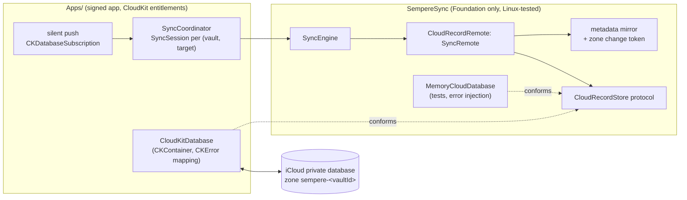
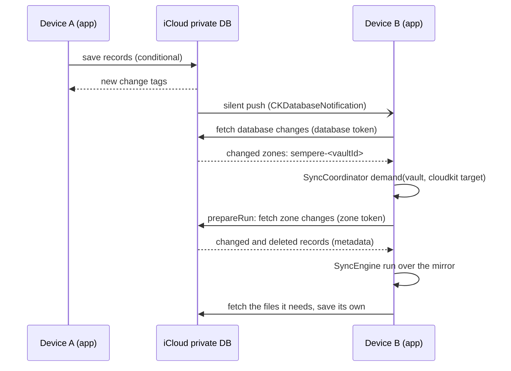

# CloudKit sync target (1.4 design)

Status: design, 2026-11-20. Target release **1.4**, headline feature. Code starts after TestFlight build 113.

Owner decisions (2026-11-20): CloudKit is a first-class sync **target** for Apple devices, next to folder and
WebDAV targets, not a replacement for them. Apple-only is fine: the Linux CLI keeps WebDAV (and folders) for
backup and sync, and there is no Android. 1.4 ships it as a headline feature.

Reading: `docs/io.md` "Sync engine and transports", "Folder targets in providers", "Sync targets in the app";
`docs/design/device-first-sync.md` §3 (one engine, many transports) and §3.4 (extension points);
`docs/format.md` §1 (layout, mutable files) and §15.15 (device changes over sync).

## Why

TestFlight 1.3 showed what iCloud Drive costs as a folder target:

- **Packages.** iCloud Drive kept vault folders that earlier builds exported as packages as one item. A whole-vault
  `NSFileVersion` conflict copy hid files, and the fix was to name new targets `<vault>.sempere-vault` and merge
  package conflict versions back (v1.3, build 111/112).
- **Upload status is guessed.** "Synced" is inferred from `ubiquitousItemIsUploaded` and friends
  (`ProviderUploads`); Cocoa 4355 (`ubiquitousFileUbiquityServerNotAvailable`) produced a false "storage may be
  full".
- **Slow, opportunistic propagation** that the app cannot ask for or observe.
- **Evicted files and stand-ins** ("arriving", `Arrivals.swift`): a listed file may not be readable for minutes.
- **No compare-and-swap.** The mutable files (`vault.json`, `settings.age`, summaries, insights) are replaced
  under a coordinated write, and a race shows up later as conflict versions to merge.

CloudKit gives each of these a direct answer: records instead of files (no packages), a server answer per write
(no guessed upload status), push notifications plus a change feed (fast, observable propagation), no eviction,
and record change tags that make conditional writes real.

## 1. Goals and non-goals

**Goals**

1. A `SyncRemote` over the user's CloudKit **private database** that keeps every promise of the contract in
   `SyncRemote.swift`: strong version tags, create-only and conditional replace and delete, bounded reads,
   deep listings, transient errors marked as such. The engine's rules (`SyncEngine`, `EpochSync`, quarantine,
   acceptance, `replaceUnaccepted`) run unchanged.
2. A target kind `cloudkit` in the store's registry, added from Sync Targets ("iCloud (CloudKit)"), any number of
   vaults, each in its own zone; next to folder and WebDAV targets, which stay.
3. Push-triggered runs: another device's change reaches an open vault in seconds, and a sleeping iPhone soon
   after, when iOS delivers the push.
4. Status that tells the truth: "Synced" means the server accepted the write; only definite problems show
   (the 1.3 quiet-status rule).
5. No format change. The records carry the vault's files byte for byte, so a vault moves between CloudKit,
   folders and WebDAV with no conversion, and a device without 1.4 reads every vault it read before.

**Non-goals**

- The CLI, Linux, Android, the web viewer. CloudKit needs the app's entitlements, which a Homebrew CLI binary
  cannot carry; CloudKit Web Services would be new network code in `Sources/` for a case WebDAV already covers.
  The CLI lists a `cloudkit` target and says it runs only in the app (`sempere store target add --cloudkit`:
  "CloudKit targets are added in the app").
- Sharing a vault between Apple Accounts (`CKShare`). Two people use a folder they share or a WebDAV server.
- Replacing folder or WebDAV targets, or migrating anyone automatically.
- The public database, CloudKit queries, server-side indexes. Only the change feed and fetches by id are used.
- Long-lived CloudKit operations that outlive the app (`CKOperation.Configuration.isLongLived`): runs stay the
  engine's blocking, bounded runs. A possible later step for very large blobs on iOS.

## 2. Record model

### 2.1 Where

| | Value |
| --- | --- |
| Container | `iCloud.io.github.anthonytw.sempere` (one, shared by the iOS and Mac Catalyst app: one bundle id) |
| Database | private (`CKContainer.privateCloudDatabase`): the user's own iCloud storage, invisible to the developer |
| Zone | one custom zone per vault: `sempere-<vaultId>` (the lowercase UUID from `vault.json`). Custom zones give the change feed, atomic batches and `userDeletedZone` |
| Record types | `VaultFile` (one per vault file) and `VaultFilePart` (pieces of a large file, §2.5) |

The vault id is already plaintext in `vault.json`, so the zone name adds nothing new.

### 2.2 One record per vault file

| Field | Type | Where | Notes |
| --- | --- | --- | --- |
| record name | — | system | `f-` + hex SHA-256 of the vault path (`notes/<id>/<rev>.delta.age`), 66 ASCII characters. Fixed length and character set, whatever the path; see §6.2 |
| `path` | String | `encryptedValues` | the vault path, `/`-separated, validated as the engine's paths are; a record whose `path` does not hash to its name is ignored (untrusted input) |
| `sha256` | Bytes (32) | `encryptedValues` | of the file's bytes: checked after every read, and lets a create that met an existing record decide "same bytes" without a download |
| `size` | Int64 | plain | the file's size (the asset's size shows it anyway) |
| `bytes` | Bytes | `encryptedValues` | the file inline, when it is at most **128 KiB** (`vault.json`, `settings.age`, epoch records, joins, most deltas) |
| `asset` | CKAsset | asset | the file, when it is larger and at most the part threshold |
| `parts` | Int64 | plain | the number of `VaultFilePart` records, when the file is split (§2.5) |
| `tomb` | Int64 | plain | set when the file is deleted conditionally (§2.4); a tombstoned record lists as absent |
| `v` | Int64 | plain | record layout version, `1` |

The record's `recordChangeTag` is the file's version token (`RemoteEntry.etag`), its `modificationDate` the
`lastModified` string. Write-once and mutable files use the same record type; what differs is only the
`PutCondition` the engine passes:

| Engine call | CloudKit |
| --- | --- |
| `write(.create)` | save a new `CKRecord` with that id, `savePolicy: .ifServerRecordUnchanged`. An existing record fails with `serverRecordChanged`, which is `false` (the precondition failed), unless it is a tombstone: then the write replaces the tombstone under its tag (a file deleted and written again) |
| `write(.replace(etag:))` | fetch the record (its system fields carry the tag), compare `recordChangeTag` with `etag` (different: `false`), set the fields, save with `.ifServerRecordUnchanged`; `serverRecordChanged` is `false` |
| `write(.unconditional)` | never used: the transport declares strong stamps, so the engine always has a tag. Mapped to a fetch and a save with `.changedKeys` for completeness |
| `read` / `download` | fetch by id with `desiredKeys` `bytes`/`asset`/`sha256`; check size, bound and SHA-256; return the tag |
| `stat`, `list`, `listTree` | answered from the target's metadata mirror (§3.1), refreshed at the start of each run |
| `delete(ifETag:)` | conditional: a tombstone save under the tag, then the hard delete (§2.4). Without a tag: the hard delete |
| `moveNoOverwrite` | create at the destination with the source's bytes, then tombstone the source. Not called in practice: the transport declares `atomicCreate`, so blobs need no temporary name |
| `makeCollection`, `createBase` | collections are implicit (a folder exists while a file below it does): `makeCollection` answers `.created` without a request; `createBase` creates the zone |
| `checkAbsentBase(syncedBefore:)` | the zone is missing: allowed on the first run; refused when this target synced before (the zone was deleted, §4) |
| `capabilities` | `strongStamps`, `deepListing`, `folderStampsTrackChildren` (a collection's tag is a digest of the tags below it, from the mirror), `atomicCreate` (a record appears whole); no `rangeReads`; `maxObjectBytes` nil (large files are split) |
| `requestDownload`, `conflictVersions`, `resolveConflicts` | the defaults: CloudKit never evicts a record and never forks one |
| `changes()` | hints from pushes and the delta fetch (§3.2) |

This is exactly what `replaceUnaccepted`, the `epochs/` read-back, `keys/` supersession, the published summaries'
three-round compare-and-swap and the re-encryption claims need: a strong tag, and writes and deletes that only
apply over the version read (`SyncEngine.isStrong`, `EpochSync.swift`, `ReencryptCoordinator.swift`).

### 2.3 Write-once files and the few mutable ones

Write-once (`notes/`, `att/`, `epochs/`, `notebooks/`, `inbox/`, `joins/`, `keys/`): created with `.create`
and never replaced, except catch-up (format.md §15.14) and re-encryption (§15.16), which pass `.replace(etag:)`
like any conditional write. The mutable files of format.md §1.3 (`vault.json`, `settings.age`,
`sempere-summaries.sealed`, `summaries/<device>.sealed`, `insights/*`) are replaced under their tag; a lost race
is `false`, and the engine reads again and judges again as it does for WebDAV (`MutableLockScope.swift`, at most
three rounds). Two devices writing one mutable file at once can no longer both "win": there are no conflict
versions to merge afterwards. The web viewer's `sempere-index.json` is not published (`publishForWebViewer`
stays off: the web viewer reads WebDAV).

### 2.4 Deletes and tombstones

The engine judges deletions from listings against its own record (`SyncState.files`: held on both sides at the
last sync, absent now), so it needs no tombstones in the vault; an absent record is enough. CloudKit, as far
as we know, has no conditional delete (a delete in `CKModifyRecordsOperation` ignores the save policy; the
phase 0 spike confirms it), and the contract's `delete(_:ifETag:)` must delete only that version. So a
conditional delete is two steps:

1. Save the record with `tomb = 1` and its payload fields cleared, `.ifServerRecordUnchanged` on the tag.
   `serverRecordChanged`: `false` (the file changed and is still there). From here on the record lists as
   absent, on every device, through the change feed.
2. Delete the record (best effort, in the same run). If it fails, the tombstone stays and a later run's sweep
   deletes tombstones it finds, after fetching each again and finding the same tag.

A create over a tombstone replaces the tombstone under its tag (§2.2), so a file written again after a delete is
never refused. The window that remains is a create landing between the sweep's fetch and its delete; the
write-once file it would lose is still on its writer, whose next run finds it missing and uploads it again (the
union rules, `io.md` "WebDAV sync", the table of held sets).

### 2.5 Large files

CloudKit limits a record to about 1 MB outside its assets, and an asset to a size Apple documents loosely
(phase 0 measures what the container accepts). Blobs may reach 1 GiB of content (format.md §8.4). Files over
**64 MiB** are split into 16 MiB `VaultFilePart` records (`p-<file record hash>-<n>`, each with `asset` and
`sha256`), uploaded first, and the `VaultFile` record (with `parts` and the whole file's `sha256`) is created
last, so the file appears whole or not at all (`atomicCreate` holds). A cut upload leaves parts behind: the next
attempt reuses parts whose `sha256` matches, so a large blob resumes part by part across runs, and the sweep
deletes parts no `VaultFile` names after 7 days. The engine's large-blob rules (`LargeUploads.swift`: last in the
run, deferred after a cut, `sentNothing`) apply as for WebDAV.

### 2.6 Quotas and limits

| Limit | Handling |
| --- | --- |
| The user's iCloud storage | `quotaExceeded`: a definite problem (§4); downloads go on |
| Record size (about 1 MB outside assets) | inline only up to 128 KiB; the rest is an asset or parts |
| Records per modify request (a few hundred) and bytes per request | the transport saves one file per operation in phase 1; a later batcher coalesces concurrent saves. `limitExceeded` halves the batch and retries |
| Request rate | `requestRateLimited`, `zoneBusy`, `serviceUnavailable` carry `retryAfterSeconds`: honored (§4) |
| Change feed page | `moreComing` pages until done, bounded by the run's `maxEntries` |
| Concurrency | `TransferPool` width 4 for CloudKit (8 for WebDAV); tuned in phase 0 against throttling |

## 3. Change tracking

### 3.1 The metadata mirror and the run model

Each CloudKit target keeps, in its state directory (`<store>/.sync/<vault id>/<target id>/cloudkit/`), the
zone's server change token and a mirror of the zone's metadata: path, record name, change tag, size,
modification date, SHA-256, tombstone and parts flags (about 150 bytes a file; no system-field archives, which
is why conditional writes fetch the record first, §2.2).

A run starts with **`prepareRun()`**, a new optional `SyncRemote` hook (default: nothing; also useful to a
later S3 or Dropbox transport with cursors). For CloudKit it fetches the zone's changes since the saved token
(`CKFetchRecordZoneChangesOperation`, `desiredKeys` limited to the metadata fields, so no inline bytes and no
assets come down), applies them to the mirror, and saves both. Every `list`, `listTree` and `stat` of the run
then answers from the mirror: the engine still gets a **full listing** each run, from local memory, so none of
its listing rules change, and `skipUnchangedNotes` works from the synthesized folder tags (a note whose tags did
not change is skipped). The transport's own writes update the mirror with the tags CloudKit returns, so a run
reads its own writes.

The mirror is a cache, never the truth: a lost or corrupt mirror is dropped and rebuilt by a fetch from a nil
token (a full fetch), and the engine's `SyncState` decides everything else as before. Every record from the feed
is untrusted (format.md §9): its path must validate and hash to its name, sizes and counts are bounded
(`Limits.maxEntries`), and anything else is skipped and counted in the report.

### 3.2 Pushes, hints and the schedule

- **One `CKDatabaseSubscription`** on the private database per device and Apple Account
  (`shouldSendContentAvailable`, no alert), covering every zone. A push makes the app fetch database changes
  (`CKFetchDatabaseChangesOperation`, with a device-level database token) and turns each changed zone into a
  demand on the matching vault's CloudKit session. `changes()` yields `.unknown` for the push and `.paths` from
  the delta, so a scoped run is possible later.
- **iOS**: pushes arrive through `application(_:didReceiveRemoteNotification:fetchCompletionHandler:)`
  (`UIBackgroundModes` gains `remote-notification`), with about 30 s to run: one bounded run, like a
  `BGAppRefreshTask`. Silent pushes are throttled and never guaranteed, so the existing background tasks stay as
  the fallback (P8: `BGAppRefreshTask`, and `BGProcessingTask` when uploads wait, with the network required).
- **Mac Catalyst**: pushes reach a running app; the periodic loop covers the rest.
- **Schedule** (`SyncSchedule`): 5 s after a write (CloudKit runs are cheap: no listing round trips), on push,
  on unlock, activation and Sync Now; periodic 5 minutes while something moved, backing off to 15 minutes while
  idle (pushes do the real work); the network path monitor gates runs as for WebDAV (no path: offline, no runs
  started by the schedule).
- Locked and closed vaults: upload-only runs and locked staging (`LockedStaging`, `PullOnlyRemote`) work over
  this transport unchanged; only the open, unlocked vault's runs are two-way.

## 4. Errors and status

The transport maps `CKError` to `CloudRecordError: TransientRemoteError` (in `SempereSync`, as plain codes, so the
mapping rules are Linux-tested; the app adapter only converts `CKError.Code` to them). `retryAfterSeconds` up to
5 s is waited out inside the request (interruptible through `interrupt`); a longer one ends the run with a
`throttled(until:)` error that the session takes as its next run time, never as a failure.

Status follows the 1.3 quiet-status rule: **the bar shows a problem only when something definitely needs the
user**. Anything that may heal by itself is quiet in the bar and listed in Vault Details.

| CloudKit says | Transport | Status |
| --- | --- | --- |
| `networkUnavailable` | transient, `isUnreachable`, `sentNothing` | offline (not an error), as WebDAV |
| `networkFailure`, `serverResponseLost` | transient, `isUnreachable` (a lost answer: the conditional write's next attempt finds its own record, compares SHA-256, done) | offline only if `LinkBreaker` trips; else quiet |
| `serviceUnavailable`, `requestRateLimited`, `zoneBusy` | transient, honors `retryAfter` | quiet |
| `serverRecordChanged` | not an error: the write's `false` | none |
| `partialFailure` | unpacked: each record's own error, mapped by this table | per item |
| `limitExceeded` | halve the batch, retry | none |
| `changeTokenExpired` | drop the token and mirror, full fetch in the same run | none |
| `assetFileNotFound`, `assetNotAvailable` | transient; retried next run | quiet |
| `quotaExceeded` | transient (not unreachable); uploads stop for the run, downloads go on | **problem**: "iCloud storage is full. Free up space or upgrade iCloud+, then Sync Now." |
| `zoneNotFound` on a target that synced before | `checkAbsentBase` refuses, as for a folder that is gone | **problem**: "This vault's iCloud data is gone. Nothing here was deleted." Actions: Upload Again, Remove |
| `userDeletedZone` | the same, never recreated by itself | **problem**: "This vault's data was deleted in iCloud settings. Nothing here was deleted." Upload Again (a union run into a new zone) or Remove |
| `notAuthenticated`; account status `noAccount` | no runs until the account changes | **problem**: "Sign in to iCloud in Settings to sync this vault." |
| account status `temporarilyUnavailable`, `couldNotDetermine` | wait for `CKAccountChanged` | quiet |
| account status `restricted`, `managedAccountRestricted` | no runs | **problem**: "iCloud is restricted on this device (Screen Time or device management)." |
| `CKAccountChanged` to **another** user record | the target pauses; the vault is never uploaded into another account by itself | **problem**: "This device is signed in to a different Apple Account. Syncing with iCloud is paused; nothing was deleted." Use This Account (a union into that account's zone) or Remove |
| `incompatibleVersion` | no runs | **problem**: "Update Sempere to keep syncing with iCloud." |
| `badContainer`, `missingEntitlement`, `permissionFailure`, `invalidArguments`, `internalError`, `serverRejectedRequest` | not transient; backoff | quiet at first; a **problem** only when no run has succeeded for 24 h while the network was up: "iCloud has not accepted changes since …" (the same 24 h stall rule covers any quiet error that never clears) |

The target records the Apple Account's user record id (hashed) when it is added (`CKContainer.userRecordID`), so
"another account" is a comparison, not a guess. "Synced" means every file this device wrote is in the mirror with
a server tag: there is no upload-status inference, `ProviderUploads` does not apply, and Cocoa 4355 cannot occur.

## 5. Epochs and keys (KH4) over CloudKit

Nothing in the key hierarchy assumes a file system; it assumes the `SyncRemote` contract, which this transport
keeps. Checked against format.md §15.15 and `EpochSync.swift`:

| Rule | Over CloudKit |
| --- | --- |
| `epochs/` first, union, never deleted; a record named by a verified hash is read back when its tag moved, and other bytes there replaced under their tag | strong tags and `.replace(etag:)`; reads return the tag |
| never a `vault.json` beside a record that is not the right one (record first, then `vault.json`) | two separate saves in order; no batch needed |
| `vault.json` of another epoch judged on arrival (taken, record-pending, unverified-pending, unlisted, behind, conflict) | from local files after the download, as now |
| the target's `vault.json` replaced only under the version read (`If-Match`) | `.replace(etag:)` |
| `replaceUnaccepted`: strong version tags only | change tags are strong; never `.unconditional` |
| `joins/`: union; a request one side deleted since both held it is deleted on the other; home's 7-day expiry by its own clock | conditional delete (§2.4); the transport's clock is not involved |
| `keys/`: union; a superseded passphrase copy deleted under the version listed | conditional delete |
| keyless join runs (`firstPullIdentities`, `keylessManifestHeld`: a run without the key never uploads `vault.json`), `HoldGate` (a joiner writes only its request) | engine rules, transport-neutral |
| re-encryption claims and confirms on every target (`ReencryptCoordinator`, `syncedBefore`) | over `SyncRemote`, with the CloudKit target's `SyncState` |
| a conflict copy of `vault.json` | cannot arise from the store (no forks); the engine's conflict rule still applies to versions written by two homes |

The only places that know about files are the folder transport's own (`checkAbsentBase` for stand-ins,
conflict versions, coordination), and each has a CloudKit counterpart above or is a default. Joining over
CloudKit needs the joiner signed in to the same Apple Account, since the zone is private.

## 6. Privacy and security

### 6.1 What is protected

Every file is already end-to-end encrypted by Sempere before it reaches any target, except `vault.json` (device
labels, public keys, wrapped keys, signatures: the one plaintext file the privacy policy names). CloudKit adds its
own layers: inline bytes, paths and hashes go in `encryptedValues`, which Apple encrypts with keys in the user's
iCloud Keychain when Advanced Data Protection is on, and with Apple-held keys otherwise. Sempere's encryption is
the guarantee; Apple's is a bonus.

### 6.2 What still shows, and why record names are hashed

| Visible to Apple | |
| --- | --- |
| zone name | the vault id (random; plaintext in `vault.json` anyway) |
| record names | `f-<SHA-256(path)>`: unkeyed, but a path holds a random 128-bit note id, so a name cannot be guessed back. Hiding the path matters because revision names carry hybrid-clock times (when each edit was made), device ids and sequence numbers |
| sizes, counts, modification times, request times | as on iCloud Drive and WebDAV today (blobs are padded to size classes, format.md §8) |
| `vault.json` | inside `encryptedValues` like any inline file (protected from Apple only with ADP) |

A keyed hash (under a key derived from `K_e`) would hide even the shape of the path, but upload-only runs of a
locked vault and keyless join runs have no `K_e`, and an epoch change would rename every record. Not worth it.

### 6.3 Where the CloudKit code lives

**Decision: the CloudKit calls live in `Apps/`, in one file, `Apps/Sempere/SempereApp/CloudKitDatabase.swift`;
everything else is network-free in `SempereSync`.**

- The hard rule stays as it is: no network code in `Sources/` except `SempereWebDAV`. `SempereSync` gains the
  `CloudRecordStore` protocol (zone changes, fetch by id, modify with per-record results, zones, account status,
  as plain value types), `CloudRecordRemote: SyncRemote` (paths, mirror, conditions, tombstones, parts, error
  mapping) and `MemoryCloudDatabase`: all Foundation-only and Linux-tested. Their names avoid `CKContainer` and
  `CKDatabase`, which `release-check.sh`'s `NETWORK_PATTERN` matches.
- A package target behind `#if canImport(CloudKit)` was considered and rejected: it would add a network-allowed
  target for nothing, since only the signed app can use CloudKit (the CLI cannot hold the entitlement, and an
  unsigned `swift test` binary cannot reach a container), so its tests could not run where package tests run.
- The adapter is thin (about 300 lines): `CKRecord` and `CKError.Code` to value types and back. Its mapping has
  unit tests in the app test target that build `CKError`s by code (no network, no entitlement: they run in the
  gate's `test-mac`).

### 6.4 Entitlements, release checks, policy

- **Entitlements** (iOS `SempereiOS.entitlements` and Mac `Sempere.entitlements`; none for the widgets or the
  watch): `com.apple.developer.icloud-container-identifiers` = [`iCloud.io.github.anthonytw.sempere`],
  `com.apple.developer.icloud-services` = [`CloudKit`], `aps-environment` (iOS) and
  `com.apple.developer.aps-environment` (Mac Catalyst; phase 0 confirms which key Catalyst takes). The value is
  `development` in Debug and `production` in Release; `com.apple.developer.icloud-container-environment` is left
  to the signing (Xcode sets Production on export). The Mac already has `network.client`.
- **`scripts/release-check.sh`**: the keys above in `ENTITLEMENTS_ALLOWED`; the container id and `CloudKit`
  pinned in `ENTITLEMENT_VALUES`; `CloudKitDatabase.swift` in `NETWORK_ALLOWED` with its reason; the
  `WATCH_ENTITLEMENT_FILES` rule already keeps CloudKit off the watch. `UIBackgroundModes` `remote-notification`
  on the iOS app. `PrivacyInfo.xcprivacy`: CloudKit adds no required-reason API by itself; the mirror's file
  dates are covered by the existing file-timestamp reason.
- **Privacy policy** (both copies, same date): a new bullet under "Where your notes live" and in "Network
  connections": with an iCloud (CloudKit) target, the app connects to Apple's iCloud servers as the signed-in
  user and stores the vault's encrypted files in that account's private iCloud database, counted against its
  iCloud storage; Apple's push service wakes the app when another device changes the vault; the developer cannot
  read that database. `DESIGN.md` "Network" says the same.
- **App Store privacy answers**: data in the user's private CloudKit database that the developer cannot access is
  not collected, so "Data Not Collected" should stay; the owner confirms the answers at submission (§11).
- **Signing**: the App ID gains iCloud (CloudKit, with the container) and Push Notifications, and the App Store
  profiles are made again (§11). No `DEVELOPMENT_TEAM` is committed: development signing for CloudKit tests reads
  the team from `~/.config/sempere/release.env`, as `testflight.sh` does.

## 7. Recovery and export

CloudKit holds records, not files, so **the stock-CLI `age` recovery path (format.md §15.13) cannot read it**.
The recovery path needs a plain copy of the vault, and there are two:

1. **Backups** (`.sempere-backup`, Settings ▸ Backups, `sempere backup`): a frozen, verified vault folder.
2. **A folder target** (a drive, a share, iCloud Drive): a live plain copy.

What the app does about it:

- Sync Targets says, under a vault whose only off-device copy is CloudKit: "iCloud keeps your vault on Apple's
  servers. To open it without Sempere (with the recovery kit and `age`), keep a backup or a folder copy too."
  with Set Up Backup. Once, not a banner.
- Losing every device is still covered without a plain copy: a new Apple device signed in to the same Apple
  Account adds the vault from iCloud and takes over with the recovery kit (KH5), then can make a backup. Only
  the CLI-without-Sempere path needs the plain copy.
- `docs/security.md` and the recovery kit's printed text gain one line: "If your vault syncs only through
  iCloud (CloudKit), keep a backup: the recovery steps read files."

## 8. Migration and mixed versions

Adding a CloudKit target to an existing vault is a union like any new target: the first run uploads everything
(large blobs last) and deletes nothing.

1. Update every device to 1.4.
2. On one device: Sync Targets ▸ Add ▸ iCloud (CloudKit). The zone is created and the first runs upload.
3. On the vault's other 1.4 devices signed in to the same Apple Account, the app finds the zone
   (`fetchAllRecordZones`, `sempere-<vaultId>` for a vault in its store) and suggests once: "This vault is in
   iCloud (CloudKit). Sync with it here too?" One tap adds the target. Suggested, not automatic: adding a target
   is the user's choice everywhere else too.
4. When every device's CloudKit target says Synced and Vault Details shows every device's revisions held there,
   remove the folder target on each device (Remove never touches the folder). Deleting the iCloud Drive folder
   afterwards is the user's own step in Files; the app never deletes it.

**A new device** with no copy: Open Vault ▸ "From iCloud (CloudKit)" lists the account's `sempere-*` zones by the
name in their `vault.json`, copies one in (a partial copy first, as for WebDAV) and joins (Join This Device, the
words or the code).

**Mixed versions.** The format does not change, so no `features` marker. A device on 1.3 or earlier has no
CloudKit; it keeps meeting the others through the folder or WebDAV target. A 1.4 device with both targets bridges
them (the engine already bridges targets, `io.md` "Sync targets in the app"), but only while it runs, so keep the
folder target until every device runs 1.4. A registry written by 1.4 lists `cloudkit` targets; a CLI that does
not know the kind lists them and never runs them (the existing unknown-kind rule).

## 9. App UI

- **Sync Targets ▸ Add**: "iCloud (CloudKit)" first on Apple devices, with the line "Syncs this vault through
  your Apple Account. Apple devices only." Then "Folder…" (whose picker covers iCloud Drive; its subtitle says
  "a folder in iCloud Drive, on a drive or a share"), then "WebDAV Server…". Adding a CloudKit target with no
  iCloud account shows "Sign in to iCloud in Settings first." with a link to Settings.
- **New Vault ▸ Sync With**: none, iCloud (CloudKit), WebDAV, or a folder; nothing preselected (owner decision 1,
  §12). Choosing a folder inside iCloud Drive shows one line suggesting the iCloud (CloudKit) option instead, with
  a one-tap switch (decision 2); Add Target does the same.
- **Status lines**: "Synced with iCloud · 2 min ago"; "Syncing with iCloud: ↑ 3 ↓ 12"; "n changes not synced
  yet"; offline as for WebDAV; the problems of §4. The bar never says "waiting for iCloud to upload" for this
  kind: a write the server accepted is synced.
- **Vault Details** (per target): last sync, files in step, zone size from the mirror, the quiet errors of §4 with
  their last time, and Remove. "Delete from iCloud…" (deletes the zone, after a confirmation that names the
  vault and says other devices stop syncing through it) is offered only when the vault has another target or a
  backup.
- **Settings ▸ Sync & Devices** lists the CloudKit target with the others. The iPhone's Settings ▸ Apple Account
  ▸ iCloud ▸ Manage Storage shows Sempere's usage; deleting it there is `userDeletedZone` (§4).
- Every new string goes into the catalog with Spanish (`LocalizationCatalogTests`).

## 10. Testing plan

### 10.1 Linux-testable: a fake CloudKit database

`MemoryCloudDatabase` (SempereSync) conforms to `CloudRecordStore` and behaves like the private database:
zones, change tags per save, zone and database change tokens, tombstones in the feed, `moreComing` pages, saves
with both policies, per-record results, assets as files. Error injection from a seed, per operation and record
(as `MemoryFaults` does): every case in §4, including `partialFailure` mixes, `retryAfter`, `limitExceeded`,
`quotaExceeded` on writes only, `zoneNotFound`, `userDeletedZone`, `changeTokenExpired`, account switches and
sign-outs, `serverResponseLost` (applied, answer lost), assets not available, and a feed that lags behind saves.

- `SyncRemoteConformanceTests` gains a CloudKit fixture (create races, conditional replace and delete, tombstone
  then create, stamps, listings, parts, hostile records: a path that does not match its name, oversized fields).
- The engine's scenarios over every transport, `EpochInterleavingTests` (J1 to J10) and the N-device sync
  stress run over the fake.
- `CloudKitTwoDeviceSyncTests` (SempereAppCoreTests, like `TwoDeviceSyncTests`): two `AppModel`s on one
  `MemoryCloudDatabase` running the real engine: a note and a rename reaching the other list and open editor,
  offline edits on both, settings, a 6 MB attachment and a 100 MB one (parts), runs cut midway, a zone deleted by
  the user, an account switch, a closed vault that only uploads, a push hint starting a run.
- Status mapping tests: each §4 row gives its `SyncStatus` (quiet or the exact problem), and the 24 h stall rule.
- Fuzz: the mirror decoder and feed records (`*FuzzTests`).

### 10.2 Real CloudKit, automated on the Mac

- **Environment**: the container's development environment only. A dedicated test Apple ID is signed in on the
  claude macOS account and in a base iOS simulator; agents run on clones of that simulator (`SEMPERE_SIM_ID`),
  phase 0 confirms a clone keeps the sign-in.
- **Signing**: an Apple Development certificate and development profiles with the iCloud and push entitlements
  for the iOS app (simulator) and Mac Catalyst (this Mac registered as a device), team read from `release.env`.
  The normal unsigned builds and the PR gate stay as they are.
- **Suites**: `scripts/app.sh test-cloudkit` (through `xc-lock`): the adapter against the real container, each
  test in a fresh zone `test-<uuid>` that it deletes; then the two-device test: the Mac Catalyst app and a
  simulator, signed in to the same account, a note written on one (debug launch variables) appears on the other,
  and a push wakes the simulator's app (phase 0 checks that simulators get CloudKit pushes on this Mac). It is in
  `local-ci.sh --testflight` when the test account is present, and says plainly that it did not run otherwise.
- **`xcrun cktool`**: export and check the development schema in CI against a checked-in copy
  (`Apps/Sempere/CloudKit/schema.ckdb`), reset the development environment, and inspect records when a test
  fails.

### 10.3 Owner checks (first TestFlight with CloudKit)

1. Production environment: add an iCloud (CloudKit) target to a scratch vault on two real devices and see a
   note cross both ways.
2. Push to a sleeping iPhone: lock it, write a note on the Mac, unlock after a few minutes and see it there
   without waiting for a run (iOS may still delay a push; a delay is not a failure).
3. Migrate one real vault (the one that lived in an iCloud Drive folder) by §8, then remove its folder target.

## 11. One-time setup the owner must do

Checked 2026-11-20: the existing App Store Connect API key can **read** bundle ids, their capabilities and the
profiles (the App ID has `APP_GROUPS` and `IN_APP_PURCHASE` today). Writes were not tried.

1. **Create a test Apple ID** for automated CloudKit tests (needs a phone number and two-factor sign-in).
   *Owner only.*
2. **Sign that Apple ID in** on the claude macOS account (System Settings, iCloud on) and in one iOS simulator
   that agents clone. *Owner only* (two-factor codes); agents clone the simulator afterwards.
3. **Create the iCloud container** `iCloud.io.github.anthonytw.sempere` (developer.apple.com ▸ Identifiers ▸
   iCloud Containers) and assign it to the App ID `io.github.anthonytw.sempere` under iCloud ▸ CloudKit. A
   container can never be deleted or renamed. *Owner*: the public App Store Connect API has no endpoint for
   iCloud containers or for assigning one, as far as we know.
4. **Enable iCloud (CloudKit) and Push Notifications** on that App ID. *Agent, probably*: the API's
   `bundleIdCapabilities` takes `ICLOUD` and `PUSH_NOTIFICATIONS`, and the key reads them; whether it may write
   them is untested. Done in the portal with step 3 if the API refuses.
5. **Make the App Store profiles again** (iOS and Mac Catalyst) so they carry the new entitlements, and install
   them. *Agent, probably*, through the API's `profiles` endpoint (readable with this key; creating untested).
6. **Development certificate and profiles** for CloudKit tests on this Mac (register the Mac as a device).
   *Agent, probably*, through the API (`certificates`, `devices`, `profiles`); untested for writes.
7. **A CloudKit management token** for `cktool` (CloudKit Console ▸ Settings ▸ Tokens): *owner* creates it and
   leaves it in a file under `~/.config/sempere/` (mode 600); an agent runs `xcrun cktool save-token`.
8. **Deploy the schema to production** before the first TestFlight build with CloudKit (CloudKit Console ▸
   Deploy Schema Changes). *Owner*: as far as we know `cktool` imports schemas into development only; phase 0
   checks the Xcode 27 `cktool`.
9. **Review the App Privacy answers** in App Store Connect at the 1.4 submission (expected unchanged: Data Not
   Collected). *Owner.*

## 12. Phasing, effort, open questions

Sizes as in device-first-sync §10: S < 300 changed lines, M 300 to 1,000, L > 1,000.

| # | Work | Size | Depends on |
| --- | --- | --- | --- |
| C0 | Spike on the Mac (after setup 1 to 7): container, entitlements, Catalyst push key, asset and batch limits, conditional delete, simulator pushes and sign-in on clones, `cktool`. Updates this doc's numbers | S | setup |
| C1 | `SempereSync`: `CloudRecordStore`, `CloudRecordRemote`, mirror, tombstones, parts, error mapping, `prepareRun()`, `MemoryCloudDatabase`; conformance, engine scenarios, epoch interleaving, stress | L | — (can start before C0 with the fake) |
| C2 | App: `CloudKitDatabase`, target kind `cloudkit`, subscriptions and push, account monitoring, schedule, entitlements, release-check tables, privacy policy, DESIGN.md | M | C0, C1 |
| C3 | UI: Add target, Open Vault from iCloud, suggestion on other devices, status texts, Details, backup note, Spanish | M | C2 |
| C4 | Real-CloudKit suite (`test-cloudkit`), two-device Catalyst plus simulator, schema check; docs (`io.md` section, CLAUDE.md gotcha, `cli.md`) | M | C2 |
| C5 | TestFlight with production schema; owner checks §10.3 | — | C3, C4, setup 8 |

Roughly 6 to 8 author sessions, C1 the largest. C1 and C4's fake-based tests carry most of the risk; C0 removes
the unknowns (limits, push on simulators, signing) before the app work starts.

**Decided here**: hashed record names with paths in `encryptedValues`; CloudKit code in `Apps/` only; one zone
per vault; a metadata mirror with full listings per run; conditional deletes by tombstone; parts above 64 MiB;
suggestion (not auto-add) on other devices; quiet status with a 24 h stall rule; no CLI support; no `CKShare`.

**Owner decisions (2026-11-21)**

1. **No default sync target.** New Vault and Add Target offer three equal choices: iCloud (CloudKit), WebDAV and
   Folder. Nothing is preselected.
2. **A suggestion only where it helps, once.** When someone adds a folder target inside iCloud Drive (new or
   existing vault), the sheet notes that the iCloud (CloudKit) option syncs more reliably, with a one-tap switch;
   no nag. For vaults that already sync through an iCloud Drive folder, at most one note per vault (a flag stored
   with the vault's device-local state, shown the first time 1.4 opens it), never repeated. Low priority: the owner
   is the only user today, so this may ship later than C3.
3. **Backward compatibility is a standing requirement** from 1.4 on: a 1.3 device keeps syncing a vault's folder
   or WebDAV targets while another device adds a CloudKit target; nothing a 1.4 device writes may stop a 1.3 device
   reading or syncing the vault; the record format and zone layout are versioned from day one (a `schema` field on
   each record, readers refuse newer majors read-only, like `format.md` §7).

**Owner questions**

1. Which email and phone number go on the **test Apple ID** (setup 1)?
