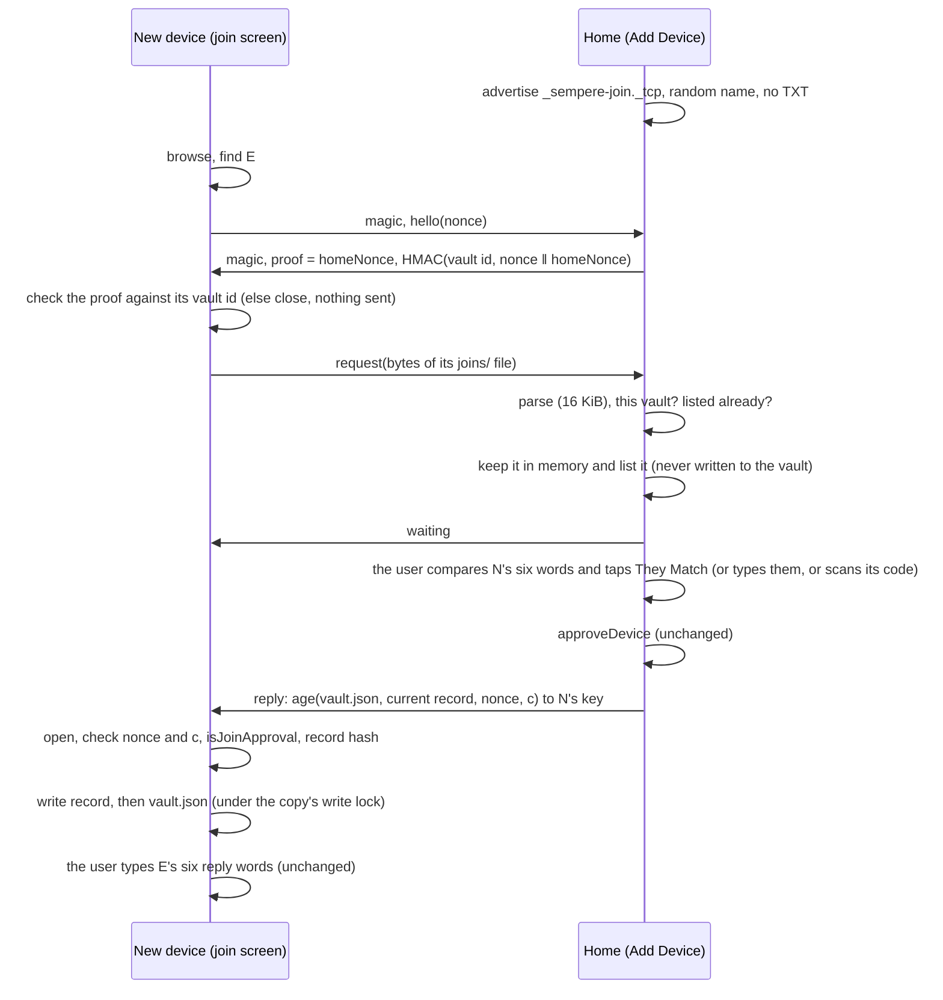

# Joining nearby: the join request and the approval over a direct link (1.1)

Status: implemented (1.1), revised after review. Part of joining by approval (key-hierarchy.md §6.2, §6.2.1;
format.md §15.12). The decisions are N1 to N13 below; the review's findings and where each is handled are at the end.

## Problem

Joining by approval ran entirely through the sync target: the new device wrote `joins/<id>.join.json` into its copy,
its runs took it to the target, home's next run brought it down, home approved it (a new `vault.json`), home's runs
took that up, and the new device's next run took it down. With iCloud Drive as the target each leg waits for the
provider, and on 2026-11-11 the whole round took more than ten minutes, with the request never reaching the owner's
Mac although the iPhone said "Sent". The owner's devices are often on different Wi-Fi networks, or on networks with
client isolation, so the local network alone does not help.

## What the new device reads between the approval and the unlock

Traced through the code (`AppModel+JoinDevice`, `Vault.confirmJoin`, `Vault.open`, `VaultCheck.listCheck`):

1. The new device's run takes a `vault.json` that lists its key (`SyncEngine` via `Vault.isJoinApproval`).
2. `refreshLockedManifest` and `joinStage` read `vault.json` again: listed, so the join screen asks for the reply words.
3. `confirmJoin` opens the vault with the device key: `Vault.open` reads `vault.json`, unwraps the device's entry, and
   checks the list against the chain in **the current epoch's record**, `epochs/<e>-<id>.epoch.age`, which
   `vault.json` names with its hash (`readCurrentRecord`). Then the reply words are checked, and the trust record is
   saved.
4. `unlock` lists the copy's notes (what the copy holds; the runs fill it).

So the new device needs exactly two files: **`vault.json`**, and **the current epoch record** when its copy does not
hold it (home started an epoch, by a removal for example, after the new device copied the vault in). An approval
changes no other file (design §5.1: no file is re-encrypted, the epoch does not change). Nothing under `keys/` is
read. Earlier records, the re-encryption journal, `settings.age`, notes, notebooks and the inbox are content: they
still come with the sync, and files under keys whose records have not arrived are pending meanwhile, as for any copy
that took `vault.json` before its records.

Home needs only the request.

## The link

- **Transport**: Network.framework, plain TCP, `includePeerToPeer = true` (`NWNearbyTransport`,
  `Apps/Sempere/SempereApp/NearbyTransport.swift`): Bonjour on peer-to-peer Wi-Fi (AWDL, as AirDrop) and on any
  shared network. The protocol knows nothing of it: `NearbyJoinConnection` is a byte stream (`Sources/Sempere/`
  `NearbyJoin.swift`, `NearbyJoinSession.swift`; `NearbyJoinPipe` in memory; the model's `NearbyJoinTransport` in
  SempereAppCore, `MemoryNearbyTransport` for tests).
- **Framing**: both sides start with the 16 bytes `sempere-nearby/1`; then frames of a 4-byte big-endian body length,
  a type byte and the payload. The new device sends `hello` (type 5: its 32-byte nonce) and, after a good proof,
  `request` (type 1: the request file's bytes); home sends `proof` (6: its own 32-byte nonce, then the 32-byte tag),
  `waiting` (2, empty), `reply` (3: the sealed reply) or `refused` (4: one byte, `NearbyJoinRefusal`). Each read has
  its stage (`NearbyFrameReader.Stage`) with the types allowed there and each one's largest body: home reads a
  `hello` (1 + 32), then a `request` (1 + 16 KiB); the new device reads a `proof` (1 + 64) or a refusal (1 + 1)
  first, then `waiting`, a `reply` (about 24 MiB) or a refusal, and after `waiting` a reply or a refusal. A type the
  stage does not allow, a length beyond what it allows that type, or a bad magic ends the session with a typed error
  from the frame's header, before any body is held, and a read never takes more bytes than one frame of its stage
  (`NearbyFrameReader`, fuzzed stage by stage in `SempereFuzzTests.testFuzzNearbyJoinLink`).
- **The reply**: `sempere-nearby-reply/1\n ‖ lp(nonce) ‖ lp(c) ‖ lp(vault.json) ‖ lp(record name) ‖ lp(record)`,
  encrypted with age to the request's `age1pq1…` key (X-Wing, as the wraps in `vault.json`). Fields are bounded
  (`vault.json` 16 MiB, record 8 MiB, an exact epoch-record name).
- **Timeouts**: every read and every send is timed. On home's side one short limit (3 seconds,
  `NearbyJoin.Timeouts.request`) covers the `hello` and the `request` together, from the connection. The handshake
  limit (10 seconds) covers each frame *header* on the new device's side (its first answer's body too, a few bytes),
  and home's `proof`, `waiting` and refusals; frame *bodies* toward the new device (a reply of megabytes) and home's
  reply send get what is left of the session (10 minutes in all, the user's typing included; never less than the
  handshake limit). A send the peer does not take
  in time (a zero window) aborts the connection. TCP keepalive (15 s idle, then 3 probes 5 s apart) notices a peer that
  vanished within about 30 seconds.

## Decisions

| | Question | Decision and why |
|---|---|---|
| N1 | Who advertises? | **Home, while Add Device shows; the new device browses while its join screen waits.** Add Device is where a request is accepted, so one listener there serves any number of new devices one at a time; the new device tries the advertisers at random, those it has not tried first, but at most six new ones a minute (instance names are the advertisers' to choose: none sorts its way ahead, and a stream of fresh names does not keep the screen from the others). Neither side advertises or browses at any other time, nor in the background (N12). |
| N2 | Encrypt or authenticate the link? | **No link encryption; a proof that home knows the vault's id before anything identifying is sent (N13); the reply sealed to the new device's key.** Before the user types the words the two devices share no secret: the commitment and its six words are hashes of the public request, which a device in the middle relays and can compute too, and the vault id is not secret either (storage holds it). So no key derived from them stops an active attacker, and an unauthenticated key exchange would only hide the request from a purely passive listener. Sealing the reply buys something concrete with no new construction: `vault.json` (every device's name, kind and keys, which device is home) is readable only by the device whose key the user approved, even through a device in the middle. |
| N3 | What crosses the link? | **The request one way; `vault.json` and the current record the other.** Exactly what the target would carry for the join (section above). The reply words never cross: they are the user's check that this is the vault home approved (design §6.2 step 4), and sending them would let whoever answers the connection confirm a vault of its own. |
| N4 | Same checks? | **Yes, unchanged on both ends.** Home approves only through `approveDevice(words:qr:)`, which matches the typed words or the scanned code against the request's commitment; the new device takes a reply only through `Vault.isJoinApproval`, the sync engine's own test (same vault and root, a listed entry for its key whose wrap opens), and the record only when its SHA-256 is the one `vault.json` names (`Vault.takeNearbyReply`). It then confirms with the reply words, which check the root and the frontier as before. Nothing is pinned before that. |
| N5 | Where does home keep a request that came nearby? | **In memory only, never in the vault.** Add Device keeps the requests that came nearby while it shows (`nearbyRequests`: at most 4, one per commitment, the oldest dropped first; kept after their session ends, so a request whose device hung up can still be approved; forgotten when Add Device closes). Approval takes the request by value (`approveDevice(_:)`); the new device's own file still arrives by sync, and home deletes requests of listed keys. Writing it to `joins/` would let any device nearby that knows the vault's id put files into home's vault that every target and every device then holds. The list shows the nearby ones first and matches by commitment: a file in `joins/` under the same 8-hex name but of other keys is listed beside it, never in its place, and is never what the "Nearby" mark names. |
| N6 | Both routes at once? | **Whichever comes first wins; everything is idempotent.** Home approves a key once (`deviceAlreadyListed` after); a request of a listed key is no longer listed (`pendingJoinRequests`) and home's runs delete its file (design §6.2). A device home lists already is answered at once with the reply, so an approval through the target reaches a device nearby without its sync. The new device takes a `vault.json` equal to its copy's as nothing (`takeNearbyReply` returns false), and the reply is the bytes on home's disk, the same the target gets, so the sync then finds nothing to change. |
| N7 | Replay | **Each session has a fresh 32-byte nonce, sealed inside the reply with the request's commitment.** A reply recorded in one session, or answering another request, is refused (`replayed`). This authenticates nothing: age is sender-anonymous and the nonce crosses in the clear, so anyone can seal a reply that passes the nonce and commitment check. The binding only stops a replay by someone who cannot read an old reply. The gate is `isJoinApproval` (this vault's id and root, an entry for the device's key whose wrap opens) and then the reply words. |
| N8 | Sessions | **One at a time on home, named by a token, taken only by a request.** A connection first gets one of 4 handshake places (when all are taken, the oldest is ended) and must send its `hello` and a request within the request limit; only a parsed request of this vault takes the session. A device that connects and stays silent, or sends anything else, holds no session and is dropped within that limit. A request that arrives while another session goes gets `busy`, and the new device tries again in a moment. A session that waits for the user ends when the new device hangs up (its wait is canceled), when the user declines the request (`declined`), after 10 minutes, or when Add Device closes or the app goes to the background: then the session is torn down at once, its connection aborted, and a new one may start (its token differs). |
| N9 | Names | **The instance name is `Sempere-` and 12 random hex digits, new for each advertisement; no TXT record.** The service type says the app is there. The Bonjour records also name the advertising host, as any Bonjour service does: on a Mac that is often the computer's name ("Alexs-MacBook-Pro.local"). Nothing in the service names the vault or its devices. |
| N10 | A record too large | **Above 8 MiB the record is left out**, and the new device, whose copy lacks it, takes nothing and waits for the sync. A record that size means a chain of tens of thousands of epochs. |
| N11 | The re-encryption journal, earlier records | **Not carried.** Neither is read before the unlock; files that need them are pending until the sync brings them. |
| N12 | Failures and the background | **Both sides stop in the background (`observeAppLifecycle`) and start again in the foreground while their screen shows; a listener or browser the system fails, or that keeps waiting for a local network permission for more than a few seconds (the first prompt may still be up: a short wait is not a failure), is dropped on its own (the other side's is not touched), the screen says the link is unavailable, and it starts again after a wait that doubles with each failure since that side last came up (from `nearbyRetry`, at most a minute; the count starts from zero when the side is up again, when the screen shows again or when the app comes back).** A Bonjour registration never outlives a suspended app. |
| N13 | Who gets the request? | **Only a device that proves it knows the vault's id.** The new device sends `hello` (its nonce, nothing else); home answers with a fresh nonce of its own and `HMAC-SHA256(key: the vault id's 16 bytes, "sempere-nearby/1 home" ‖ nonce ‖ homeNonce)` for its open vault (home's nonce keeps a tag from ever repeating, so a recorded one is neither replayed nor linked to another session; home still answers anyone who knows the id, which is acceptable); the new device checks it in constant time against the vault id of its own request and only then sends the request. Without it the request (device name, kind, public keys, and the vault id, a stable identifier) went to every advertiser: other people's Add Device, and any device advertising the service to collect requests. The vault id is not secret (storage holds it, and a device that watched an earlier join over the air learned it), so this narrows who receives the request; it proves nothing about home, and the new device's checks (N4) are what authenticate the approval. A device whose proof is wrong is left alone for a minute. |
| CLI | The CLI | **App-only.** `Sources/` has no network code outside `SempereWebDAV` (`scripts/check-portability.sh`), Linux has no AWDL, and a macOS command-line tool has no `Info.plist` for `NSBonjourServices` or the local network prompt. The protocol, the framing, the session state machine and the vault steps (`nearbyReply`, `takeNearbyReply`) are package code, tested by `swift test`, and the CLI's join (`device init`, `devices approve`, `device confirm`) is unchanged. |

## Threats

| Who | What they can do | What stops the rest |
|---|---|---|
| A passive listener nearby | See that the service runs and the host that advertises it (N9); during a join, the request in the clear (the device's name, kind and public keys, the vault id: what storage holds in `joins/`); the size and timing of the reply, which tell roughly how long the device list is. The vault id is the same in every join and every target: a listener who sees two joins knows they are of one vault. | The reply is sealed to the new device's key (N2). |
| An active device nearby that does not know the vault's id | Advertise the service and receive `hello`s: a random nonce, nothing else. Connect to home and stay silent, or send garbage. | N13: the new device sends its request only after a proof keyed by the vault's id. A connection without a request holds only a handshake place, for the request limit at most, never the session (N8); an advertiser's first frame is judged from its header (Framing), and the new device picks advertisers at random with a cap on new ones (N1). |
| An active device nearby that knows the vault's id (from storage, or from a join it watched) | Pose as home: receive the request, answer `waiting` or `declined`, or stall. One that can also read storage (the vault's root, `vault.json`) can send a copy of storage's approval nearby, which the copy takes as it would from storage. | It cannot make a reply that passes the reply words: `isJoinApproval` needs this vault's root and an entry for the device's key whose wrap opens, the record must have the hash `vault.json` names (in the reply or already in the copy), and a forged vault of its own fails the reply words, as from storage; the real approval replaces what it sent. Its words are not trusted: the join screen says "a device nearby" has the request or declined it, and keeps looking (L1). A stall costs the new device one session (10 seconds to each header, 10 minutes at most) and then leaves that device alone for five minutes (L5); it keeps trying the others and the target. |
| The same, posing as a new device | Send a request of its own keys. | Home approves only the request whose commitment the user typed or scanned from the new device's screen. Its request sits in Add Device's list (memory only, at most 4) and holds home's one session until the user declines it or 10 minutes pass. |
| A device in the middle | Relay both ways. | It can change nothing that passes the checks (the commitment, the sealed reply, the reply words), and reads nothing of the reply. |
| Hostile bytes and stalls | Garbage, a huge length, a slow trickle, frames in the wrong order, a peer that stops reading. | Bounded frames, a fixed set of types per direction, timed reads and sends (a send the peer does not take aborts the connection), typed errors (fuzzed). |

## Tests

- `NearbyJoinTests` (SempereTests, over `NearbyJoinPipe` with real vaults): a whole join confirmed with the reply words
  (home's `joins/` untouched); a listed device answered at once; a copy one epoch behind taking the record, a forged
  record and a missing one refused; the proof (keyed by the id and the nonce) and an advertiser without the id getting
  only the hello; a replayed reply, one sealed to another key, another vault's approval, home's list before the
  approval, a request of another vault; oversized frames, garbage, the wrong message, a request before the hello, a
  request that does not parse; a silent peer, a one-byte-per-100-ms trickle and a stalling approver; a peer that never
  reads a 4 MiB reply; a peer leaving while home waits; `busy`; the per-stage limits (a large first frame refused from
  its header), the one limit for the hello and the request, home's proof never repeating, a reply whose record differs
  from the copy's, declining by commitment. `SempereFuzzTests.testFuzzNearbyJoinLink` (both readers, stage by stage,
  headers, the reply plaintext).
- `NearbyJoinModelTests` (SempereAppCoreTests, two models over `MemoryNearbyTransport`, a folder target whose provider
  holds the request back; a one-minute limit, short timeouts): the join through the link while the target delivers
  nothing, then the target catching up with nothing approved twice; a second device told `busy`; a decline reaching the
  device, which keeps looking; Add Device closed tearing the session down and a new one starting at once; a failed
  listener and browser starting again; the background stopping both and the foreground restarting them; the cap on kept
  requests; a device approved through the target getting its reply nearby; no link; a silent device reconnecting in a
  loop keeping nobody out, the oldest handshake ended for a new one, a failed listener or browser restarting alone with
  a growing wait, a decision needing the session's token, the join screen's random pick and its cap.
- `NearbyTransportAppTests` (the app's test host, bounded): the sessions over real `NWListener` and `NWConnection` on
  127.0.0.1, a 3 MiB reply in many receives, a 2 GiB length refused, a peer hanging up.
- **Not tested here**: Bonjour discovery and AWDL between two physical devices (different Wi-Fi networks, client
  isolation, the local network prompt), and a listener the system fails for real. The loopback tests run the same
  connection code; discovery and its failures are the system's.

## Review (2026-11-11) and where each finding went

| Finding | Where |
|---|---|
| B1: a nearby request written into home's `joins/` | N5: memory only; `placeNearbyJoinRequest` removed |
| B2: sends without a deadline; stop and close not ending a session | Timeouts above, N8 (token, teardown, `abort`) |
| B3: the request sent to any advertiser | N13 |
| B4: listener and browser failures; the background | N12 |
| L1: unauthenticated `declined` and `waiting` | Threats; the join screen's words; it keeps looking |
| L2: dedup and the "Nearby" mark by file name | N5; declining matches by commitment too (`Vault.declineJoinRequest`, the model's `nearbyDeclined`) |
| L3: keepalive | Timeouts above |
| L4: a large first answer within the handshake | Timeouts above (header and body apart) |
| L5: stalls tying the join up | Threats; untried devices first, five minutes' rest after a stall |
| L7: the host name; the vault id across sessions; the reply's size | N9, Threats |
| L8: unbounded `busy` answers | N8 |
| L9: the nonce authenticates nothing | N7 |
| L6: a nearby reply over a later local version while unconfirmed | Not changed: the sync route takes the same rule, and the reply words then decide |
