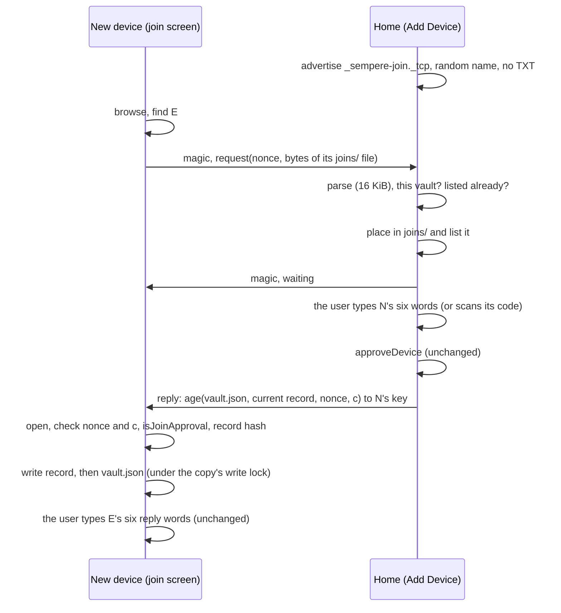

# Joining nearby: the join request and the approval over a direct link (1.1)

Status: implemented (1.1). Part of joining by approval (key-hierarchy.md §6.2, §6.2.1; format.md
§15.12). Decisions are recorded below (N1–N12) for the reviewer.

## Problem

Joining by approval ran entirely through the sync target: the new device wrote `joins/<id>.join.json` into its copy,
its runs took it to the target, home's next run brought it down, home approved it (a new `vault.json`), home's runs
took that up, and the new device's next run took it down. With iCloud Drive as the target each leg waits for the
provider, and on 2026-11-11 the whole round took more than ten minutes, with the request never reaching the owner's
Mac although the iPhone said "Sent". The owner's devices are often on different Wi-Fi networks, or on networks with
client isolation, so the local network alone does not help.

## What the new device reads between the approval and the unlock

Traced through the code (`AppModel+JoinDevice`, `Vault.confirmJoin`, `Vault.open`, `VaultCheck.listCheck`):

1. The new device's run takes a `vault.json` that lists its key (`SyncEngine` via `Vault.isJoinApproval`).
2. `refreshLockedManifest` and `joinStage` read `vault.json` again: listed, so the join screen asks for the reply words.
3. `confirmJoin` opens the vault with the device key: `Vault.open` reads `vault.json`, unwraps the device's entry, and
   checks the list against the chain in **the current epoch's record**, `epochs/<e>-<id>.epoch.age`, which
   `vault.json` names with its hash (`readCurrentRecord`). Then the reply words are checked, and the trust record is
   saved.
4. `unlock` lists the copy's notes (what the copy holds; the runs fill it).

So the new device needs exactly two files: **`vault.json`**, and **the current epoch record** when its copy does not
hold it (home started an epoch, by a removal for example, after the new device copied the vault in). An approval
changes no other file (design §5.1: no file is re-encrypted, the epoch does not change). Nothing under `keys/` is
read. Earlier records, the re-encryption journal, `settings.age`, notes, notebooks and the inbox are content: they
still come with the sync, and files under keys whose records have not arrived are pending meanwhile, as for any copy
that took `vault.json` before its records.

Home needs only the request.

## The link

- **Transport**: Network.framework, plain TCP, `includePeerToPeer = true` (`NWNearbyTransport`,
  `Apps/Sempere/SempereApp/NearbyTransport.swift`): Bonjour on peer-to-peer Wi-Fi (AWDL, as AirDrop) and on any
  shared network. The protocol knows nothing of it: `NearbyJoinConnection` is a byte stream (`Sources/Sempere/`
  `NearbyJoin.swift`, `NearbyJoinSession.swift`; `NearbyJoinPipe` in memory; the model's `NearbyJoinTransport` in
  SempereAppCore, `MemoryNearbyTransport` for tests).
- **Framing**: both sides start with the 16 bytes `sempere-nearby/1`; then frames of a 4-byte big-endian body length,
  a type byte and the payload. The new device sends one `request` (type 1: a 32-byte nonce, then the request file's
  bytes); home sends `waiting` (2, empty), `reply` (3: the sealed reply) or `refused` (4: one byte, `NearbyJoinRefusal`).
  A frame of a type the sender may not send, a length beyond its direction's limit (home reads at most
  1 + 32 + 16 KiB, the new device at most about 24 MiB), or a bad magic ends the session with a typed error before
  any body is held (`NearbyFrameReader`, fuzzed in `SempereFuzzTests.testFuzzNearbyJoinLink`).
- **The reply**: `sempere-nearby-reply/1\n ‖ lp(nonce) ‖ lp(c) ‖ lp(vault.json) ‖ lp(record name) ‖ lp(record)`,
  encrypted with age to the request's `age1pq1…` key (X-Wing, as the wraps in `vault.json`). Fields are bounded
  (`vault.json` 16 MiB, record 8 MiB, an exact epoch-record name).
- **Timeouts**: 10 seconds from the connection to the request (home) and to home's first answer (the new device);
  10 minutes for the whole session, the user's typing included. TCP keepalive notices a vanished peer.

## Decisions

| | Question | Decision and why |
|---|---|---|
| N1 | Who advertises? | **Home, while Add Device shows; the new device browses while its join screen waits.** Add Device is where a request is accepted, so one listener there serves any number of new devices one at a time; the new device tries each advertiser in turn and leaves one that refuses (another person's vault) alone for a minute. Neither side advertises or browses at any other time. |
| N2 | Encrypt or authenticate the link? | **No link crypto; the reply is sealed to the new device's key.** Before the user types the words the two devices share no secret: the commitment and its six words are hashes of the public request, which a device in the middle relays and can compute too. So no key derived from them, nor an unauthenticated key exchange, stops an active attacker. An exchange would only hide the request from a purely passive listener, and the request is what storage holds in the clear in `joins/` anyway and what any device nearby gets by advertising the service. Sealing the reply buys something concrete with no new construction: `vault.json` (every device's name, kind and keys, which device is home) is readable only by the device whose key the user approved, even through a device in the middle. |
| N3 | What crosses the link? | **The request one way; `vault.json` and the current record the other.** Exactly what the target would carry for the join (section above). The reply words never cross: they are the user's check that this is the vault home approved (design §6.2 step 4), and sending them would let whoever answers the connection confirm a vault of its own. |
| N4 | Same checks? | **Yes, unchanged on both ends.** Home approves only through `approveDevice(words:qr:)`, which matches the typed words or the scanned code against the request's commitment; the new device takes a reply only through `Vault.isJoinApproval`, the sync engine's own test (same vault and root, a listed entry for its key whose wrap opens), and the record only when its SHA-256 is the one `vault.json` names (`Vault.takeNearbyReply`). It then confirms with the reply words, which check the root and the frontier as before. Nothing is pinned before that. |
| N5 | Where does home keep a request that came nearby? | **In its copy's `joins/`, create-only, as a sync places one; and in memory for the session.** The file keeps the vault's records complete (home's runs carry it to the targets) and the new device sends the bytes of its own file, so both routes bring one identical file. The in-memory copy (`nearbyRequests`) is what Add Device lists and matches first, so a stray file planted under the same name cannot keep the real request from being approved. |
| N6 | Both routes at once? | **Whichever comes first wins; everything is idempotent.** Home approves a key once (`deviceAlreadyListed` after); a request of a listed key is no longer listed (`pendingJoinRequests`) and home's runs delete it (design §6.2). A device home lists already is answered at once with the reply, so an approval through the target reaches a device nearby without its sync. The new device takes a `vault.json` equal to its copy's as nothing (`takeNearbyReply` returns false), and the reply is the bytes on home's disk, the same the target gets, so the sync then finds nothing to change. |
| N7 | Replay | **Each session has a fresh 32-byte nonce, sealed inside the reply with the request's commitment.** A reply recorded in one session, or answering another request, is refused (`replayed`). |
| N8 | Sessions | **One at a time on home.** Another connection meanwhile gets `busy` and is closed; the new device tries again in a moment. A session that waits for the user ends when the new device hangs up (its wait is canceled), when Add Device closes (`closed`), when the user declines the request (`declined`, the new device says so), or after 10 minutes. |
| N9 | Names | **The instance name is `Sempere-` and 12 random hex digits, new for each advertisement; no TXT record.** The service type necessarily says the app is there; nothing names the vault, its devices or their owner. |
| N10 | A record too large | **Above 8 MiB the record is left out**, and the new device, whose copy lacks it, takes nothing and waits for the sync. A record that size means a chain of tens of thousands of epochs. |
| N11 | The re-encryption journal, earlier records | **Not carried.** Neither is read before the unlock; files that need them are pending until the sync brings them. |
| N12 | The CLI | **App-only.** `Sources/` has no network code outside `SempereWebDAV` (`scripts/check-portability.sh`), Linux has no AWDL, and a macOS command-line tool has no `Info.plist` for `NSBonjourServices` or the local network prompt. The protocol, the framing, the session state machine and both vault steps (`placeNearbyJoinRequest`, `nearbyReply`, `takeNearbyReply`) are package code, tested by `swift test`, and the CLI's join (`device init`, `devices approve`, `device confirm`) is unchanged. |

## Threats

| Who | What they can do | What stops the rest |
|---|---|---|
| A passive listener nearby | See that the service runs, the request in the clear (the device's name, kind and public keys, the vault id: what storage holds in `joins/`), and the size and timing of the reply. | The reply is sealed to the new device's key (N2). |
| An active device nearby posing as home | Get the new device's request (as storage can); answer with junk, a refusal or a stall. | It cannot make a reply the new device takes: `isJoinApproval` needs this vault's id and root and an entry for the device's key whose wrap opens, and a forged vault of its own fails the reply words, as from storage. Its stalls cost the new device one session (10 s to the first answer, 10 minutes at most), and the new device keeps trying the other advertisers and the target. |
| An active device nearby posing as a new device | Send a request of its own keys. | Home approves only the request whose commitment the user typed or scanned from the new device's screen. A request it sends sits in the list like one from storage, and holds home's one session until the user declines it or 10 minutes pass. |
| A device in the middle | Relay both ways. | It can change nothing that passes the checks (the commitment, the sealed reply, the reply words), and reads nothing of the reply. |
| Hostile bytes | Garbage, a huge length, a slow trickle, frames in the wrong order. | Bounded frames, a fixed set of types per direction, the timeouts, typed errors (fuzzed). |

## Tests

- `NearbyJoinTests` (SempereTests, over `NearbyJoinPipe` with real vaults): a whole join confirmed with the reply words;
  a listed device answered at once; a copy one epoch behind taking the record, a forged record and a missing one
  refused; a replayed reply, one sealed to another key, another vault's approval, a request of another vault;
  oversized frames, garbage, the wrong message, a request that does not parse; silent peers on both sides; a peer
  leaving while home waits; `busy`. `SempereFuzzTests.testFuzzNearbyJoinLink`.
- `NearbyJoinModelTests` (SempereAppCoreTests, two models over `MemoryNearbyTransport`, a folder target whose provider
  holds the request back): the join through the link while the target delivers nothing, then the target catching up
  with nothing approved twice; a second device told `busy`; a decline reaching the device; Add Device closed; a device
  approved through the target getting its reply nearby; no link.
- `NearbyTransportAppTests` (the app's test host): the sessions over real `NWListener` and `NWConnection` on
  127.0.0.1, a 3 MiB reply in many receives, a 2 GiB length refused, a peer hanging up.
- **Not tested here**: Bonjour discovery and AWDL between two physical devices (different Wi-Fi networks, client
  isolation, the local network prompt). The loopback tests run the same connection code; discovery is the system's.
